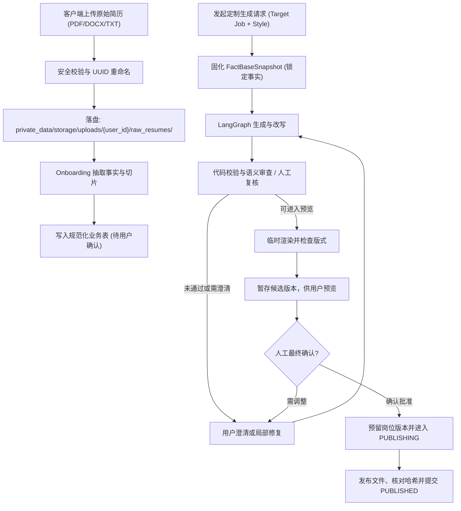
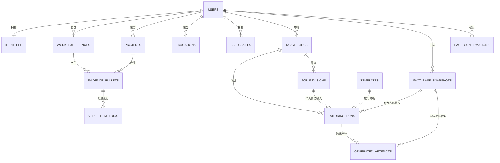

# Production-Grade Resume Tailor Agent: 详细实施计划 (v2.1 修订版)

本文档是尚未实现的工程计划，旨在构建一个以用户确认的履历事实为依据、可恢复运行并重视隐私的简历定制 Agent。当前产品以用户下载后的单用户本机运行为主：初期以 CLI 完成核心闭环，最终交付本机使用的 TypeScript 前端。集中式服务器仅是未来发展方向，不纳入当前实施阶段。各阶段仅声明实际实现并验证过的能力，不将模型审查、隐私保护或排版检查描述为绝对保证。

---

## 目录

1. [核心架构修订与设计决策](#1-核心架构修订与设计决策)
2. [云端高能力模型接入、隐私与安全边界设计](#2-云端高能力模型接入隐私与安全边界设计)
3. [项目工程目录结构与用户文件存储体系](#3-项目工程目录结构与用户文件存储体系)
4. [核心数据契约与数据库设计](#4-核心数据契约与数据库设计)
5. [三级事实校验与质量控制防线](#5-三级事实校验与质量控制防线)
6. [单一确定性文档渲染管线](#6-单一确定性文档渲染管线)
7. [LangGraph 工作流与恢复幂等性设计](#7-langgraph-工作流与恢复幂等性设计)
8. [回归评估体系与故障注入测试 (Eval Harness)](#8-回归评估体系与故障注入测试-eval-harness)
9. [四阶段端到端实施路线图 (Phased Implementation Roadmap)](#9-四阶段端到端实施路线图-phased-implementation-roadmap)
10. [功能技能与开发工作流技能](#10-功能技能与开发工作流技能)
11. [生产可观测性、追溯与可靠性](#11-生产可观测性追溯与可靠性)
12. [未来集中式服务器（暂不实施）](#12-未来集中式服务器暂不实施)

---

## 1. 核心架构修订与设计决策

### 1.1 弃用“夸大百分比”，引入三档定位风格（Positioning Style）

**设计问题**：原 `exaggeration_pct`（15%、30%）缺乏客观测度，且会诱导模型在证据不足时主动篡改职责范围或虚构指标，破坏“零编造”基准。

**修订方案**：统一采用 `positioning_style`，定义为三种不同的信息组织策略。**三种风格必须严格遵守完全一致的事实边界，不允许任何形式的事实编造**：

* **`conservative`（保守/精准型）**：最大程度保留用户原本的词汇与句式，仅修正语病、调整叙事逻辑并提高表达清晰度。
* **`balanced`（标准对齐型，推荐默认）**：重构为 STAR 句式（情境-任务-行动-结果），使用精准强动词（Action Verbs），自然映射目标 JD 中的合法同义技术词汇。
* **`assertive`（进取/复杂度主导型）**：深入突出已有证据支持的技术复杂度、个人贡献与业务价值。缺少指标时可选地询问用户，但必须提供定性改写选项，不得要求用户编造或强迫填数；存在未证实的具体主张时，必须澄清或移除该主张。

### 1.2 事实可信度的真实边界

* **承认 LLM 审查的漏检概率**：不将“零幻觉”误宣称为数学上的绝对保证，尤其当 Generator 与 Auditor 采用同构模型时。
* **确定性优先**：能用代码规则校验的绝对不交给 LLM；LLM 审查（Auditor）仅作为语义范围核查的辅助手段，并纳入持续的回归测试。

### 1.3 渲染管线收敛至单一主力链路

* **单一主输出链**：`TailoredResumePayload` $\rightarrow$ `docxtpl` $\rightarrow$ `.docx` $\rightarrow$ Headless LibreOffice $\rightarrow$ `.pdf`。
* **放弃双轨渲染与动态排版压缩**：不使用 WeasyPrint 双轨生成，也不自动压缩字体或间距；使用字符预算与模板约束做渲染前预估，再进行渲染后检查和人工预览。
* **Markdown 角色定位**：仅作为只读文本归档、前端 Diff 对比以及剪贴板导出格式，不作为生成简历 PDF 的中间媒介。

### 1.4 人机协同（Human-in-the-Loop, HITL）交互澄清机制

**核心设计原则**：“宁可向用户求证，绝不替用户编造”。改写过程如遇事实边界模糊或存在重要发挥空间，系统必须主动暂停并与用户交互，实现精细化的人机协作：

* **缺失量化指标求证**：若某条经历与岗位高度相关但仅有定性陈述，可生成 `ConfirmationPlaceholder` 邀请用户提供实际数据，也可直接选择定性改写；任何未确认的数字不得进入待批准产物。
* **职责主导权核对**：当改写内容对复杂度和领导力进行挖掘时，若 Auditor 认为存在“参与被夸大为主导”的嫌疑，且两次局部自动修复仍未消除歧义，系统自动中断并向用户求证，由用户决定是“确认主导”还是“降级为核心参与”。
* **排版超限取舍决策**：当产物超出用户选择的目标页数或其他排版检查未通过时，系统不进行硬截断，而是向用户列出建议精简条目，由用户确认裁剪优先级。

---

## 2. 云端高能力模型接入、隐私与安全边界设计

### 2.1 统一线上高能力模型接入与异构双模型架构

鉴于简历定制与三级事实审查对**深层业务语义理解、精确 STAR 叙事结构组织、严格的负向约束遵循（绝不编造数据）**有极高的质量要求，小规模本地开源模型由于推理能力与指令依从度不足，难以稳定达到生产级可用性。

因此，当前计划支持通过云端模型完成生成和审查；应用及用户数据主要运行和保存在本机，不代表模型推理完全离线。模型名称、可用性和价格由用户配置并在实施时核对，不依赖固定的过时型号。

系统支持**异构双模型独立配置（Dual-Model Architecture）**：
* **生成模型（`MAIN_LLM_*`）**：负责简历结构化抽取、关键词映射与三档定位风格定制；
* **审查/仲裁模型（`JUDGE_LLM_*`）**：作为独立 Auditor 执行语义蕴含核验与主导权夸大审查。
* **边界**：不同供应商或模型族可能降低共同偏差，但不能消除相关错误或保证拦截率；具体效果以合成回归集和人工复核为准。
* **独立配置**：两个角色的 provider、model、base URL 和凭据分别配置，不得静默复用主模型或密钥。审查节点未实现、未配置或调用失败时必须明确提示，不能标记为审查通过。

```python
from abc import ABC, abstractmethod
from typing import TypeVar
from pydantic import BaseModel

T = TypeVar("T", bound=BaseModel)

class ModelProvider(ABC):
    @abstractmethod
    async def generate_structured(
        self,
        schema: type[T],
        prompt: str,
        system_prompt: str,
        temperature: float = 0.2
    ) -> T:
        """统一异步结构化输出抽象，具体协议与能力由 provider 实现"""
        pass
```

#### 2.1.1 常用 Endpoint 与配置

两种角色均可独立选择以下接入方式；兼容 OpenAI 的请求格式不意味着参数、模型能力、数据政策和错误行为完全相同。

| 接入方式 | 默认 Base URL | 模型与协议要求 |
| :--- | :--- | :--- |
| OpenRouter | `https://openrouter.ai/api/v1` | 使用 OpenRouter 模型 ID，例如 `供应商/模型`；实际模型及上游供应商由用户选择并确认。 |
| DeepSeek 直连 | `https://api.deepseek.com` | 使用 DeepSeek 当前公布的模型 ID 和 OpenAI 兼容接口；按其接口能力配置请求。 |
| 其他 OpenAI 兼容服务 | 用户显式配置 | 自定义 base URL、模型及凭据；不假定支持与上述服务相同的结构化输出或参数。 |
| 原生协议服务 | 依各供应商适配器 | 若支持 Anthropic 等原生协议，使用相应独立适配器；不能把不同协议的 endpoint 当作同一种接口。 |

配置示意仅展示变量和 endpoint，不包含凭据或自动选择模型；模型及各自的 API 凭据由用户在本机 `.env` 中分别填写：

```dotenv
MAIN_LLM_PROVIDER=openrouter
MAIN_LLM_BASE_URL=https://openrouter.ai/api/v1
MAIN_LLM_MODEL=
MAIN_LLM_API_KEY=

JUDGE_LLM_PROVIDER=deepseek
JUDGE_LLM_BASE_URL=https://api.deepseek.com
JUDGE_LLM_MODEL=
JUDGE_LLM_API_KEY=
```

* 主模型与 Judge 均可以配置为 OpenRouter、DeepSeek 或其他已实现的 provider；允许用户显式选择同一服务，但不因此声称模型独立或审查更可靠。Judge 未实施的阶段可以不配置 Judge，但不得标记审查通过。
* 由 `python-dotenv` 读取本机 `.env`，`.env` 不进入 Git；实现配置时同步维护不含凭据的 `.env.example`。base URL、模型和密钥按角色独立校验，不能将密钥放进 URL、前端代码、日志或错误消息；不将凭据发送至未被用户确认的自定义 endpoint。
* **OpenRouter 路由与隐私**：该服务可能将请求路由到不同上游供应商。调用前向用户说明并获取对路由范围及数据处理政策的同意；用户可限定允许的上游，不得静默启用未授权的上游或备选模型。使用支持结构化输出的路由时要求 `require_parameters`，并按用户策略限制 `only` 和 `allow_fallbacks`。若上游不可用或能力不符，明确报错，不切换主/Judge 角色；实际路由信息不可得时记录“未知”，不推测。
* **结构化输出**：OpenRouter 的 JSON Schema 支持取决于具体模型和上游；DeepSeek 文档提供 `json_object` 模式，不等同于保证符合任意 JSON Schema。各 adapter 应按真实能力构造请求，随后统一解析并使用 Pydantic 校验；不支持的参数、拒绝、空响应、截断或不合 Schema 的输出均显式报错，按 7.2 分类处理。Schema 解析硬失败终止当前任务，不能返回成功形状的默认值或静默绕过。
* **测试与演进**：默认用模拟 transport 测试两个角色分别接入 OpenRouter/DeepSeek、自定义 URL、参数差异、结构化响应和失败；可选在线集成测试必须经用户同意并设置费用上限。模型 ID、provider 能力和价格可能变动，配置或文档不能当作永久保证。

实施时核对官方资料：[OpenRouter Quickstart](https://openrouter.ai/docs/quickstart)、[OpenRouter Structured Outputs](https://openrouter.ai/docs/guides/features/structured-outputs)、[OpenRouter Provider Routing](https://openrouter.ai/docs/guides/routing/provider-selection)、[DeepSeek API](https://api-docs.deepseek.com/) 和 [DeepSeek JSON Output](https://api-docs.deepseek.com/guides/json_mode/)。

### 2.2 线上 API 调用中的数据隐私与前置脱敏

数据库和本地工作区由用户部署与管理；个人输入、输出和应用管理的本机数据应与普通项目文档分离，见 3.2。云端模型调用仍会向供应商传输数据。所有模型调用，包括首次简历抽取、JD 提取、改写、修复和审查，必须经过同一隐私边界：

1. **本地预处理与数据最小化**：先在本地提取文本、识别已知身份字段并替换为占位符；按任务只发送必要片段。占位符映射只保留在本地，不发送给模型。若本地无法安全分离所需内容，明确提示并停止云端调用，不回退到发送完整简历。
2. **用户知情与确认**：首次使用某供应商前说明发送内容类别、保留政策和风险，由用户明确同意；允许用户查看和修正待发送的脱敏内容。供应商、模型或发送范围变更时重新确认。
3. **残余风险**：姓名和联系方式可出现在任意自由文本，工作经历、公司和指标也可能重新识别个人。自动检测和日志过滤均有漏检风险，不能承诺“绝对不发送 PII”或“全流程零泄露”。渲染只使用本地不可变快照中的身份信息。
4. **凭据与日志**：模型密钥通过环境变量或受保护配置注入，不进入 Git、测试、日志或错误消息；不记录完整简历、JD、Prompt、响应或占位符映射。对必要的结构化日志进行脱敏并测试，配置 `.env.example` 与实际变量保持一致。上述保护从首次云端调用阶段开始实施。

### 2.3 JD 输入与外部抓取的 SSRF 防护

即使用户可信，粘贴或抓取的 JD 仍属于不可信的第三方数据：

1. **输入边界**：JD 仅作为岗位信息，不得覆盖系统指令、改变事实、请求泄露信息或决定工具行为。使用清晰的系统指令与结构化数据隔离，并对提取结果和最终内容执行代码校验；标签本身不是安全边界。增加合成提示注入回归用例。
2. **SSRF（服务端请求伪造）防护**：
   * 优先推荐用户直接“粘贴文本”作为 JD 输入；
   * 抓取功能在完整防护落地并测试前不开放。仅允许 `http`/`https`，限制重定向至最多 2 次；首次请求及每次重定向都校验 URL、DNS 全部解析结果与实际连接地址，阻止私有、回环、链路本地、保留及其他非全局 IPv4/IPv6 地址，包括映射地址与云元数据地址，避免 DNS 重绑定和代理绕过；
   * 限制连接/读取时间、响应大小和内容类型；错误不得包含完整 JD 或敏感 URL。

---

## 3. 项目工程目录结构与用户文件存储体系

### 3.1 源码工程目录结构

```text
resume-tailor/
├── pyproject.toml                  # Python 运行与开发依赖
├── src/resume_tailor/
│   ├── cli.py                      # 主入口，早期提供完整人工交互
│   ├── api.py                      # 可选 FastAPI 入口，本机前端运行时启用
│   ├── api_routes/                 # 前端所需的事实、定制、恢复与下载接口
│   ├── providers/                  # 注入式异步主模型与独立审查模型
│   ├── schemas/                    # 事实、JD、产物、审查和交互契约
│   ├── services/                   # 本地解析、隐私、渲染、存储和安全抓取
│   ├── db/                         # 数据库会话、规范化表与快照
│   └── agents/                     # 从 Phase 1 起由 LangGraph 编排
├── tests/                          # 单元、集成、恢复及合成评测数据
├── alembic/                        # PostgreSQL 迁移
├── documents/                      # 普通项目文档，不放新的个人资料
├── private_data/                   # Git 忽略：用户输入、输出与本机运行数据
├── templates_builtin/              # 内置 DOCX 模板
└── frontend/                       # Phase 4: TypeScript + Next.js + Tailwind CSS
```

CLI 和本机 API 共用服务、数据契约与工作流，不各自实现业务规则。FastAPI 在仅使用 CLI 时是可选入口，交付前端时启用本机接口；前端、后端、存储、PostgreSQL 和 LibreOffice 均由用户在本机运行。当前 PostgreSQL 设计保留为本机依赖，安装说明须说明启动、停止和备份；容器如有使用也只允许本机访问。云端连接仅用于用户同意的模型调用及可选 JD 抓取，不建设公开服务器。

### 3.2 运行时用户文件存储架构 (Runtime User Storage Architecture)

`documents/` 仅用于普通项目文档；简历、JD、事实快照、生成产物和其他包含个人信息的数据放在仓库内单独的 `private_data/`，并由 Git 忽略。现有 `documents/` 文件可能仍包含个人信息，保留其现有忽略规则，不自动移动或公开。CLI 从仓库根目录运行时默认读取 `private_data/resume.txt` 和 `private_data/job_description.txt`；未指定 `--output` 时仍输出到终端。

计划中的应用运行目录为 `private_data/storage/`，备份放在 `private_data/backups/`。下图展示 `private_data/storage/` 的内部结构，文中 `storage/...` 均指相对于 `private_data/` 的路径：

```text
storage/
├── uploads/                                      # 1. 原始文件暂存区 (受控接收与安全扫描)
│   └── {user_id}/
│       ├── raw_resumes/                         # 用户上传的原始简历文件 (PDF/DOCX/TXT)
│       │   └── {file_uuid}.pdf
│       └── raw_jds/                             # 用户保存的 JD 原始文本/HTML 切片
│           └── {jd_uuid}.txt
│
├── users/                                        # 2. 本机用户持久化工作空间
│   └── {user_id}/
│       ├── templates_custom/                     # 用户个人上传的专属 DOCX 模板
│       │   └── {template_uuid}.docx
│       │
│       └── jobs/                                 # 针对具体求职意向/岗位的独立文件夹
│           └── {job_id}/                         # 服务端生成的安全标识
│               ├── jd_metadata.json              # 结构化提取后的 JD 实体、技能清单与画像
│               ├── runs/                         # 历史生成链路跟踪 (可回滚、可重试)
│               │   └── {run_id}/
│               │       └── {artifact_id}/        # 每次候选修订独立暂存
│               │           ├── payload.json
│               │           ├── audit_report.json # 记录实际执行的校验
│               │           ├── generated.docx
│               │           └── generated.pdf
│               │
│               └── final/                        # 用户最终审批通过 (Approved) 的正式投递包
│                   ├── v1/
│                   │   ├── resume.docx
│                   │   ├── resume.pdf
│                   │   ├── cover_letter_v1.docx  # [Phase 4]
│                   │   └── manifest.json         # 包含 hash、版本号、生成参数的只读清单
│                   └── v2/                       # 后续微调产生的新正式版本
│
└── tmp/                                          # 3. 瞬态临时工作区 (受生命周期与定期清理管辖)
    └── render_scratch/
        └── {run_id}/{artifact_id}/               # 每次渲染隔离工作区和 LibreOffice 配置
```

#### 3.2.1 文件流转生命周期与状态机



#### 3.2.2 文件存储安全与隔离规范

* 本机临时渲染文件、审计报告、导出产物和备份也可能包含个人信息，应保存在 `private_data/` 下或其他明确受保护的位置，不能默认写入 `documents/`。PostgreSQL 的数据目录须在受控本机位置并限制访问；数据库备份默认写入 `private_data/backups/`。
* 用户可显式选择其他输入或导出路径，但应提示自行保护该路径；不自动搬迁或复制现有个人文件。真实个人资料和生成产物不得加入测试或提交到 Git。

1. **防路径穿越（Path Traversal Defense）**：
   * 所有涉及文件路径的操作必须经过服务端的安全路径解析，并校验操作资源归属。
   * 严格解析绝对路径 `os.path.realpath`，确保目标路径必须位于指定的 `base_dir` 边界内，任何包含 `..`、根路径切换或空字符（`\0`）的请求直接抛出 `SecurityViolationError` 并中断。
2. **文件名混淆与物理重命名**：
   * 禁止将用户原始文件名直接作为磁盘存储文件名。落盘时统一采用服务端 UUID 和受控扩展名，原始展示名仅存储在数据库元数据中。
3. **本机边界与文件权限**：
   * 当前仅支持单个本机用户，不要求注册或搭建远程身份服务。`user_id` 仅标识本地资料空间，不代表已实现多租户隔离；目录和文件使用限制当前系统用户访问的权限。
   * 本机 Web 前端和 API 仅监听回环地址，不暴露到公网或局域网；校验 Host/Origin、限制 CORS，并以本机会话令牌等机制防止其他网页直接调用敏感接口。服务端仍须校验资源路径与本地资料归属，路径或 UUID 本身不构成授权。CLI 不依赖 Web 登录。
   * 已批准版本禁止普通修改或覆盖，但用户必须能通过明确确认的删除流程清理其数据库记录、快照、检查点与文件；定义保留期限、删除进度和失败重试。集中式身份认证和跨租户授权仅列为第 12 节未来工作。
4. **存储驱动抽象（StorageService Protocol）**：
   * 后端通过 `StorageService` 协议抽象底层实现，当前阶段使用本地安全持久目录。`move` 不隐含跨文件系统或对象存储的原子性；S3/MinIO 需另行设计条件写入与发布协议，不能直接声称等价：
     ```python
     from typing import Protocol, BinaryIO

     class StorageService(Protocol):
         async def save(self, relative_path: str, data: bytes | BinaryIO) -> str: ...
         async def read(self, relative_path: str) -> bytes: ...
         async def exists(self, relative_path: str) -> bool: ...
         async def move(self, src_relative_path: str, dst_relative_path: str) -> None: ...
         async def delete(self, relative_path: str) -> None: ...
     ```
5. **瞬态目录 GC 与清理策略**：
   * 定期清理超过保留期限且无活动租约的临时工作区；不得清理仍在运行或恢复中的任务。清理失败需记录不含文档内容的错误并重试。

---

## 4. 核心数据契约与数据库设计

业务数据模型使用显式类型定义；框架边界的序列化数据必须在使用前验证，不能用宽泛的 `dict` 替代业务契约。

### 4.1 事实库契约 (`schemas/fact_base.py`)

```python
from pydantic import BaseModel, Field
from typing import Literal

class ImmutableIdentity(BaseModel):
    """不可变身份：直接由渲染器回填，模型不可生成或篡改"""
    full_name: str
    email: str
    phone: str
    location: str
    linkedin_url: str | None = None
    github_url: str | None = None
    portfolio_url: str | None = None

class VerifiedMetric(BaseModel):
    """用户确认的指标，记录数值及其语义，而非独立证明事实真实"""
    metric_id: str
    raw_statement: str
    metric_value: str               # 例："35"
    unit: str                       # 例："%", "QPS"
    subject: str                    # 指标对象，如延迟
    change_direction: Literal["increase", "decrease", "unchanged", "unknown"]
    metric_type: Literal["percentage", "scale", "latency", "currency", "count", "other"]

class EvidenceBullet(BaseModel):
    fact_id: str = Field(description="全局唯一事实ID，如 exp_1_b_1")
    raw_source_text: str = Field(description="原始简历切片或用户补充的原话")
    source_kind: Literal["resume_extract", "user_confirmation"]
    verified_statement: str = Field(description="经人工核实确认的标准事实")
    verified_metrics: list[VerifiedMetric] = Field(default_factory=list)
    tech_tags: list[str] = Field(default_factory=list)
    user_confirmed: bool = False    # 只有 True 的条目才允许被生成节点引用

class WorkExperienceFact(BaseModel):
    exp_id: str
    company_name: str               # Immutable
    role_title: str
    location: str
    start_date: str                 # Immutable (YYYY-MM)
    end_date: str                   # Immutable (YYYY-MM 或 'Present')
    bullets: list[EvidenceBullet]

class ProjectFact(BaseModel):
    """独立于工作经历的项目事实结构体"""
    project_id: str
    project_name: str
    role_title: str
    start_date: str | None = None
    end_date: str | None = None
    description: str
    bullets: list[EvidenceBullet]

class EducationFact(BaseModel):
    edu_id: str
    institution: str                # Immutable
    degree: str                     # Immutable
    field_of_study: str             # Immutable
    start_year: str                 # Immutable
    end_year: str                   # Immutable
    gpa_or_honors: str | None = None

class JobPreferences(BaseModel):
    target_roles: list[str] = Field(default_factory=list)
    target_industries: list[str] = Field(default_factory=list)
    blocked_keywords: list[str] = Field(default_factory=list)

class VerifiedSkill(BaseModel):
    skill_id: str
    skill_name: str

class UserFactBase(BaseModel):
    user_id: str
    version: int
    identity: ImmutableIdentity
    education: list[EducationFact]
    work_experiences: list[WorkExperienceFact]
    projects: list[ProjectFact]
    verified_skills: list[VerifiedSkill]  # 仅包含已确认技能
    preferences: JobPreferences
```

### 4.2 结构化生成输出契约 (`schemas/resume_payload.py`)

```python
from typing import Literal
from pydantic import BaseModel, Field
from resume_tailor.schemas.fact_base import VerifiedMetric

class ConfirmationOption(BaseModel):
    option_id: str
    label: str
    effect_action: Literal[
        "provide_metric", "keep_qualitative", "revert_raw", "custom_edit",
        "confirm_responsibility", "reduce_responsibility", "confirm_skill",
        "select_items_to_trim"
    ]
    recommended: bool = False

class ConfirmationPlaceholder(BaseModel):
    placeholder_id: str
    target_bullet_ids: list[str]     # 排版裁剪可涉及多条；摘要等可为空
    uncertainty_type: Literal[
        "missing_metric",           # 缺少指标基准
        "ambiguous_responsibility", # 职责主导权不明确 (参与 vs 主导)
        "skill_homology",           # 目标技术栈同义词映射争议
        "budget_overflow"           # 排版空间超限裁剪决策
    ]
    question_for_user: str          # 明确询问用户实际情况，禁止诱导虚构
    context_reason: str             # 触发该交互的依据 (如 JD 重点技术要求、Auditor 质疑点)
    suggested_options: list[ConfirmationOption] = Field(default_factory=list)
    allow_free_input: bool = True   # 是否允许用户自由文本补充

class UserClarificationResponse(BaseModel):
    """用户对澄清问题的结构化响应载荷"""
    placeholder_id: str
    selected_option_id: str | None = None  # 自由输入可不选预定义选项
    custom_input_text: str | None = None
    new_verified_metric: VerifiedMetric | None = None
    selected_bullet_ids: list[str] = Field(default_factory=list)

class RewrittenBullet(BaseModel):
    rewritten_text: str
    source_fact_ids: list[str] = Field(min_length=1, description="必须引用已确认的事实ID")
    matched_jd_keywords: list[str]
    applied_style: Literal["conservative", "balanced", "assertive"]
    used_metric_ids: list[str] = Field(default_factory=list)
    needs_user_confirmation: ConfirmationPlaceholder | None = None

class TailoredExperienceSection(BaseModel):
    exp_id: str                     # 关联 WorkExperienceFact.exp_id
    selected_bullets: list[RewrittenBullet]

class TailoredProjectSection(BaseModel):
    project_id: str                 # 关联 ProjectFact.project_id
    selected_bullets: list[RewrittenBullet]

class FactReference(BaseModel):
    source_type: Literal["bullet", "skill", "education", "experience", "project"]
    source_id: str

class TailoredResumePayload(BaseModel):
    summary_statement: str | None = None
    summary_sources: list[FactReference] = Field(default_factory=list)
    summary_metric_ids: list[str] = Field(default_factory=list)
    selected_skills: list[str]      # 代码核验：必须是 FactBase.verified_skills 的普通子集 (subset)
    experiences: list[TailoredExperienceSection]
    projects: list[TailoredProjectSection]
    selected_education_ids: list[str]  # 仅选取并排序快照内的教育经历
```

契约校验必须确保非空摘要有已确认的来源；摘要的每个 `FactReference` 根据类型和 ID 解析到同一快照，支持技能、教育及经历等来源；每个经历/项目中的事实和指标属于对应条目；`selected_education_ids` 唯一且属于同一快照。空摘要或空教育列表表示不输出该部分。自由输入和预定义选项必须互斥或符合所选动作的必填字段；由服务端验证占位符、目标、选项和响应版本，不信任客户端提交的 ID。

### 4.3 关系型数据库全量模型设计 (`db/models.py`)

系统采用 **规范化业务表 + 运行期快照表（Hybrid Normalized-Snapshot Pattern）**：
* **规范化业务表**：支撑前端界面中对不可变身份、工作经历、项目、教育经历、事实 Bullet（`evidence_bullets`）、量化指标（`verified_metrics`）和技能白名单的逐项 CRUD、单条核验勾选（`user_confirmed`）与标签检索。
* **运行期快照与追踪表**：运行前固定包含身份及已确认事实的不可变快照。澄清新增事实时创建关联的新快照，旧快照保持不变；每个候选产物记录实际使用的快照。数据库与文件发布通过可恢复状态机协调，不声称跨介质强一致或物理只读锁。

#### 4.3.1 实体关系模型 (ER Diagram)



#### 4.3.2 规范化事实与经历表定义

1. **`users` (本机资料空间表，当前仅一个用户)**：
   * `id`: UUID (PK, default=uuid4)
   * `created_at`: TIMESTAMP WITH TIME ZONE (Default=now())
   * 不建立远程账户、密码或多租户认证；身份联系方式保存在 `identities`，未来集中式服务需要另行设计账户模型。

2. **`identities` (不可变身份信息表)**：
   * `id`: UUID (PK)
   * `user_id`: UUID (FK -> users.id, ON DELETE CASCADE, Unique)
   * `full_name`: VARCHAR(100) (NOT NULL)
   * `email`: VARCHAR(255) (NOT NULL)
   * `phone`: VARCHAR(50) (NOT NULL)
   * `location`: VARCHAR(150) (NOT NULL)
   * `linkedin_url`: VARCHAR(255)
   * `github_url`: VARCHAR(255)
   * `portfolio_url`: VARCHAR(255)
   * `updated_at`: TIMESTAMP WITH TIME ZONE

3. **`work_experiences` (工作履历主表)**：
   * `id`: UUID (PK)
   * `user_id`: UUID (FK -> users.id, ON DELETE CASCADE, Index)
   * `company_name`: VARCHAR(150) (NOT NULL, 不可变主体)
   * `role_title`: VARCHAR(150) (NOT NULL)
   * `location`: VARCHAR(150)
   * `start_date`: VARCHAR(7) (NOT NULL, 格式 YYYY-MM)
   * `end_date`: VARCHAR(7) (NOT NULL, 格式 YYYY-MM 或 'Present')
   * `is_current`: BOOLEAN (Default=False)
   * `sort_order`: INTEGER (Default=0, 用于履历倒序排版)
   * `created_at`, `updated_at`: TIMESTAMP WITH TIME ZONE

4. **`projects` (独立项目表)**：
   * `id`: UUID (PK)
   * `user_id`: UUID (FK -> users.id, ON DELETE CASCADE, Index)
   * `project_name`: VARCHAR(150) (NOT NULL)
   * `role_title`: VARCHAR(150)
   * `start_date`: VARCHAR(7)
   * `end_date`: VARCHAR(7)
   * `description`: TEXT
   * `sort_order`: INTEGER (Default=0)
   * `created_at`, `updated_at`: TIMESTAMP WITH TIME ZONE

5. **`educations` (教育经历表)**：
   * `id`: UUID (PK)
   * `user_id`: UUID (FK -> users.id, ON DELETE CASCADE, Index)
   * `institution`: VARCHAR(150) (NOT NULL)
   * `degree`: VARCHAR(100) (NOT NULL)
   * `field_of_study`: VARCHAR(150) (NOT NULL)
   * `start_year`: VARCHAR(4) (NOT NULL)
   * `end_year`: VARCHAR(4) (NOT NULL)
   * `gpa_or_honors`: VARCHAR(100)
   * `sort_order`: INTEGER (Default=0)

6. **`evidence_bullets` (核心履历事实切片表 - 事实可信基石)**：
   * `id`: VARCHAR(64) (PK, 业务 ID 如 `exp_1_b_1` 或 UUID)
   * `user_id`: UUID (FK -> users.id, ON DELETE CASCADE, Index)
   * `experience_id`: UUID (FK -> work_experiences.id, ON DELETE CASCADE, Nullable, Index)
   * `project_id`: UUID (FK -> projects.id, ON DELETE CASCADE, Nullable, Index)
   * `raw_source_text`: TEXT (NOT NULL, 原始简历切片或用户补充原话，只读防篡改)
   * `source_kind`: VARCHAR(30) (NOT NULL, 'resume_extract' 或 'user_confirmation')
   * `verified_statement`: TEXT (NOT NULL, 经规范化提炼的标准事实)
   * `tech_tags`: JSONB (Default='[]', 关联技能标签列表，如 `["Python", "FastAPI"]`)
   * `user_confirmed`: BOOLEAN (NOT NULL, Default=False, **核心安全门禁：只有 True 的条目才允许被生成器检索引用**)
   * `sort_order`: INTEGER (Default=0)
   * `created_at`, `updated_at`: TIMESTAMP WITH TIME ZONE
   * **约束**：`CHECK ((experience_id IS NOT NULL AND project_id IS NULL) OR (experience_id IS NULL AND project_id IS NOT NULL))`（确保事实切片明确归属于工作经历或独立项目）。

7. **`verified_metrics` (经证实的量化指标表)**：
   * `id`: VARCHAR(64) (PK, 如 `met_1_1`)
   * `bullet_id`: VARCHAR(64) (FK -> evidence_bullets.id, ON DELETE CASCADE, Index)
   * `raw_statement`: TEXT (NOT NULL, 原始数字陈述)
   * `metric_value`: VARCHAR(50) (NOT NULL, 如 "35")
   * `unit`, `subject`, `change_direction`: 指标单位、对象和变化方向
   * `metric_type`: VARCHAR(30) (NOT NULL, 'percentage', 'scale', 'latency', 'currency', 'count', 'other')

8. **`user_skills` (用户核实技能库表 - 技能白名单)**：
   * `id`: UUID (PK)
   * `user_id`: UUID (FK -> users.id, ON DELETE CASCADE, Index)
   * `skill_name`: VARCHAR(80) (NOT NULL)
   * `category`: VARCHAR(50) (如 "Backend", "Frontend", "Cloud", "Data")
   * `is_verified`: BOOLEAN (Default=True)
   * **约束**：`UNIQUE(user_id, skill_name)`

9. **`target_jobs` (目标岗位投递表)**：
   * `job_id`: VARCHAR(64) (PK, 服务端生成的安全标识)
   * `user_id`: UUID (FK -> users.id, ON DELETE CASCADE, Index)
   * `company_name`: VARCHAR(150) (NOT NULL)
   * `role_title`: VARCHAR(150) (NOT NULL)
   * `status`: VARCHAR(30) (Default='DRAFT', 可选 'DRAFT', 'TAILORING', 'APPLIED', 'INTERVIEW', 'OFFER', 'REJECTED')
   * `created_at`, `updated_at`: TIMESTAMP WITH TIME ZONE

**确认记录与 JD 版本**：
* `fact_confirmations` 保存 `user_id`、事实类型、对象 ID、对象修订号或值哈希、确认时间及确认人；覆盖身份、教育、技能、经历/项目元数据及履历切片。事实变更创建新修订并要求重新确认，只有与当前值对应的确认才能进入快照。身份等字段只在单个快照内不可变，用户仍可更新自己的事实库。
* `job_revisions` 保存 `revision_id`、`job_id`、岗位信息、JD 原文与结构化关键词、内容哈希和创建时间；用户修改岗位或 JD 时创建新版本，不覆盖旧版本。原文属于敏感的本地受控数据，不进入普通日志或遥测。

#### 4.3.3 运行时快照与生成追踪表定义

10. **`fact_base_snapshots` (事实库不可变快照表)**：
    * `snapshot_id`: UUID (PK)
    * `user_id`: UUID (FK -> users.id, ON DELETE CASCADE, Index)
    * `parent_snapshot_id`: UUID (Nullable, FK -> fact_base_snapshots.snapshot_id)
    * `version_num`: INTEGER (NOT NULL, 用户维度严格递增)
    * `snapshot_payload`: JSONB (NOT NULL, 符合 Pydantic `UserFactBase` Schema，且**仅包含 `user_confirmed=True` 的履历切片**)
    * `source_sha256`: VARCHAR(64) (NOT NULL, 事实库快照哈希)
    * `created_at`: TIMESTAMP WITH TIME ZONE (Default=now())
    * **约束**：`UNIQUE(user_id, version_num)`
    * 身份、教育与其他非 Bullet 字段同样需要用户确认；快照及其哈希不可修改。新增确认事实创建子快照并记录来源和确认时间；渲染仅使用产物绑定的快照。

11. **`templates` (DOCX 简历模板表)**：
    * `template_id`: VARCHAR(64) (PK)
    * `name`: VARCHAR(100) (NOT NULL)
    * `file_path`: VARCHAR(255) (NOT NULL, 模板物理相对路径)
    * `user_id`: UUID (Nullable；内置模板为空，自定义模板必须有所有者)
    * `max_bullet_chars`: INTEGER (Default=120, 单段字符预算上限)
    * `is_builtin`: BOOLEAN (Default=True)
    * `created_at`: TIMESTAMP WITH TIME ZONE (Default=now())

12. **`tailoring_runs` (定制运行任务表)**：
    * `run_id`: UUID (PK, 全局唯一运行跟踪 ID)
    * `user_id`: UUID (FK -> users.id, Index)
    * `job_id`: VARCHAR(64) (FK -> target_jobs.job_id, Index)
    * `job_revision_id`: UUID (FK -> job_revisions.revision_id；与岗位及用户一致，运行期间不可变)
    * `snapshot_id`: UUID (FK -> fact_base_snapshots.snapshot_id, Index；当前生效快照)
    * `template_id`: VARCHAR(64) (FK -> templates.template_id)
    * `thread_id`: VARCHAR(100) (NOT NULL, LangGraph Checkpoint 会话 ID)
    * `positioning_style`: VARCHAR(20) (NOT NULL, 'conservative', 'balanced', 'assertive')
    * `status`: VARCHAR(30) (Default='PENDING'；`RUNNING`, `WAITING_USER_INPUT`, `WAITING_APPROVAL`, `PUBLISHING`, `PUBLISHED`, `FAILED`, `CANCELLED`)
    * `error_type`: VARCHAR(50) (如 'TRANSIENT_TIMEOUT', 'SCHEMA_ERROR', 'AUDIT_VIOLATION')
    * `created_at`: TIMESTAMP WITH TIME ZONE (Default=now())

13. **`generated_artifacts` (生成版本产物表)**：
    * `artifact_id`: UUID (PK)
    * `run_id`: UUID (FK -> tailoring_runs.run_id, ON DELETE CASCADE, Index)
    * `job_id`: VARCHAR(64) (FK -> target_jobs.job_id, Index；必须与 run 的岗位一致)
    * `snapshot_id`: UUID (FK -> fact_base_snapshots.snapshot_id；该产物实际使用的不可变快照)
    * `version_num`: INTEGER (Nullable；批准时按岗位预留，候选产物尚未分配)
    * `approval_state`: VARCHAR(30) (`DRAFT`, `WAITING_APPROVAL`, `PUBLISHING`, `PUBLISHED`)
    * `semantic_review_status`: VARCHAR(30) (`NOT_IMPLEMENTED`, `PASSED`, `FAILED`, `UNAVAILABLE`)
    * `structured_payload`: JSONB (NOT NULL, 最终生成的 `TailoredResumePayload`)
    * `audit_report`: JSONB (NOT NULL, 三级核验报告及评分)
    * `docx_path`: VARCHAR(255) (候选渲染前可空，暂存后为受控相对路径)
    * `pdf_path`: VARCHAR(255) (候选渲染前可空，暂存后为受控相对路径)
    * `created_at`: TIMESTAMP WITH TIME ZONE (Default=now())
    * **约束与锁机制**：
      * `UNIQUE(job_id, version_num)`；使用数据库事务分配，未发布版本号允许留空或因失败产生空号。
      * `PUBLISHED` 记录及文件禁止普通修改或覆盖；后续微调创建新候选并分配新版本。授权删除为单独的受控生命周期操作，不能被只读规则永久阻止。

#### 4.3.4 SQLAlchemy 2.0 模型实现参考 (`src/resume_tailor/db/models.py`)

```python
import uuid
from datetime import datetime
from typing import Optional
from sqlalchemy import (
    String, Boolean, Integer, ForeignKey, Text, CheckConstraint,
    UniqueConstraint, Index, DateTime, func
)
from sqlalchemy.dialects.postgresql import UUID, JSONB
from sqlalchemy.orm import DeclarativeBase, Mapped, mapped_column, relationship

class Base(DeclarativeBase):
    pass

class WorkExperience(Base):
    __tablename__ = "work_experiences"

    id: Mapped[uuid.UUID] = mapped_column(UUID(as_uuid=True), primary_key=True, default=uuid.uuid4)
    user_id: Mapped[uuid.UUID] = mapped_column(UUID(as_uuid=True), ForeignKey("users.id", ondelete="CASCADE"), index=True)
    company_name: Mapped[str] = mapped_column(String(150), nullable=False)
    role_title: Mapped[str] = mapped_column(String(150), nullable=False)
    location: Mapped[str] = mapped_column(String(150), nullable=False, default="")
    start_date: Mapped[str] = mapped_column(String(7), nullable=False)  # YYYY-MM
    end_date: Mapped[str] = mapped_column(String(7), nullable=False)    # YYYY-MM or 'Present'
    is_current: Mapped[bool] = mapped_column(Boolean, default=False)
    sort_order: Mapped[int] = mapped_column(Integer, default=0)
    created_at: Mapped[datetime] = mapped_column(DateTime(timezone=True), server_default=func.now())
    updated_at: Mapped[datetime] = mapped_column(DateTime(timezone=True), server_default=func.now(), onupdate=func.now())

    bullets: Mapped[list["EvidenceBullet"]] = relationship(back_populates="experience", cascade="all, delete-orphan")

class EvidenceBullet(Base):
    __tablename__ = "evidence_bullets"

    id: Mapped[str] = mapped_column(String(64), primary_key=True)  # e.g., exp_1_b_1
    user_id: Mapped[uuid.UUID] = mapped_column(UUID(as_uuid=True), ForeignKey("users.id", ondelete="CASCADE"), index=True)
    experience_id: Mapped[Optional[uuid.UUID]] = mapped_column(UUID(as_uuid=True), ForeignKey("work_experiences.id", ondelete="CASCADE"), nullable=True, index=True)
    project_id: Mapped[Optional[uuid.UUID]] = mapped_column(UUID(as_uuid=True), ForeignKey("projects.id", ondelete="CASCADE"), nullable=True, index=True)

    raw_source_text: Mapped[str] = mapped_column(Text, nullable=False)
    source_kind: Mapped[str] = mapped_column(String(30), nullable=False)
    verified_statement: Mapped[str] = mapped_column(Text, nullable=False)
    tech_tags: Mapped[list[str]] = mapped_column(JSONB, default=list)
    user_confirmed: Mapped[bool] = mapped_column(Boolean, default=False, nullable=False, index=True)
    sort_order: Mapped[int] = mapped_column(Integer, default=0)
    created_at: Mapped[datetime] = mapped_column(DateTime(timezone=True), server_default=func.now())
    updated_at: Mapped[datetime] = mapped_column(DateTime(timezone=True), server_default=func.now(), onupdate=func.now())

    experience: Mapped[Optional[WorkExperience]] = relationship(back_populates="bullets")
    metrics: Mapped[list["VerifiedMetric"]] = relationship(back_populates="bullet", cascade="all, delete-orphan")

    __table_args__ = (
        CheckConstraint(
            "(experience_id IS NOT NULL AND project_id IS NULL) OR (experience_id IS NULL AND project_id IS NOT NULL)",
            name="check_bullet_parent_exclusive"
        ),
    )

class VerifiedMetric(Base):
    __tablename__ = "verified_metrics"

    id: Mapped[str] = mapped_column(String(64), primary_key=True)  # e.g., met_1_1
    bullet_id: Mapped[str] = mapped_column(String(64), ForeignKey("evidence_bullets.id", ondelete="CASCADE"), index=True)
    raw_statement: Mapped[str] = mapped_column(Text, nullable=False)
    metric_value: Mapped[str] = mapped_column(String(50), nullable=False)
    unit: Mapped[str] = mapped_column(String(30), nullable=False)
    subject: Mapped[str] = mapped_column(Text, nullable=False)
    change_direction: Mapped[str] = mapped_column(String(20), nullable=False)
    metric_type: Mapped[str] = mapped_column(String(30), nullable=False)

    bullet: Mapped[EvidenceBullet] = relationship(back_populates="metrics")
```

---

## 5. 三级事实校验与质量控制防线

```text
[生成器输出 Payload]
       │
       ▼
【第一级：事实来源校验 (Source Validation)】
 ├─ 检查摘要来源和 source_fact_ids 是否存在
 └─ 检查对应事实 user_confirmed 是否为 True
       │  (校验失败 -> 直接抛出 Schema/输入违规)
       ▼
【第二级：确定性硬校验 (Deterministic Code Checks)】
 ├─ selected_skills ⊆ verified_skills (普通子集核对)
 ├─ 基础实体注入 (姓名/日期/公司名不经由 LLM，由代码从 FactBase 强制覆盖)
 └─ 数字/指标必须命中声明的 used_metric_ids
       │  (校验失败 -> 触发定向修复节点或阻断)
       ▼
【第三级：语义蕴含审查 (Semantic Audit by Auditor LLM)】
 ├─ 职责范围与主导权核查 (避免"参与"被提升为"主导")
 ├─ 复杂度真实性核对 (与原始上下文比对)
 └─ 检查是否存在主动生成的 needs_user_confirmation
       │
       ├──(未通过 / 重试 2 次仍有争议)──► 【HITL 交互澄清节点 (LangGraph interrupt)】
       │                                     │  (向用户求证指标/职责范围)
       │                                     ▼
       │                              [Targeted Fix Node / 局部重写]
       ▼ (通过且无挂起问题)
【确定性渲染与排版健康检查】
       │
       ▼
【人工最终确认 (Human-in-the-Loop Approval) -> PUBLISHING -> PUBLISHED】
```

### 5.1 第一级：事实来源校验（代码级）
* 遍历摘要的 `summary_sources` 和每条改写的 `source_fact_ids`，比对产物绑定的快照；每条经历/项目中的事实及指标必须属于该经历/项目。来源存在不等于能证明改写的语义。
* 只有用户确认的身份、教育、技能和履历事实才允许进入正式输出；含未确认主张或待澄清问题的内容不得批准或发布。

### 5.2 第二级：确定性硬校验（代码级）
* **技能普通子集检查**：执行 `set(payload.selected_skills).issubset({skill.skill_name for skill in fact_base.verified_skills})`；全集或普通子集均可通过。
* **数字与指标闭环**：从摘要和每条正文识别度量实体，并检查所声明指标属于引用事实、数值与单位匹配。指标的对象、变化方向和上下文还须语义审查或人工复核，不能因为数字相同就放行。未知数字、无法判定的单位或未解决的占位符均阻止批准。
* **技能与正文**：技能白名单不只检查 `selected_skills`；还需识别正文和摘要中的技能主张，对无法确定的同义映射要求确认。代码识别存在局限，不能代替语义复核。
* **不可变信息注入**：渲染时由代码从产物绑定的快照填入身份、公司、职务、日期和教育等字段，不依赖模型生成或读取实时表。

### 5.3 第三级：语义蕴含审查（独立 Auditor 节点）
* **覆盖全部主张**：逐条比对摘要和正文与其已确认来源，包括指标对象、单位、方向、技能和职责。用户补充原话及确认记录也是来源，但用户确认不等同于外部客观证明。
* **禁止整份简历重写**：Auditor 输出目标条目、相关事实 ID 和修改指导，下游仅修复违规条目；每次自动修复、用户编辑或快照更新后重新执行相关来源、硬校验和语义审查。
* **阶段与失败边界**：Phase 1 在独立审查尚未实现时仅允许标记 `NOT_IMPLEMENTED`，由用户逐项人工复核并批准，不得展示“审查通过”。Phase 3 后正式发布必须审查通过；配置缺失、调用失败或结果不确定时阻止发布并提示用户处理，不回退主模型。

### 5.4 人机交互澄清分支 (HITL Clarification Branch)
* **主动求助机制**：缺少指标时可选地请求补充并提供定性选项；存在重要未证实主张或审查争议时必须澄清或移除。对用户确认的事实仍需重新检查生成文本是否准确表达该事实。
* **用户响应闭环**：
  1. **补充真实指标**：用户提供指标对象、数值、单位和方向并确认来源；写入事实库，创建新的关联快照，然后重新生成与校验；
  2. **按定性改写**：系统强制指示模型使用稳健动词、剥离虚构度量，仅保留事实库已证实的定性成果；
  3. **保留原始原话**：将该条恢复为用户已确认的来源原话，再执行适用校验；
  4. **人工自定义输入**：如果包含新事实，先要求用户明确确认并记录来源、创建新快照；随后重新执行校验和适用审查，不能直接绕过门禁。

---

## 6. 单一确定性文档渲染管线

放弃双轨渲染，聚焦一条可控、可检查的交付链；固定模板、字体和渲染器版本以提高可重复性，但不保证跨环境或跨版本字节完全一致：

```text
[TailoredResumePayload] + [FactBase.ImmutableIdentity]
                       │
                       ▼ (Jinja2 上下文装配)
              [services/renderer]
                       │
                       ▼
            [docxtpl 渲染生成 .docx]
                       │
                       ▼ (CLI 调用 Headless LibreOffice)
            [转换生成 .pdf]
                       │
                       ▼
          [文档健康检查 (Health Check)]
```

### 6.1 渲染引擎规范
1. **统一模板标准**：采用标准 `.docx` 格式，在 Word 中预设页边距、行高、段落间距与样式体系，使用标准 `{{ jinja_tags }}` 占位。
2. **字符预算控制（Character Budget）**：
   * 依据模板、字体和语言设定经过实际测量的字符预算，作为生成提示和初步筛查，而不是物理页数或单行宽度保证。
   * 不进行运行时的动态字体/行距微调；超页时向用户提供保留或裁剪建议，重新校验和渲染。
3. **排版健康度自动检查（`verify_document_health`）**：
   * 渲染后，调用 `pypdf` 读取生成的 PDF 页数。
   * 检查文本提取层、未渲染标签、页面边界以及可检测的缺字或异常；文本提取和页数检查不能证明没有重叠、裁切或视觉问题。
   * 若超出用户选择的目标页数或检查失败，则阻止正式发布并提供调整入口；候选文件可供预览。批准前必须人工查看 PDF，检查无法自动证明的视觉问题；DOCX 和 PDF 应有一致的内容。

---

## 7. LangGraph 工作流与恢复幂等性设计

### 7.1 节点幂等性与可恢复文件发布

针对“Checkpoint 仅按步骤保存状态，中途重试会导致节点从头执行”的机制，所有存在文件和数据库副作用的节点必须遵守以下规范：

1. **稳定标识与候选隔离**：每次运行有 `run_id`，每个修订有 `artifact_id`；临时目录、候选文件和副作用记录以两者隔离。重放必须复用已记录的结果，不能假设对外模型调用恰好执行一次或不会重复计费。
2. **候选阶段**：审查可进入预览后在独立临时目录渲染，检查并暂存至 `runs/{run_id}/{artifact_id}/`；用户查看候选产物。候选版本和正式版本分开，修改产生新候选并重新校验。
3. **预留发布**：用户批准时以幂等请求、候选版本及快照为前提，在一个数据库事务中锁定岗位、按 `job_id` 分配唯一版本、记录批准和预期文件哈希，并置 `PUBLISHING`。重复请求返回同一发布记录；过期候选或权限不符则拒绝。
4. **发布与提交**：从候选目录准备完整版本目录，校验 DOCX、PDF 和 manifest 的哈希；本地同一文件系统上使用不覆盖已有目录的原子目录发布机制。确认文件完整后才事务性置 `PUBLISHED`，下载接口只提供该状态的正式产物。数据库事务和文件系统操作之间并非原子。
5. **恢复与对账**：启动或重试时扫描 `PUBLISHING`：目标不存在则安全续传，存在且哈希一致则完成提交；不一致或无法确认时停止、保留证据并提示错误，不覆盖已有版本。跨文件系统或对象存储必须另有可靠实现，未实现时不得宣称支持原子发布。

### 7.2 错误分类与安全重试策略

节点执行中的错误明确分为三类，由工作流路由采取不同动作：

| 错误类别 | 典型场景 | 处理机制 |
| :--- | :--- | :--- |
| **可安全重试（Transient）** | 外部 LLM API 速率限制 (429)、网络超时或 5xx | 仅幂等步骤按超时、总预算与退避策略有限重试；外部调用可能重复计费，须记录尝试并遵守供应商限额。 |
| **不可重试（Deterministic）** | 输入数据不合法、SSRF 攻击拦截、Schema 解析硬失败 | 立即终止当前任务，标记任务状态为 `FAILED`，记录错误类型，不进行重试。 |
| **模型逻辑违规（Logic Violation）** | Auditor 检测到主导权夸大、未授权技能注入 | 进入 `targeted_fix_node`，仅向模型提供违规子项与反馈，最大尝试 2 次，超出则转入 `human_clarification_node` 触发交互澄清。 |

### 7.3 基于 LangGraph `interrupt()` 的人机协同 (HITL) 交互与断点恢复

使用 LangGraph `interrupt()` 和 `Command(resume=...)` 处理澄清及最终批准，状态使用显式业务类型。Phase 1 可使用进程内状态并明确不支持跨进程恢复；Phase 2 接入持久 Checkpoint 后才承诺恢复。

* 状态转换：`PENDING -> RUNNING -> WAITING_USER_INPUT -> RUNNING`，完成检查并渲染后进入 `WAITING_APPROVAL -> PUBLISHING -> PUBLISHED`；错误或取消进入相应终态。修改候选或澄清后回到 `RUNNING` 并重新执行校验。
* 中断节点恢复时可能从节点开头重放；中断前不得执行非幂等副作用。Checkpointer 与业务状态的跨事务不一致必须可检测、可恢复，不能仅凭注释假定同步成功。
* 每组问题和候选版本有稳定 ID；服务端校验所属用户、当前状态、问题版本和全部必填响应。相同幂等键重复提交返回原结果；过期、重复但内容冲突或并发冲突的回复明确拒绝，不清空未回答的问题。
* CLI 与 API 使用同一恢复协议和校验；只有已实现的检查和审查结果才能显示为通过。

#### 7.3.1 API 交互端点与会话恢复协议
1. **查询待澄清问题清单**：
   * `GET /api/v1/tailoring/{run_id}/clarifications`
   * 返回挂起任务中的 `ConfirmationPlaceholder` 列表（包含原话证据、疑问类型、快捷选项及推荐动作）。
2. **提交确认并唤醒执行**：
   * `POST /api/v1/tailoring/{run_id}/resume`
   * 请求体：`{"responses": [UserClarificationResponse, ...]}`
   * 服务端调用 LangGraph 的 `graph.ainvoke(Command(resume=payload), config=checkpoint_config)` 恢复执行，无缝流转至定向修复或渲染节点。
3. **预览与最终批准**：查询候选及检查结果，用户确认具体 `artifact_id` 和版本后提交批准；必须校验当前状态、所有权及幂等键，再进入 7.1 的发布状态机。

---

## 8. 回归评估体系与故障注入测试 (Eval Harness)

评测代码和合成数据放在 `tests/evals/`，从 Phase 1 起随功能建设；严禁将真实简历、JD、密钥或其他个人数据加入测试集。区分离线确定性 CI 与需要用户明确授权、配置独立模型和成本预算的在线评测。

### 8.1 黄金测试集设计 (`evals/datasets/golden_cases.jsonl`)

初始集至少包含 15~20 个合成案例，并随缺陷持续扩展；固定数据集、评估器、Prompt 和模型版本，记录逐案例结果，不能将小样本结果推广为总体保证：

1. **同构/异构能力匹配测试**：
   * 案例 A（高度契合）：评估关键词融合度与 STAR 提炼表现。
   * 案例 B（技能不契合/陷阱）：JD 要求 Go / K8s，事实库仅有 Python，验证 Agent 是否**绝对不添加** Go / K8s。
2. **缺失指标测试**：事实库仅有定性成果，测试 Agent 在 `assertive` 风格下是否生成合理的定性分析，或输出 `ConfirmationPlaceholder`，严禁编造任何假数字。
3. **摘要和正文陷阱**：摘要或 Bullet 注入未掌握技能、错误职责、错误指标对象/方向、错误来源 ID，或用户编辑后引入不受支持的主张；验证适当的硬校验、审查或人工复核能阻止其发布。
4. **排版边界**：使用长文本、多语言、多段落和目标页数变化，验证检查能捕捉已知问题、超页阻止发布并触发用户取舍；对自动检查无法覆盖的视觉问题保留人工检查。
5. **信任与隐私**：覆盖 JD 指令注入、各模型调用阶段的本地脱敏、日志与错误脱敏，以及抓取启用后的 IPv4/IPv6、重定向和 DNS 变化。

### 8.2 四维回归评测门禁

| 指标维度 | 评估方式 | 准入阈值 (Gate) | 说明 |
| :--- | :--- | :--- | :--- |
| **1. 事实一致性 (Fact Consistency)** | 代码硬核验 + 独立 Judge 模型审查 | **100% 拦截已知测试集中的事实违规** | 作为黄金集的回归门槛，承认并非数学绝对证明。 |
| **2. 真实关键词融入率 (Valid Keyword Recall)** | 计算公式：$\frac{\text{简历体现的已证实 JD 关键词}}{\text{JD 关键词} \cap \text{事实库技能}}$ | 有可计算样本时 $\ge$ **80%** | 分子限于分母集合；无交集时记为 N/A，不计入均值，报告 N/A 数量。 |
| **3. 核心经历保留率 (Critical Experience Retention)** | 检查标定的核心经历 ID 是否存在于生成结果中 | $\ge$ **95%** | 避免改写剪裁时遗漏关键工作履历。 |
| **4. 文档排版健康度 (Document Health Check)** | 自动化脚本验证已定义的 PDF 文本、页数、边界及坏标签检查 | **100% 通过可自动检查项** | 人工复核覆盖重叠、裁切等自动检查不能证明的视觉问题。 |

阈值只适用于明确标定的合成样本及已实现检查；每项报告样本数、分母、跳过数、评估方式和失败案例。模型审查未实现或不可用时不得计为通过。

### 8.3 故障注入与恢复测试（CI 测试集）
* **断点测试**：在生成、等待澄清、等待批准及发布的每个数据库/文件边界注入进程终止，重启后验证恢复、状态对账、快照一致性和不覆盖历史产物。
* **并发重放测试**：对同一 `run_id` 重复提交澄清和批准，并对同一岗位的不同 run 并发发布；验证版本唯一、过期回复被拒绝和发布幂等。
* **生产失败场景**：注入主模型或审查模型超时、429、格式错误、预算耗尽、数据库/磁盘不可用、渲染异常以及日志泄露探针；验证失败可见、无静默降级且不发布未通过门禁的产物。
* **本机边界与删除**：验证服务仅监听回环地址、拒绝未授权的跨站请求和路径穿越；用户确认的删除覆盖关联文件、检查点与快照，恢复备份时不会悄然恢复已删除的数据。跨租户测试留待未来集中式服务实施时增加。

---

## 9. 四阶段端到端实施路线图 (Phased Implementation Roadmap)

根据 Review 建议，将原六阶段收敛为四个递进的端到端闭环，**先保证简历定制的主线质量，再逐步扩展求职工作台的外围能力**。

```text
[Phase 1: CLI 核心闭环] ──► [Phase 2: 可靠性与恢复] ──► [Phase 3: 独立审查与评测] ──► [Phase 4: TypeScript 工作台]
  (LangGraph/人工复核)         (持久化/幂等/追溯)          (Auditor/质量门禁)          (前端/API/扩展)
```

---

### Phase 1: 核心端到端闭环 (Core End-to-End Pipeline)

* **目标**：以 CLI 跑通最小 LangGraph 定制链路；尽量防止未证实主张，通过明确人工复核处理尚无法自动证明的语义问题。
* **执行任务**：
  1. 以 `src/resume_tailor/`、根 `pyproject.toml` 和 `tests/` 组织应用、依赖与测试；CLI 为入口，LangGraph 从第一阶段编排节点，模型调用通过注入式异步 provider。FastAPI 与前端暂不作为本阶段前提。
  2. 实现本地解析、用户确认、事实和输出契约、不可变快照及基本持久化；应用管理的个人数据使用 Git 忽略的 `private_data/`，普通文档使用 `documents/`。所有云端调用经过 2.2 的本地脱敏、知情确认和日志保护。输入 JD 首先支持粘贴，暂不启用 URL 抓取。
  3. 接入支持 OpenRouter 和 DeepSeek 直连的主模型 provider 与三档风格，校验摘要及正文的来源、技能和指标；支持 CLI 澄清、编辑与逐项人工复核，未解决的问题阻止批准。
  4. 提供单一 DOCX 模板和 LibreOffice PDF 渲染，检查页数及可自动检查的问题，允许人工预览、批准并本地导出。独立 Auditor 未实现时清晰标记 `NOT_IMPLEMENTED`，不能显示为模型审查通过；Phase 1 不承诺 Phase 2 的持久发布状态机或崩溃恢复。
  5. 从第一阶段加入结构化运行 ID、必要错误分类、成本/超时边界及合成测试；进程内 Checkpoint 不承诺跨进程恢复。
* **验收标准**：
  * 使用合成简历和 JD 完成事实确认、改写、澄清、人工复核与 DOCX/PDF 输出；已知的来源、技能和数字违规以及未解决问题阻止批准。
  * 使用模拟 transport 验证 OpenRouter/DeepSeek 的 endpoint、结构化响应和错误处理；清晰显示未执行的语义审查及人工复核结果，测试隐私边界、JD 注入防线和日志。

---

### Phase 2: 可靠性、持久化与恢复保障 (Reliability & State Persistence)

* **目标**：在既有 LangGraph 工作流上引入持久状态、可追溯发布与安全恢复。
* **执行任务**：
  1. 配置 `AsyncPostgresSaver`，建立基于本机 PostgreSQL 的 Checkpoint 持久化；数据库不得公开监听。
  2. 按 7.1 实现候选隔离、岗位级版本分配、幂等批准、可恢复发布和对账；补齐数据库迁移、唯一约束与不可变快照关联。
  3. 实现 11 节的日志、指标、追溯记录、超时/预算、有限重试和恢复机制，确保不记录敏感内容。
  4. 编写故障注入、并发恢复、备份恢复和用户确认的删除测试；明确单用户本机与未来集中式服务的边界。
* **验收标准**：
  * 在工作流执行中途强行终止服务，重启后能正确恢复至中断节点并成功完成。
  * 发布中任一边界崩溃后可恢复或明确报错，不暴露不完整产物；历史版本不被覆盖，同岗位并发发布不发生版本冲突。

---

### Phase 3: 独立审查与自动化评测体系 (Auditing & Quality Gate)

* **目标**：接入第三级语义审查（Auditor），建立回归评估套件作为质量门禁。
* **执行任务**：
  1. 实现独立配置的 `AuditorAgent` provider 和 LangGraph 节点，支持以 OpenRouter 或 DeepSeek 接入 Judge，审查摘要及正文的事实、职责、技能和指标语义；失败或未配置时不得回退主模型。
  2. 实现 `targeted_fix_node`：接收 Auditor 结构化缺陷列表，针对违规条目进行定向重写（上限 2 次）。
  3. 扩展合成黄金测试集，覆盖第 8 节的事实、隐私、JD 注入和故障场景。
  4. 实现评测命令和报告，计算事实一致性、有效关键词融入率、经历保留率与可自动检查的文档健康度。
  5. 所有修复和用户编辑后重新校验和审查；正式发布要求审查通过及用户批准。配置缺失或模型不可用时明确阻止并提示。
* **验收标准**：
  * 在测试用例中人为注入未掌握的技能或编造的性能数字，系统必须 100% 在第二级或第三级核验中将其拦截。
  * 黄金评测集所有指标达到准入阈值，生成格式整洁的 Eval 评估报告。

---

### Phase 4: 完整求职工作台扩展 (Workbench Expansion)

* **目标**：必须交付在用户本机运行的 TypeScript 前端，让用户通过图形界面完成核心简历流程；CLI 继续可用。外围能力在核心界面与安全接口完成后扩展。
* **执行任务**：
  1. **多产物契约定义与生成**：实现独立的 `CoverLetterPayload` 与 `RecruiterCallPrepPayload` 数据契约，绑定事实来源生成求职信与面试对齐卡片。
  2. **带 SSRF 防御的 JD 抓取**：仅在实现并测试 2.3 的全部防护后开放 URL 抓取；粘贴文本仍然可用。
  3. **丰富模板库**：增加 2~3 套不同风格的高质量单栏/多栏 DOCX 模板，并支持自定义 DOCX 模板映射。
  4. **前端工作台体验**：使用 TypeScript、Next.js 和 Tailwind CSS，在本机启动并通过仅监听回环地址的 FastAPI 入口访问与 CLI 共用的服务；无需远程账户，保护本机会话与跨站请求，并提供错误状态、恢复和安全下载：
     * 构建 Fact Base 逐项核对与编辑界面。
     * 构建改写 Diff Viewer（并排对照原话与改写、Auditor 审核通过标记、未确认指标填空框）。
     * 构建职位投递追踪看板（Tracker Kanban：从 Draft 到 Offer 全流程状态流转）。
     * 展示隐私同意、澄清、人工批准、审查是否实际执行、发布状态和可操作的失败信息；不将运行中或失败状态伪装成成功。
* **验收标准**：
  * 用户可以在前端流畅完成“录入简历事实 $\rightarrow$ 输入 JD $\rightarrow$ 选择风格 $\rightarrow$ 确认改写 $\rightarrow$ 一键下载 DOCX/PDF $\rightarrow$ 追踪投递”的全流程。
  * 前端包含澄清恢复、审批、本机访问边界、错误与加载状态的端到端测试；提供本机安装、启动和停止说明，前端可用不以移除 CLI 为代价。

---

## 10. 功能技能与开发工作流技能

“技能”在本计划中分为两类，避免将运行时业务能力与编码 Agent 的项目工作流混为一谈。以下为待实施的设计，不表示这些技能已存在或已连接。

### 10.1 运行时功能技能

运行时技能是由 LangGraph 显式编排的能力节点或服务，不要求实现为独立自主 Agent。每项应有明确输入、类型化输出、权限边界、错误与超时行为，并可单独用合成数据测试；确定性操作使用代码实现，模型调用通过注入式异步 provider。JD 不得选择工具、修改工作流或赋予自身指令权限。

| 功能技能 | 职责与边界 | 阶段 |
| :--- | :--- | :--- |
| 文档解析与事实抽取 | 本地解析简历，保护身份信息；可调用主模型提取候选事实，全部由用户确认后入快照 | 1 |
| 隐私预处理 | 对所有模型调用执行最小化、脱敏和用户同意检查；检测到阻断条件时停止而非发送原文 | 1 |
| JD 分析与事实匹配 | 将不可信 JD 提取为结构化要求；与已确认技能和事实匹配，不将岗位要求当作候选人事实 | 1；安全抓取在 4 |
| 简历定制 | 按三档风格选择和改写已有事实；为摘要和每条正文附来源，不能添加未经证实的技能或指标 | 1 |
| 确定性校验与人工澄清 | 检查来源、技能、指标、待处理问题和用户选择；有疑问时暂停，修改后重新校验 | 1；跨进程恢复在 2 |
| 文档渲染与预览 | 从快照和候选内容生成 DOCX/PDF，执行可自动检查项并提供人工预览 | 1 |
| 恢复、发布与追溯 | 持久 Checkpoint、版本预留、幂等发布、状态对账及运行记录 | 2 |
| 独立语义审查与定向修复 | 使用独立配置的 Judge 核查摘要和正文；有限修复后重新校验，不得冒充人工确认 | 3 |
| 求职扩展 | 求职信、面试对齐卡及投递看板分别使用显式契约、事实来源和用户批准；不得继承未验证的结论 | 4 |

### 10.2 编码 Agent 的按需项目技能

仅在对应工作流开始实施、且项目内已有可复用的实际命令和验证方式时，在 `.agents/skills/<skill-name>/SKILL.md` 创建；始终适用的规则仍放在项目指令中。这些技能辅助开发，不是产品运行时依赖，也不应默认读取用户私有文档或上传数据。

| 建议技能 | 适用任务与最低验证内容 |
| :--- | :--- |
| `provider-integration` | 接入或修改主模型/独立 Judge，包括 OpenRouter 与 DeepSeek；验证 endpoint、参数能力、配置隔离、异步注入、失败与不回退行为，使用模拟 provider。 |
| `privacy-and-jd-evals` | 修改脱敏、日志或 JD 输入；使用合成样本测试各调用阶段、提示注入、日志泄露和抓取边界。 |
| `graph-recovery` | 修改 LangGraph、Checkpoint 或发布；验证中断恢复、重放、并发、快照关联及崩溃对账。 |
| `resume-evaluation` | 修改改写、事实验证或审查 Prompt；运行相关合成黄金集，报告分母、跳过项和模型使用情况。 |
| `document-rendering` | 修改模板或渲染；检查 DOCX/PDF 内容一致、页数和已知版面问题，说明人工视觉复核范围。 |
| `production-readiness` | 修改运行配置或部署；验证健康检查、监控、预算、错误处理、备份恢复和隐私安全门禁。 |

每个技能应记录触发条件、所需前提、执行步骤、最小验证及失败时的处理；实际命令以项目实现为准，不预先虚构。

---

## 11. 生产可观测性、追溯与可靠性

生产要求从 Phase 1 开始设计，并在 Phase 2 完成持久化和故障恢复；只有通过相应验收后才能将系统描述为生产可用。

### 11.1 可观测性与隐私

* **结构化日志**：为每次 run、候选产物和尝试记录关联 ID、节点名称、状态转换、错误类别、耗时和重试次数；不记录简历、JD、Prompt、模型原始响应、身份、凭据或占位符映射。用户界面显示安全的错误摘要和关联 ID。
* **分布式追踪**：CLI/API、LangGraph 节点、provider、数据库和渲染器通过 trace/span 关联；恢复后的新执行关联原 run 和尝试，不能假装中断前后是同一次调用。可使用标准追踪格式，但本地日志为默认；外部遥测必须由用户明确启用，仅发送经过审核的非敏感元数据。
* **指标与本机提示**：记录请求量、运行状态、节点耗时、失败和重试率、模型限流/超时、预算耗尽、审查失败、等待人工、发布对账失败及渲染失败。指标标签不得包含用户 ID、岗位、文件名、文档内容或其他高基数/敏感值。本机模式提供清晰的状态和错误提示，不要求搭建集中式监控或告警服务。
* **测试泄露边界**：以合成的姓名、联系方式和凭据占位值作为探针，检查日志、异常、指标、追踪与导出均不包含这些值；不依赖单个脱敏过滤器作为唯一防线。

### 11.2 审计与可追溯

* 每个候选和正式版本记录 run、岗位、用户、实际使用的不可变快照及其来源、JD 版本、模板及内容哈希、代码版本、Prompt 版本、provider/model、必要参数、渲染器与字体版本、校验和审查结果、用户确认、审批、发布版本及时间。
* 将敏感事实、身份与文档内容保存在受控的本地存储和数据库，不写入普通日志或遥测；审计记录受本机文件权限和会话访问保护，并遵守删除策略。哈希用于完整性和版本关联，不视为匿名化或保密手段。
* 保存实际输出和所用依赖版本以供审计；重新调用模型或更换环境不保证得到相同文本或字节。明确区分“查看历史结果”“恢复中断运行”和“基于相同输入重新生成”。
* 状态与审批事件应有稳定 ID；记录可追加的状态变化和操作者，禁止将未执行的审查记录为通过。记录审计事件本身也必须支持重试与对账。

### 11.3 稳健性与资源控制

* **超时与预算**：为每次模型调用、渲染、抓取及整次运行设置可配置的截止时间、并发和资源上限；人工等待不计入活动执行超时。初始参考值为模型单次请求 60 秒、瞬态错误最多 3 次尝试（含首次）、指数退避和抖动；部署前按实际供应商调整并测试。运行前明确 token/费用预算和估算方式，预算不足或无法确定时提示并阻止相应调用；供应商重试计费仍可能导致实际费用偏差。
* **失败处理**：区分配置、输入、权限、模型格式、网络、审查、存储和渲染错误；有限重试只适用于明确可重试的操作。供应商持续失败时限制并发、退避或暂时熔断，向用户显示可恢复状态；不得静默切换模型角色或绕过审查。
* **隔离与背压**：限制上传大小、解析时间、本机队列长度、任务并发及渲染进程数；每次 LibreOffice 转换使用独立工作区与配置。对非可信文件按类型校验并限制资源，不执行宏或外部链接。
* **健康检查**：分别报告进程存活和服务就绪；就绪结果应反映当前功能所需的数据库、存储与配置，但不泄露密钥。模型供应商不可用时明确报告受影响能力，不把局部能力不可用伪装成完整就绪。
* **备份与恢复**：明确本机数据库、文件和 Checkpoint 的一致性、加密备份、密钥管理、保留及恢复步骤；验证备份恢复与用户删除不会使已删除数据重新可见。以可操作的本机备份、恢复说明和演练结果为验收依据。

### 11.4 本机发布验收与维护

发布前记录支持的本机运行环境、依赖、并发与资源上限，并区分用户等待/取消与系统失败；避免用未约定环境的固定延迟数字冒充保证。至少完成：

1. 第 8 节合成回归、提示注入、隔离、隐私和故障注入；核心事实门禁和发布一致性测试全部通过。
2. 指定负载下的超时、重试、背压与预算测试；验证错误可见、无静默降级，且未批准或未通过门禁的产物不可下载为正式版本。
3. 完成本机备份恢复与发布中断演练；检查日志、指标、追踪及审计记录能定位问题而不泄露文档。
4. 提供本机安装、启动和停止、密钥轮换、版本回滚、数据删除和故障排查说明，并验证回滚不会破坏已有快照或已发布版本。

---

## 12. 未来集中式服务器（暂不实施）

如果将来需要由一个统一服务器服务多个用户，再单独规划部署和迁移；当前 Phase 1–4 不建设公网服务，不实现注册登录、多租户、集中式账户管理或云端对象存储。当前本机 API、数据契约与 provider 抽象应避免不必要地阻碍未来扩展，但不声称已经具备多用户安全性。

未来工作需重新确定：

1. 身份认证、会话管理、逐资源授权、租户隔离、安全下载及相应的跨用户测试。
2. PostgreSQL 与文件存储的部署、备份、迁移和隔离；若采用 S3/MinIO，重新设计条件写入和可恢复发布，不假定对象存储支持本地原子重命名。
3. 公网传输安全、密钥管理、隐私同意、数据保留与删除，以及集中式监控、告警和故障响应。
4. 多用户负载、限流、容量、服务等级和 RTO/RPO；审查与测试通过后再考虑对外开放。