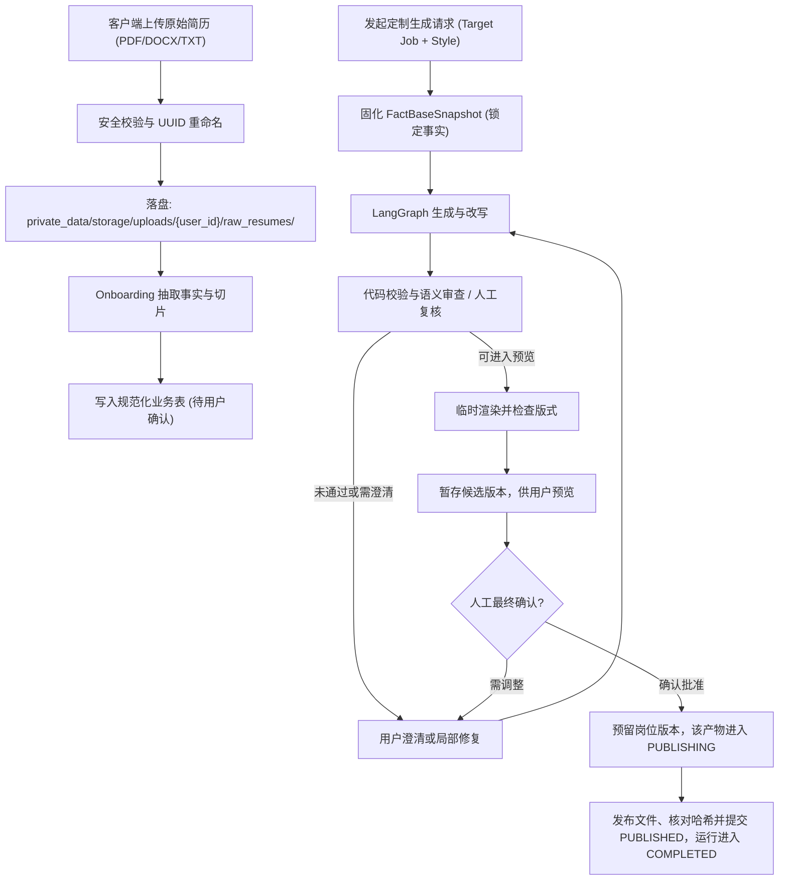
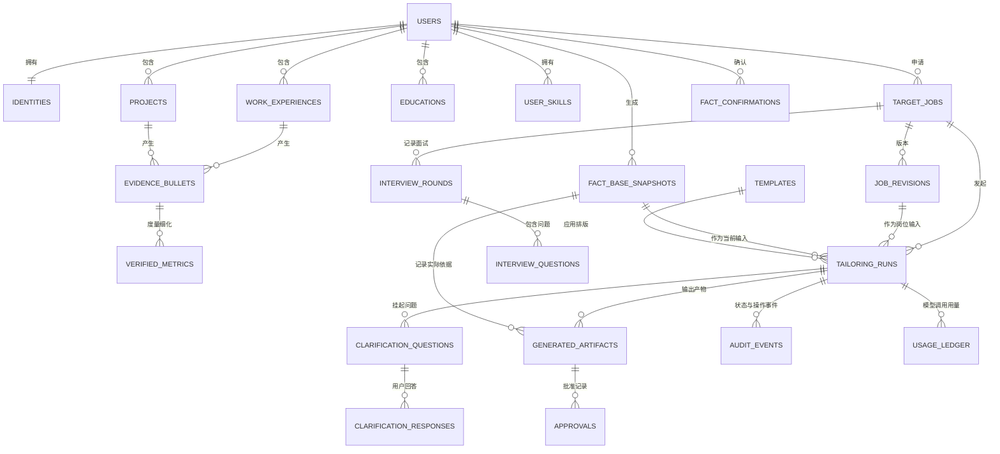

# Production-Grade Resume Tailor Agent: 详细实施计划 (v2.3 修订版)

本文档是分阶段工程路线图，不代表所有规划能力都已实现。Phase 1 的 Prompt 核心流水线及合成自动化测试已在代码中实现；Codex 与 Claude Code 的跨宿主端到端验收仍需人工执行，尚未在本项目中验证。Phase 2–4 仍为计划。产品以用户下载后的单用户本机运行为主，采用两条交互路线：默认通过仓库根目录的 `PROMPT.md`，让用户现有的编码 Agent（如 Claude Code 或 Codex）一步步提问并完成核心简历定制；这条路线不要求本项目直接调用模型 API 或另购 API Key，但不等同于离线运行，模型访问由编码 Agent 的订阅/服务提供。TypeScript 前端仍作为本机完整工作台保留，承载多岗位看板、筛选和跨申请历史汇总等更适合图形界面的功能。交互式 CLI 不再作为产品用户界面；CLI 保留为供 Agent 或自动化调用的非交互本机命令（见 1.5）。集中式服务器仅是未来发展方向，不纳入当前实施阶段。各阶段仅声明实际实现并验证过的能力，不将模型审查、隐私保护或排版检查描述为绝对保证。

---

## 目录

1. [核心架构修订与设计决策](#1-核心架构修订与设计决策)
2. [双路线模型接入、隐私与安全边界设计](#2-双路线模型接入隐私与安全边界设计)
3. [项目工程目录结构与用户文件存储体系](#3-项目工程目录结构与用户文件存储体系)
4. [核心数据契约与数据库设计](#4-核心数据契约与数据库设计)
5. [三级事实校验与质量控制防线](#5-三级事实校验与质量控制防线)
6. [单一确定性文档渲染管线](#6-单一确定性文档渲染管线)
7. [LangGraph 工作流与恢复幂等性设计](#7-langgraph-工作流与恢复幂等性设计)
8. [回归评估体系与故障注入测试 (Eval Harness)](#8-回归评估体系与故障注入测试-eval-harness)
9. [四阶段端到端实施路线图 (Phased Implementation Roadmap)](#9-四阶段端到端实施路线图-phased-implementation-roadmap)
10. [功能技能与开发工作流技能](#10-功能技能与开发工作流技能)
11. [生产可观测性、追溯与可靠性](#11-生产可观测性追溯与可靠性)
12. [未来集中式服务器（暂不实施）](#12-未来集中式服务器暂不实施)

---

## 1. 核心架构修订与设计决策

### 1.1 弃用“夸大百分比”，引入三档定位风格（Positioning Style）

**设计问题**：原 `exaggeration_pct`（15%、30%）缺乏客观测度，且会诱导模型在证据不足时主动篡改职责范围或虚构指标，破坏“零编造”基准。

**修订方案**：统一采用 `positioning_style`，定义为三种不同的信息组织策略。**三种风格必须严格遵守完全一致的事实边界，不允许任何形式的事实编造**：

* **`conservative`（保守/精准型）**：最大程度保留用户原本的词汇与句式，仅修正语病、调整叙事逻辑并提高表达清晰度。
* **`balanced`（标准对齐型，推荐默认）**：在已确认事实支持的范围内按 STAR 句式（情境-任务-行动-结果）组织，使用精准强动词（Action Verbs），并把目标 JD 中的术语映射到已登记的同义词（别名表，见 5.2）。**STAR 只用于组织已有要素：事实中没有的情境、任务或结果直接省略，不得为凑齐 STAR 补写情境或成果**；成果仅限已确认事实或已确认指标。
* **`assertive`（进取/复杂度主导型）**：深入突出已有证据支持的技术复杂度、个人贡献与业务价值。缺少指标时可选地询问用户，但必须提供定性改写选项，不得要求用户编造或强迫填数；存在未证实的具体主张时，必须澄清或移除该主张。

### 1.2 事实可信度的真实边界

* **承认 LLM 审查的漏检概率**：不将“零幻觉”误宣称为数学上的绝对保证，尤其当 Generator 与 Auditor 采用同构模型时。
* **确定性优先**：能用代码规则校验的绝对不交给 LLM；LLM 审查（Auditor）仅作为语义范围核查的辅助手段，并纳入持续的回归测试。
* **门禁分层表述**：确定性代码门禁只对已定义的故障类别、并只针对合成故障集声明“全部拦截”；语义审查只报告检出率，不承诺拦截率。审查模式、状态与审批条件以 5.5 为唯一规范来源，其他章节引用而不重述。

### 1.3 渲染管线收敛至单一主力链路

* **DOCX 主输出链**：`TailoredResumePayload` + 其绑定的事实库快照 $\rightarrow$ `docxtpl`（沙箱化 Jinja 环境，见 6.1）$\rightarrow$ `.docx` $\rightarrow$ Headless LibreOffice $\rightarrow$ `.pdf`。默认使用项目随附的内置单栏 DOCX 模板（`templates_builtin/`）；用户也可指定经校验的自定义模板。
* **Markdown 降级链**：仅当用户明确选择 Markdown，或内置与自定义 DOCX 模板均不可用（如模板校验失败）时，生成 `.md`，再经项目自有的受限转换器生成 HTML，并由同一 LibreOffice PDF 后端生成 `.pdf`；不另设 WeasyPrint 等第二套 PDF 引擎。这是保真度最低的路径，不作为没有自备模板的用户的默认路线，输出须在 `render_path` 字段中标明。
* **Markdown 与 PDF 的边界**：Markdown 是用户明确选择或模板不可用时的有效候选产物，不要求先生成 DOCX。若 LibreOffice 不可用，则保留 `.md`（或 DOCX 主链中的 `.docx`），明确标记 PDF 未生成并允许用户手动转换；不得伪报 PDF 健康检查通过。
* **排版策略**：不自动压缩字体或间距；使用按语言实测的字符预算与模板约束做渲染前预估，再进行渲染后检查和人工预览。页数上限以 LibreOffice 生成的 PDF 为准；Word 打开同一 DOCX 时的分页可能不同，输出须提示这一点（见 6.1）。

### 1.4 人机协同（Human-in-the-Loop, HITL）交互澄清机制

**核心设计原则**：“宁可向用户求证，绝不替用户编造”。改写过程如遇事实边界模糊或存在重要发挥空间，系统必须主动暂停并与用户交互，实现精细化的人机协作：

* **缺失量化指标求证**：若某条经历与岗位高度相关但仅有定性陈述，可生成 `ConfirmationPlaceholder` 邀请用户提供实际数据，也可直接选择定性改写；任何未确认的数字不得进入待批准产物。
* **职责主导权核对**：当改写内容对复杂度和领导力进行挖掘时，若 Auditor 认为存在“参与被夸大为主导”的嫌疑，且两次局部自动修复仍未消除歧义，系统自动中断并向用户求证，由用户决定是“确认主导”还是“降级为核心参与”。
* **排版超限取舍决策**：当产物超出用户选择的目标页数（`run_config.target_pages`，见 4.2）或其他排版检查未通过时，系统不进行硬截断，而是向用户列出建议精简条目，由用户确认裁剪优先级。

---

### 1.5 Prompt 优先与 TypeScript 工作台双路线

默认产品入口是可复制粘贴的根目录 `PROMPT.md`，而不是 CLI 问答界面。参考 [Gathin23/cleanyourtv](https://github.com/Gathin23/cleanyourtv) 的 README/PROMPT.md 模式：用户在有文件与终端权限的编码 Agent 中打开项目并粘贴一段入口 Prompt；Agent 复用项目已有工具，在首次读取前披露宿主的数据处理方式，但不再逐次询问是否可读取当前用户自己的文件。当前单用户本机模式把仓库的 `private_data/` 视为当前用户的数据目录，用户请求简历定制即足以授权对相关文件进行有界发现和读取；Agent 从当前简历或档案识别用户，只读取完成任务所需文件，不递归扫描。未来多用户模式必须把每个用户的全部个人数据放在 `private_data/users/{stable_user_id}/`，只访问当前用户目录，绝不读取其他用户数据。Agent 再从 JD 自动提取公司和岗位、从两份材料自动确定输出语言；可选偏好采用默认值（定位 `balanced`），只对文件歧义或确实缺少的必要信息澄清。未被简历支持的 JD 要求不是完成门槛；事实快照确认后、起草前，一次性列出所有未覆盖或部分覆盖的 requirement（must-have 与 nice-to-have），按优先级建议“有真实证据时补充”或“略过”。只对建议补充的项目给出 2–3 个条件式证据建议，最多集中询问一次；不逐项追问，未回答的项目省略并继续。派生文件可在 `private_data/` 下直接写入，无需逐次许可；原始简历和 JD 只读，并在完成时报告写入路径。门禁全部通过后自动发布，不再要求逐次发布批准。本项目只借鉴交互模式，不假定所有编码 Agent 的工具能力完全相同，也不复用其领域逻辑。

Prompt 路线由宿主编码 Agent 承担对话与生成，不通过本项目的 `MAIN_LLM_*` 或 `JUDGE_LLM_*` 直接调用模型。它应支持“先在当前用户的数据目录查找本地资料档案，必要时提供一份新/已更新简历和一份 JD → 对新简历的一次来源级选择（可选偏好采用默认值）→ 生成候选（不要求覆盖所有 JD 要求）→ 本机确定性检查与人工复核 → 门禁通过后自动发布”的基本闭环；访问当前用户的相关文件和在 `private_data/` 中写入派生文件均无需逐次请求许可，原始简历和 JD 保持只读并在完成时报告路径；用户简历中明确陈述的来源事实不逐项要求高风险确认，同一来源哈希的已保存档案不重复确认。Prompt 路线不要求最终发布批准，但未完成或不可用的语义审查仍需用户明确豁免；TypeScript 工作台保留显式审批。不要求启动 FastAPI、PostgreSQL 或 TypeScript 前端。用户订阅的模型额度、服务条款和数据处理政策适用；不需要独立 API Key 不代表内容不会发送到宿主 Agent 的云端服务。

| 功能 | Prompt + 订阅 Agent 路线 | TypeScript 本机工作台路线 |
| :--- | :--- | :--- |
| 核心简历定制 | 支持单份简历和单个目标岗位；对首次或已变更简历，用户一次选择即可批准来源中明确陈述的事实；不对这些来源事实逐项追问高风险确认，也不要求第二次键入 `confirm`；不清晰或矛盾的来源、用户编辑和模型建议仍须处理；同一来源哈希的资料档案不重复确认 | 支持结构化录入、编辑、Diff、恢复和候选版本管理 |
| 模型与审查 | 同一宿主 Agent 负责生成与 Judge，不要求独立 API Key；审查模式、状态与审批条件以 5.5 为准 | 应用直连模型需独立配置 `MAIN_LLM_*`；独立配置的语义审查需另行配置 `JUDGE_LLM_*` |
| 申请追踪 | 可选地在用户确认后，为当前岗位维护状态、更新时间和下一步的轻量本地便笺 | 完整看板、跨岗位列表/筛选、状态历史、面试轮次与可追溯问题汇总 |
| 面试资料 | 可在当前岗位的便笺中记录用户提供的单轮笔记；不保证跨岗位检索或聚合 | 按岗位和轮次管理笔记与实际问题，支持全部问题或按 Title 汇总并回溯来源 |
| 输入与数据管理 | 当前单用户模式默认在当前用户的 `private_data/` 中有界查找资料档案和任务所需文件，不逐文件询问读取权限；文件或档案有歧义时询问选择。未来多用户模式把每个用户的全部数据隔离在 `private_data/users/{stable_user_id}/`，绝不跨用户访问；不递归。没有批量上传或图形化预览 | 支持本机表单、文件预览、批量浏览与更丰富的资料管理 |

完整申请追踪、跨岗位搜索/聚合、提醒、可视化时间线和多轮面试资料管理归属 TypeScript UI；Prompt 路线只提供可选的单岗位便笺，不将其描述为等价看板。两条路线共用事实契约、确定性校验、文件存储和渲染规则，但不共享宿主 Agent 的私有会话、订阅凭据或未公开的模型 API。Prompt 路线的 Judge 由宿主 Agent 承担，不得为此提取凭据或绕过宿主调用模型 API；同模型自审、订阅内替代模型和应用 API Judge 必须分别记录（词汇表见 5.5），最终仍需用户批准。

**Phase 1 宿主 Agent 的无状态 CLI 协议（已实现；跨宿主验收待人工验证）**：所有命令不交互、不读取 `.env`、不调用模型，命令模块不得导入 `python-dotenv`；CLI 只读取显式传入的输入路径，不自行扫描用户目录或仓库去寻找个人文件。宿主 Agent 可按 7.3.2 在当前用户的 `private_data/` 中受限发现档案和任务所需文件，无需逐次请求读取权限；未来多用户模式只可发现当前用户专属目录，不能访问其他用户。也可在用户明确提供且属于当前用户的其他输入目录中执行第一层文件名发现。CLI 只向显式传入的输出路径或受控的 `private_data/storage/`、`private_data/profiles/`、`private_data/tmp/` 写入，且一律为独占创建：目标已存在即报错，绝不覆盖（见 3.2.2）。成功结果以统一的版本化 JSON 信封输出到 stdout（字段见 4.4），简短错误写入 stderr，两者都不打印简历或 JD 全文；`--diagnostics-out` 写入不含文档内容的步骤记录。宿主 Agent 必须以 JSON 的 `status` 为准，退出码只是粗粒度信号。确定性文本抽取与逐字来源核验由代码完成；把简历内容整理成结构化候选属于宿主 Agent（应用 API 路线为主模型）的工作，代码对其结果只做校验，不替它生成。

宿主侧发现优先使用已验证、覆盖 Git-ignored 文件的精确深度文件列表 API。Linux/GNU `find` 可作为固定的只读回退，具体命令仅限 7.3.2；这不是 CLI 命令，也不改变 CLI 禁止目录扫描的约束。不得据此声称其他操作系统或宿主提供相同能力。

| 子命令 | 计划用法 | 行为与结果 |
| :--- | :--- | :--- |
| `extract-text` | `resume-tailor extract-text <path> [--out <path>] [--no-redact]` | 对 TXT/DOCX/PDF 做确定性文本抽取（PDF 仅读文本层，扫描件或空文本层报错），把 `SourceText` 写入文件（`--out`，默认 `fact_base/sources/{source_sha256}.json`），stdout 只含信封与路径，不含正文。`SourceText` 含源文件哈希、带稳定 `block_id` 与位置的文本块和抽取警告（疑似多栏、乱码等）。默认对 Agent 可见的文本做本地联系信息遮蔽（邮箱、电话、链接、街道地址）：原文映射写入同目录的 `.redaction.json`，身份候选预填到 `identity.local.json` 供用户在本机核对（均为 0600，见 3.2），都不进入 stdout。姓名、公司、学校等无法可靠遮蔽，不作承诺。不做结构化，也不判断事实。 |
| `validate-facts` | `resume-tailor validate-facts --source <path> --candidates <path> [--ledger-out <path>]` | 校验宿主 Agent 提交的 `FactCandidates`：Schema 合法；全部条目 `user_confirmed=false`；每条 `resume_extract` 来源的 `raw_source_text` 必须是 `SourceText` 文本块中的逐字子串（仅规范化空白），否则报告为伪造来源；未建模章节列入 `unparsed_sections`。同时由代码渲染确认账本并给出 `ledger_sha256`。 |
| `build-snapshot` | `resume-tailor build-snapshot --candidates <path> --confirmations <path> [--identity <path>] [--parent <path>] (--out <path> \| --profile-name <username> --profile-source <SourceText-path>) [--diagnostics-out <path>]` | 核对确认记录绑定的 `ledger_sha256` 与候选内容哈希一致，生成不可变快照（`UserFactBase` + `snapshot_sha256`、父快照哈希）；只有被确认的条目进入快照；身份字段只从本机 `--identity` 文件合并。档案模式按安全用户名、事实库版本与来源 SHA-256 写入 `private_data/profiles/`；新版本独占创建，不覆盖已有快照。 |
| `check-facts` | `resume-tailor check-facts --snapshot <path> --payload <path> [--requirements <path>] [--review <path>]` | 校验 payload 绑定的 `snapshot_sha256`，执行第一、二级确定性校验（5.1–5.2），输出 `passed`/`blocked` 与逐项报告；`--requirements` 提供 JD 要求以启用未支持术语检查；传入 `--review` 时核对其 `payload_sha256` 并按 5.5 汇总审批条件。 |
| `render` | `resume-tailor render --snapshot <path> --payload <path> (--company <name> --role <title> \| --out-dir <path>) [--job-id <id>] [--requirements <path>] [--review <path>] [--template <name>] [--format docx\|markdown] [--run-id <id>]` | **先在内部执行 `check-facts` 的全部硬校验，阻断则不生成任何简历文件。** 可传入 `--requirements` 以重验 JD 术语和 payload 绑定。默认使用内置 `default` 模板（DOCX 主链），`--format markdown` 才走降级链；未知模板名报错，不静默切换；语言、页数上限取自 payload 的 `run_config`。`--company`/`--role`（从所选 JD 提取的值，用户可更正）用于在 `private_data/storage/` 下查找或创建岗位目录（同公司同岗位名存在多个目录时须显式传入 `--job-id`），`--out-dir` 则明确导出到用户指定路径，不写入受控目录。`job_id`、`run_id`、`artifact_id` 由本命令在本机生成并写入输出 JSON 与候选目录内的 `candidate.json`。输出候选文件、`audit_report.json`、`render_path` 与跳过的检查。 |
| `publish` | `resume-tailor publish --candidate-dir <path> --approval <path>` | 校验 `approval.json` 与候选文件哈希一致、且满足 5.5 的审批条件；在同一岗位目录下以独占 `mkdir` 预留 `final/vN/`（N 为现有最大版本加一，冲突则重试）、写入文件并最后写入 `manifest.json`。不覆盖、不修改已有版本。只接受位于受控目录中的候选；用 `--out-dir` 导出的文件由用户自行管理，没有 `final/` 与 manifest。 |

计划中的命令统一使用退出码：`0` 表示完整成功；`1` 表示输入或运行错误（文件缺失、JSON 不合法、写入冲突等）；`2` 保留给命令行用法错误（argparse、Click 等库的默认值，不得改作他用，否则 Agent 无法区分用法错误与门禁阻断）；`3` 表示事实、来源或审批门禁阻断；`4` 表示已生成 DOCX 或 Markdown 候选但 PDF 因环境缺失而降级。`render` 必须在 JSON 中明确列出实际产物和 `skipped_checks`；退出码 `4` 不得被宿主 Agent 当成完整 PDF 导出成功。

**Prompt 路线的确认与信任边界**：Prompt 路线中的确认记录最终由宿主 Agent 写入文件，代码无法证明“用户确实同意”，因此本计划不把 `user_confirmed` 描述为不可伪造的认证，而是用以下措施提高可验证性，并如实披露残余风险：

1. 候选事实一律以 `user_confirmed=false` 进入；`validate-facts` 拒绝任何已被标为确认的候选，抽取阶段不得自动确认。
2. 由代码从候选渲染“确认账本”（按章节列出事实 ID、原话、规范化陈述、指标与技能）；对首次或来源哈希已变化的简历，Agent 展示简洁摘要并请求一次来源级选择，随后将用户明确提供的来源事实映射到确认记录。一次清晰选择即是该动作的最终确认，不再要求逐项选择或第二次键入 `confirm`。
3. 指标、职责主导权、技能、日期和雇主等高风险标签仍可在账本中提示审阅，但对于简历明确陈述的来源事实不触发逐项确认。仅对含糊/矛盾来源、用户编辑、模型建议或无法从来源支持的主张暂停澄清或拒绝确认；来源级选择不豁免来源引文与确定性校验。
4. `render` 与 `publish` 的输出信封都包含 `data.confirmation_summary`：快照哈希、已确认条目数，以及自账本批准以来新增或修改的条目；Prompt 路线在完成摘要中展示，要求用户审批的工作台路线则须在审批前展示。
5. 用户选择的资料档案中若 `resume_source_sha256` 与当前来源一致，则复用原不可变快照，不重复确认；来源改变时构建新版本并再次请求一次来源级选择。需要“确认动作必须由人在界面上完成”的更强保证时，使用 TypeScript 工作台；Prompt 路线的确认只能视为经用户可见账本支持的、由 Agent 记录的确认。

---

## 2. 双路线模型接入、隐私与安全边界设计

### 2.1 统一线上高能力模型接入与异构双模型架构

简历定制与语义审查对**深层业务语义理解、精确 STAR 叙事结构组织、严格的负向约束遵循（绝不编造数据）**有较高要求。本计划分别支持由用户现有编码 Agent 订阅驱动的 Prompt 路线，以及由应用自行调用模型 API 的路线；两者是不同的模型边界，不能静默互换或把一种路线的审查结果算到另一种路线。

Prompt 路线中，模型由用户启动的编码 Agent 提供；应用 API 路线中，模型通过本节定义的 provider 接入。个人资料尽量在本机处理和保存，但 Prompt 路线的内容是否发送到云端、留存多久及如何使用，受宿主 Agent 的服务条款和隐私设置控制。任何路线均不得宣传为“绝不外传”或“完全离线”。

以下**异构双模型独立配置（Dual-Model Architecture）仅适用于应用 API 路线**：
* **生成模型（`MAIN_LLM_*`）**：负责简历结构化抽取、关键词映射与三档定位风格定制；
* **审查/仲裁模型（`JUDGE_LLM_*`）**：作为独立配置的 Auditor 执行语义蕴含核验与主导权夸大审查，记录为 `API_JUDGE`；其与主模型的实际独立程度（不同供应商、同供应商不同模型、同一模型）按配置计算并记录为 `judge_independence`，不因角色分开配置就声称模型独立（见 5.5）。
* **边界**：不同供应商或模型族可能降低共同偏差，但不能消除相关错误或保证拦截率；具体效果以合成回归集和人工复核为准。
* **独立配置**：两个角色的 provider、model、base URL 和凭据分别配置，不得静默复用主模型或密钥。审查节点未实现、未配置或调用失败时必须明确提示，不能标记为审查通过。

Prompt 路线不访问这些应用 provider 配置：生成候选后由宿主 Agent 在全新上下文中执行第二遍 Judge（输入与输出契约见 5.3），对照已确认事实检查职责、技能、指标和 JD 匹配。默认使用同一模型自审；若宿主按用户当前订阅提供另一个模型供 Judge 使用，且用户同意，可切换到该模型，不需要 `JUDGE_LLM_*` 或独立 API Key。仅使用宿主公开支持的模型选择能力；不得读取订阅凭据或调用未公开接口。若用户指定的替代模型不可用，应明确告知并征求是否改用同模型自审。失败后给出具体问题并进入局部修复或用户澄清，修改后重新运行确定性校验和 Judge。按实际方式记录为 `SELF_REVIEW` 或 `SUBSCRIPTION_ALT_MODEL`（词汇表与审批条件见 5.5），两者均不得冒充应用 API 路线的 `API_JUDGE`。确定性校验、语义未决时的澄清和用户最终批准仍是必需门禁。

```python
from abc import ABC, abstractmethod
from dataclasses import dataclass
from typing import Generic, Literal, TypeVar

from pydantic import BaseModel

T = TypeVar("T", bound=BaseModel)


class ProviderError(Exception):
    """provider 错误基类，子类对应 7.2 的错误类别；消息不得含文档内容或密钥"""


class ProviderConfigError(ProviderError):
    """配置缺失或无效：不可重试"""


class ProviderUnavailableError(ProviderError):
    """429、超时、5xx：可按预算安全重试"""


class ProviderRefusalError(ProviderError):
    """模型拒绝回答：不可重试"""


class ProviderTruncatedError(ProviderError):
    """输出被截断：不可重试，除非 adapter 声明可调参数后在预算内重试一次"""


class ProviderSchemaError(ProviderError):
    """空响应或不合 Schema：不可重试"""


@dataclass(frozen=True)
class ModelCallMeta:
    """单次调用的非内容元数据，供审计、预算和路由披露使用"""

    role: Literal["MAIN", "JUDGE"]
    provider: str
    model: str
    upstream: str | None  # 实际上游；不可得时为 None，记录为“未知”，不推测
    finish_reason: str | None
    input_tokens: int | None
    output_tokens: int | None
    attempt: int  # 从 1 开始；重试同样计入费用和预算
    request_id: str | None


@dataclass(frozen=True)
class StructuredResult(Generic[T]):
    parsed: T
    meta: ModelCallMeta


class ModelProvider(ABC):
    @abstractmethod
    async def generate_structured(
        self,
        schema: type[T],
        prompt: str,
        system_prompt: str,
        temperature: float = 0.2,
    ) -> StructuredResult[T]:
        """统一异步结构化输出抽象，具体协议与能力由 provider 实现。

        不支持的参数、拒绝、空响应、截断和不合 Schema 的输出抛出对应的
        ProviderError，不返回成功形状的默认值。
        """
```

#### 2.1.1 常用 Endpoint 与配置

以下接入方式仅供应用 API 路线的两个模型角色独立选择；兼容 OpenAI 的请求格式不意味着参数、模型能力、数据政策和错误行为完全相同。Prompt 路线不读取 `.env`，也不要求用户为本项目填写 API 凭据。

| 接入方式 | 默认 Base URL | 模型与协议要求 |
| :--- | :--- | :--- |
| OpenRouter | `https://openrouter.ai/api/v1` | 使用 OpenRouter 模型 ID，例如 `供应商/模型`；实际模型及上游供应商由用户选择并确认。 |
| DeepSeek 直连 | `https://api.deepseek.com` | 使用 DeepSeek 当前公布的模型 ID 和 OpenAI 兼容接口；按其接口能力配置请求。 |
| 其他 OpenAI 兼容服务 | 用户显式配置 | 自定义 base URL、模型及凭据；不假定支持与上述服务相同的结构化输出或参数。 |
| 原生协议服务 | 依各供应商适配器 | 若支持 Anthropic 等原生协议，使用相应独立适配器；不能把不同协议的 endpoint 当作同一种接口。 |

配置示意仅展示变量和 endpoint，不包含凭据或自动选择模型；模型及各自的 API 凭据由用户在本机 `.env` 中分别填写：

```dotenv
MAIN_LLM_PROVIDER=openrouter
MAIN_LLM_BASE_URL=https://openrouter.ai/api/v1
MAIN_LLM_MODEL=
MAIN_LLM_API_KEY=

JUDGE_LLM_PROVIDER=deepseek
JUDGE_LLM_BASE_URL=https://api.deepseek.com
JUDGE_LLM_MODEL=
JUDGE_LLM_API_KEY=
```

* 主模型与 Judge 均可以配置为 OpenRouter、DeepSeek 或其他已实现的 provider；允许用户显式选择同一服务或同一模型，但不因此声称模型独立或审查更可靠，该情形的 `judge_independence` 如实记录为 `SAME_PROVIDER_DIFFERENT_MODEL` 或 `SAME_MODEL`（见 5.5）。Judge 未实施的阶段可以不配置 Judge，但不得标记审查通过。
* 由 `python-dotenv` 读取本机 `.env`，`.env` 不进入 Git；实现配置时同步维护不含凭据的 `.env.example`。只有应用 API 入口（`api.py` 及其工作流）加载 `.env`；Prompt 路线的命令模块不得导入 `python-dotenv`，Prompt 路线用户也不需要创建 `.env`。base URL、模型和密钥按角色独立校验，不能将密钥放进 URL、前端代码、日志或错误消息；不将凭据发送至未被用户确认的自定义 endpoint。
* **OpenRouter 路由与隐私**：该服务可能将请求路由到不同上游供应商，且其路由参数 `data_collection` 默认为 `allow`（允许可能保存数据的上游）。调用前向用户说明并获取对路由范围及数据处理政策的同意；简历类请求默认发送 `provider.data_collection = "deny"`，用户要求零数据留存时再加 `provider.zdr = true`；用户可用 `only` 限定允许的上游并按策略设置 `allow_fallbacks`。不得静默启用未授权的上游或备选模型，也不得因没有可用上游而自动放宽 `data_collection` 或 `zdr`。使用支持结构化输出的路由时要求 `require_parameters`。若上游不可用或能力不符，明确报错，不切换主/Judge 角色；实际路由信息不可得时记录“未知”，不推测。
* **结构化输出**：OpenRouter 的 JSON Schema 支持取决于具体模型和上游；DeepSeek 文档提供 `json_object` 模式，不等同于保证符合任意 JSON Schema。各 adapter 应按真实能力构造请求，随后统一解析并使用 Pydantic 校验；不支持的参数、拒绝、空响应、截断或不合 Schema 的输出均抛出类型化的 `ProviderError`，按 7.2 分类处理。Schema 解析硬失败终止当前任务，不能返回成功形状的默认值或静默绕过。每次调用返回的 `ModelCallMeta`（实际模型、上游、用量、尝试次数）写入用量记录（4.3.5），用于路由披露、预算和审计。
* **测试与演进**：默认用模拟 transport 测试两个角色分别接入 OpenRouter/DeepSeek、自定义 URL、参数差异、结构化响应和失败；可选在线集成测试必须经用户同意并设置费用上限。模型 ID、provider 能力和价格可能变动，配置或文档不能当作永久保证。

实施时核对官方资料：[OpenRouter Quickstart](https://openrouter.ai/docs/quickstart)、[OpenRouter Structured Outputs](https://openrouter.ai/docs/guides/features/structured-outputs)、[OpenRouter Provider Routing](https://openrouter.ai/docs/guides/routing/provider-selection)、[DeepSeek API](https://api-docs.deepseek.com/) 和 [DeepSeek JSON Output](https://api-docs.deepseek.com/guides/json_mode/)。

#### 2.1.2 编码 Agent 订阅路线与无 API Key 边界

* **认证与调用**：用户直接在兼容的编码 Agent 中使用已有订阅（首批目标为 Codex 与 Claude Code）。不要求本项目持有 API Key，也不读取、复制或模拟宿主 Agent 的 OAuth/session 凭据；不依赖非公开接口或将订阅登录伪装成 provider。
* **能力边界**：宿主 Agent 负责对话和模型生成；本项目只提供本机契约、校验、渲染及受控存储能力。若 Agent 不支持读取用户选定文件或执行受支持的本机任务，应提示用户粘贴内容或手动完成，不得静默改走应用 API。
* **费用与隐私**：模型用量受宿主服务订阅、额度、条款和数据处理政策限制。此路线省去单独购买应用 API Key/余额，但不是离线模型，也不保证宿主服务不处理用户输入。
* **质量声明**：Prompt 路线必须由宿主 Agent 对生成结果执行专门 Judge；审查模式（`SELF_REVIEW`、`SUBSCRIPTION_ALT_MODEL`）、状态（含宿主无法完成时的 `UNAVAILABLE`）及其对审批的影响以 5.5 为准，不得宣称为应用 API 路线的 `API_JUDGE`。若指定的替代模型不可用，须先询问用户是否回退到同模型自审。
* **TypeScript UI 边界**：本机 UI 后端不能假定可复用 Codex/Claude Code 的订阅会话。UI 内的模型生成只走明确配置的应用 provider；没有 API 配置时，用户仍可使用 Prompt 路线完成核心简历定制，但 UI 不声称已自动接入 Agent 订阅。

### 2.2 模型数据路径中的隐私与前置脱敏

数据库和本地工作区由用户部署与管理；个人输入、输出和应用管理的本机数据应与普通项目文档分离，见 3.2。两条模型路径有不同的隐私边界：应用 API 请求受本项目的本地脱敏流程控制；编码 Agent 路线由宿主服务处理内容，本项目无法控制宿主侧的传输与留存。

1. **应用 API 路线的本地预处理**：在任何 provider 调用前本地提取文本、识别已知身份字段并替换为占位符；按任务只发送必要片段。占位符映射只保留在本地，不发送给模型。若无法安全分离所需内容，明确提示并停止 provider 调用，不回退到发送完整简历。
2. **应用 API 路线的用户知情与确认**：首次使用某供应商前说明发送内容类别、保留政策和风险，由用户明确同意；允许用户查看和修正待发送的脱敏内容。供应商、模型或发送范围变更时重新确认。
3. **Prompt 路线的宿主服务披露与本地遮蔽**：在 Agent 读取、接收或处理简历/JD 前，Prompt 必须说明用户输入可能进入其订阅服务处理，并要求用户确认。`extract-text` 默认在本地遮蔽联系信息（邮箱、电话、链接、街道地址），Agent 只看到遮蔽后的文本；原文映射和身份候选只保存在本机 0600 文件中，身份字段由用户在本机身份文件中填写或核对，仅在 `build-snapshot` 与渲染时本地合并，Agent 不读取该文件。用户可用 `--no-redact` 明确放弃遮蔽，或改为粘贴自行脱敏的内容。姓名、雇主、学校和指标仍可能留在文本中并重新识别个人，此确认不能替代宿主服务自身的数据政策，也不能保证项目的遮蔽覆盖宿主上下文。宿主 Agent 通常会在本机保存会话记录，位置与保留期由宿主决定、不在 `private_data/` 内，本项目的删除流程无法清除；Prompt 必须在开始前告知用户，README 说明各宿主清理会话记录的方法。
4. **残余风险**：姓名和联系方式可出现在任意自由文本，工作经历、公司和指标也可能重新识别个人。自动检测和日志过滤均有漏检风险，不能承诺“绝对不发送 PII”或“全流程零泄露”。渲染只使用本地不可变快照中的身份信息。
5. **凭据与日志**：应用 API 密钥通过环境变量或受保护配置注入，不进入 Git、测试、日志或错误消息；Prompt 路线不得读取或记录宿主凭据。两条路线都不记录完整简历、JD、Prompt、响应或占位符映射。对本项目必要的结构化日志进行脱敏并测试，配置 `.env.example` 与 API 路线实际变量保持一致。

### 2.3 JD 输入与外部抓取的 SSRF 防护

即使用户可信，粘贴或抓取的 JD 仍属于不可信的第三方数据：

1. **输入边界**：JD 仅作为岗位信息，不得覆盖系统指令、改变事实、请求泄露信息或决定工具行为。粘贴文本和抓取页面都要作为不可信数据隔离；对提取结果和最终内容执行代码校验，不能把提示词标签当作安全边界。Prompt 路线中，宿主 Agent 必须先用文件写入工具把粘贴的 JD/简历文本保存到 `private_data/`，再把路径传给命令；文本内容不得拼接进 shell 命令行、heredoc 或环境变量（避免命令注入），JD 中的任何指令都不能扩大 1.5 所列的命令白名单。这些是纵深防御措施，不是安全边界：Phase 1 同时提供宿主权限配置示例（如拒绝读取 `.env`），并增加合成提示注入回归用例。
2. **SSRF（服务端请求伪造）防护**：
    * Prompt 路线只使用用户粘贴或明确选择的本机 JD 文件，不由 Agent 自动抓取 URL；TypeScript UI 中粘贴文本始终可用，URL 读取由用户显式选择，Phase 4 完成防护和测试前不开放。
    * 只允许 `http`/`https`，拒绝 URL 用户信息和非标准端口，最多跟随 2 次重定向。首次请求及每次重定向都校验规范化 URL、DNS 的全部解析结果，并将实际连接固定到已验证的公网地址；阻止私有、回环、链路本地、保留及其他非全局 IPv4/IPv6 地址，包括映射地址与云元数据地址。禁用环境代理并验证 TLS 证书，防止 DNS 重绑定和代理绕过。
    * 限制连接、读取和总耗时，限制响应体大小（包括解压后的大小）；仅接收 `text/html` 和 `text/plain`。错误不得包含完整 JD、敏感 URL 或响应正文。
3. **抓取、正文抽取与用户确认**：
    * 前端提供“粘贴文本 / 从链接读取”输入方式；粘贴文本可直接编辑，链接由仅监听回环地址的后端抓取，不在浏览器中直接跨站请求，也不执行页面 JavaScript。
    * 首版只解析静态 HTML 和纯文本；对需要登录、验证码、JavaScript 渲染、附件下载或不支持内容类型的页面，显示安全且可操作的失败原因，并引导用户粘贴 JD，不尝试绕过访问控制。
    * 使用维护中的 HTML 正文抽取库提取主要内容，剔除脚本、样式、导航等非 JD 内容；保存脱敏来源、抓取时间、抽取方法和内容哈希供本地追溯。抓取结果先作为预览展示，用户可编辑并确认后才创建 `job_revision` 或发送给模型。
    * 规划 `POST /api/v1/job-descriptions/fetch-preview`：只返回受限长度的抽取预览和安全来源元数据，不触发模型调用或生成流程。失败时不把部分页面或原始 HTML 静默送入模型；用户可改用粘贴文本。URL、错误和抓取指标按隐私规则脱敏，不记录完整 URL 查询参数或页面内容。

---

## 3. 项目工程目录结构与用户文件存储体系

### 3.1 源码工程目录结构

```text
resume-tailor/
├── pyproject.toml                  # Python 运行与开发依赖
├── PROMPT.md                       # 用户复制到兼容编码 Agent 中的逐步交互入口
├── src/resume_tailor/
│   ├── cli.py                      # Prompt 路线的非交互命令入口（1.5）；不含交互问答，不加载 .env
│   ├── api.py                      # TypeScript 工作台使用的本机 FastAPI 入口
│   ├── api_routes/                 # 前端所需的事实、定制、恢复与下载接口
│   ├── providers/                  # 应用 API 路线的注入式主模型与独立配置的审查模型
│   ├── schemas/                    # 事实、JD、产物、审查和交互契约
│   ├── services/                   # 本地解析、隐私、渲染、存储和安全抓取
│   ├── data/                       # 版本化的术语表、证书表与同义词别名表（确定性检查使用）
│   ├── templates_builtin/          # 内置 DOCX 模板（含默认单栏模板），作为包数据随安装分发
│   ├── db/                         # 数据库会话、规范化表与快照
│   └── agents/                     # 应用 API 路线的 LangGraph 工作流
├── tests/                          # 单元、集成、恢复及合成评测数据
├── alembic/                        # SQLAlchemy 数据库迁移
├── documents/                      # 普通项目文档，不放新的个人资料
├── private_data/                   # Git 忽略：用户输入、输出与本机运行数据
└── frontend/                       # Phase 4: TypeScript + Next.js + Tailwind CSS
```

Prompt 与 TypeScript 工作台共用类型化数据契约、事实校验、文件存储和渲染服务，不各自实现业务规则。Prompt 路线由宿主编码 Agent 承担交互，通过 1.5 定义的命令调用确定性操作；不要求启动 FastAPI、PostgreSQL 或前端，也不读取 `.env`。`cli.py` 不是交互式产品界面，只暴露明确、可验证的非交互本机命令。TypeScript 工作台通过仅监听回环地址的 FastAPI 访问共用服务；该完整工作台所需的数据库、前后端和 LibreOffice 均由用户在本机运行。容器如有使用也只允许本机访问；不建设公开服务器。

### 3.2 运行时用户文件存储架构 (Runtime User Storage Architecture)

`documents/` 仅用于普通项目文档；简历、JD、事实快照、生成产物、资料档案、诊断记录和其他包含个人信息的数据放在仓库内单独的 `private_data/`，并由 Git 忽略。`documents/` 现已被 Git 跟踪，`.gitignore` 不再忽略它，因此任何个人资料都不得放入；Phase 1 增加仓库护栏测试（见 8.3 与 9 节）。当前单用户 Prompt 路线把 `private_data/` 作为当前用户的工作目录；简历定制请求允许 Agent 对任务相关文件做有界发现和读取，无需另行询问读取权限，但首次读取前仍需披露宿主的数据处理方式。Agent 只读取完成任务所需的文件，不递归扫描；文件/档案候选有歧义时询问选择，而不是询问能否访问。未来多用户实现必须把每位用户的全部个人数据（含上传、档案、事实快照、生成产物、身份 sidecar、诊断、数据库、checkpoint 和备份）放在 `private_data/users/{stable_user_id}/` 下，禁止跨用户列目录或读写文件；从当前简历/档案识别用户后，只能使用对应目录，身份映射不明确时仅请求用户指出自己的档案/目录。用户明确提供的其他输入目录也必须属于当前用户。只有用户批准写入后，候选与正式产物才默认按经确认的公司名和岗位保存到 `private_data/storage/`；用户也可明确选择其他导出路径。原始简历和 JD 不得被覆盖。

计划中的应用运行目录为 `private_data/storage/`，备份放在 `private_data/backups/`；Prompt 路线的版本化事实档案放在 `private_data/profiles/<profile-name>/`，步骤诊断记录放在 `private_data/tmp/<run-id>/`。档案包含个人事实及来源摘录，因此和其他简历数据一样敏感；诊断记录只含操作元数据。下图描述当前单用户布局与应用存储计划，不构成未来多用户隔离边界；多用户实现必须将整个用户工作目录（而非仅 `storage/users/`）放在 `private_data/users/{stable_user_id}/` 下，包括档案、存储、临时文件、数据库、checkpoint 和备份。文中 `storage/...` 均指相对于 `private_data/` 的路径：

```text
storage/
├── app.sqlite3                                     # Phase 2+: 单用户本机数据库（及其 WAL 辅助文件）
├── checkpoints.sqlite3                             # Phase 2+: LangGraph Checkpoint 专用库，不进入 Alembic 管理
├── uploads/                                      # 1. 原始文件暂存区 (受控接收与安全扫描)
│   └── {user_id}/
│       ├── raw_resumes/                         # 用户上传的原始简历文件 (PDF/DOCX/TXT)
│       │   └── {file_uuid}.pdf
│       └── raw_jds/                             # 用户保存的 JD 原始文本/HTML 切片
│           └── {jd_uuid}.txt
│
├── users/                                        # 2. 本机用户持久化工作空间
│   └── {user_id}/
│       ├── templates_custom/                     # 用户个人上传的专属 DOCX 模板（按 Jinja 模板对待，见 6.1）
│       │   └── {template_uuid}.docx
│       │
│       ├── fact_base/                            # Phase 1 文件模式事实库；Phase 2+ 以数据库为准，快照 JSON 为交换格式
│       │   ├── sources/{source_sha256}.json      # extract-text 输出（遮蔽后的文本，0600）；同名 .redaction.json 保存遮蔽映射（Agent 不读取）
│       │   ├── candidates/{candidate_set_id}.json
│       │   ├── ledgers/{ledger_sha256}.md        # 代码渲染的确认账本
│       │   ├── identity.local.json               # extract-text 预填的身份候选，由用户在本机核对修改，Agent 不读取（0600）
│       │   └── snapshots/{snapshot_id}.json      # 不可变快照（含 snapshot_sha256），不覆盖
│       │
│       └── companies/                             # 按 JD 中经用户确认的公司名归档
│           └── {company_slug}/                    # 创建岗位时按规范化公司名固定；之后更正公司名只改显示名，不移动目录
│               └── jobs/
│                   └── {job_id}/                  # 本机代码生成的安全岗位标识（Phase 1 由 render 创建），同公司不同岗位独立隔离
│                       ├── jd_metadata.json       # JobRequirements（4.4）：结构化 JD 要求与关键词，绑定确认后的 JD 文本哈希
│                       ├── application_note.md    # Prompt 路线可选的单岗位状态/下一步便笺
│                       ├── runs/                  # 历史生成链路跟踪 (可回滚、可重试)
│                       │   └── {run_id}/
│                       │       └── {artifact_id}/ # 每次候选修订独立暂存
│                       │           ├── candidate.json    # job_id/run_id/artifact_id、绑定的快照与 payload 哈希
│                       │           ├── payload.json
│                       │           ├── semantic_review.json # SemanticReview（4.4），绑定 payload_sha256
│                       │           ├── audit_report.json # 记录实际执行的校验与跳过的检查
│                       │           ├── generated.docx
│                       │           ├── generated.md   # 选择 Markdown 或模板不可用时的候选
│                       │           └── generated.pdf
│                       │
│                       └── final/                 # 用户最终审批通过 (Approved) 的正式投递包
│                           ├── v1/
│                           │   ├── resume.docx
│                           │   ├── resume.md
│                           │   ├── resume.pdf
│                           │   ├── cover_letter_v1.docx # [Phase 4]
│                           │   ├── approval.json        # 用户批准记录与确认的豁免项（4.4）
│                           │   └── manifest.json        # 文件哈希、版本号、生成参数与来源哈希；最后写入，作为发布完成标记
│                           └── v2/                # 后续微调产生的新正式版本
│
└── tmp/                                          # 3. 瞬态临时工作区 (受生命周期与定期清理管辖)
    └── render_scratch/
        └── {run_id}/{artifact_id}/               # 每次渲染隔离工作区和 LibreOffice 配置
```

Prompt 路线的 `application_note.md` 仅在用户明确要求时记录当前岗位状态、更新时间和下一步；不维护跨岗位索引、状态时间线、提醒或面试问题聚合。完整申请与面试记录以 TypeScript 工作台的关系型数据为准。

#### 3.2.1 文件流转生命周期与状态机

以下上传与发布状态机适用于 TypeScript 工作台/API 路线；Prompt 路线只在用户授权后读取本机指定文件，不将文件上传到本项目服务器。



#### 3.2.2 文件存储安全与隔离规范

* 本机临时渲染文件、审计报告、导出产物和备份也可能包含个人信息，应保存在 `private_data/` 下或其他明确受保护的位置，不能默认写入 `documents/`。Phase 2–4 的单用户数据库文件位于 `private_data/storage/app.sqlite3`；备份默认写入 `private_data/backups/`。
* SQLite 仅用于单用户本机阶段，不放在网络文件系统或同步盘上。每个连接（含 SQLAlchemy/aiosqlite 连接池和 Alembic 使用的连接）创建时通过连接事件执行 `PRAGMA foreign_keys=ON`、`PRAGMA journal_mode=WAL` 与 `PRAGMA busy_timeout`：SQLite 默认关闭外键，不开启则外键、`ON DELETE CASCADE` 和删除流程都不会生效，须有测试断言插入悬空外键会失败；同时限制并发写入。需要互斥的写事务（如分配版本号）以 `BEGIN IMMEDIATE` 开始，参考实现通过连接事件在单用户本机场景下对所有事务统一发出（4.3.4），出现读写并发需求时再按事务选择：SQLite 不支持 `SELECT … FOR UPDATE`，SQLAlchemy 在 SQLite 上也不会生成该子句，不得依赖行锁；`UNIQUE` 约束只是最后防线，冲突时重试或返回已有记录。SQLite 不保存时区，所有时间戳以 UTC 存储，由自定义 `UtcDateTime` 类型拒绝无时区的时间并在读取时补回 UTC（4.3.4）。LangGraph Checkpoint 使用独立的 `checkpoints.sqlite3`（表由 `AsyncSqliteSaver.setup()` 创建，不在 Alembic 的 metadata 内）；若将来与业务库同文件，Alembic `env.py` 必须用 `include_object` 排除 `checkpoints` 与 `writes`，并测试 autogenerate 不会生成删除它们的迁移。运行中备份使用 SQLite backup API 或受控 checkpoint，不直接复制可能仍有 WAL 数据的主文件；备份、恢复与删除流程同时覆盖两个 SQLite 文件。PostgreSQL 留待未来集中式多用户服务重新规划。
* 路径分为两类，策略不同。**受控路径**（`private_data/storage/`、`private_data/backups/`、`private_data/profiles/` 与 `private_data/tmp/` 之下）必须经下述防穿越解析或对应的专用路径校验后才可读写。**用户指定路径**（用户明确传入的输入文件或导出位置）不套用 `base_dir` 限制，但必须显式给出并经 `Path.resolve()` 规范化：输入只读；输出一律独占创建，目标已存在即报错，因此不可能覆盖原件；父目录必须已存在（命令不在受控目录之外自动创建目录）；新文件权限为 0600。用户应自行保护这些路径；不自动搬迁或复制现有个人文件。真实个人资料和生成产物不得加入测试或提交到 Git。
* JD 中的公司名先提取并由用户确认；缺失或不明确时提示用户补充。`company_slug` 只作为安全、可读的目录别名，不直接使用未经规范化的公司名拼接路径；规范化名称冲突时附加稳定标识区分。岗位目录路径在创建岗位时固定（Phase 2+ 记录为 `target_jobs.storage_relpath`），之后更正公司名只更新显示名，不移动目录或已发布文件；整理目录须由用户确认的迁移任务完成并同步所有路径引用。简历、求职信、面试准备材料及其审查报告等候选产物均保存到对应公司的 `jobs/{job_id}/runs/{run_id}/{artifact_id}/`，正式产物保存到同一岗位的 `final/vN/`。每个岗位使用独立 `job_id`，新候选和版本不得覆盖历史文件。

1. **防路径穿越（Path Traversal Defense，适用于受控路径）**：
   * 所有涉及受控路径的操作必须经过服务端的安全路径解析，并校验操作资源归属。
   * 使用 `pathlib.Path.resolve()` 解析后，以 `Path.is_relative_to(base_dir)` 判断目标位于指定的 `base_dir` 之内（不得用字符串前缀比较）；任何包含 `..`、根路径切换或空字符（`\0`）的请求，以及解析后经符号链接逃出 `base_dir` 的路径，直接抛出 `SecurityViolationError` 并中断。
2. **文件名混淆与物理重命名**：
   * 禁止将用户原始文件名直接作为磁盘存储文件名。落盘时统一采用服务端 UUID 和受控扩展名，原始展示名仅存储在数据库元数据中。
3. **本机边界与文件权限**：
   * 当前仅支持单个本机用户，不要求注册或搭建远程身份服务。`user_id` 仅标识本地资料空间，不代表已实现多租户隔离（Phase 1 文件模式使用固定的本地空间标识）；目录和文件使用限制当前系统用户访问的权限（目录 0700、文件 0600）。
   * 本机 Web 前端和 API 仅监听回环地址，不暴露到公网或局域网；校验 Host/Origin、限制 CORS，并以本机会话令牌等机制防止其他网页直接调用敏感接口。服务端仍须校验资源路径与本地资料归属，路径或 UUID 本身不构成授权。Prompt 路线不依赖本机 Web 登录。
   * 已批准版本禁止普通修改或覆盖，但用户必须能通过明确确认的删除流程清理其数据库记录、快照、检查点与文件；定义保留期限、删除进度和失败重试。集中式身份认证和跨租户授权仅列为第 12 节未来工作。
4. **存储驱动抽象（StorageService Protocol）**：
   * 后端通过 `StorageService` 协议抽象底层实现，当前阶段使用本地安全持久目录；阻塞式文件 I/O 在异步方法内通过 `asyncio.to_thread` 执行，不阻塞事件循环。`save` 与 `move` 默认独占创建（`overwrite=False`，目标已存在抛 `FileExistsError`），只有明确的内部流程（如临时文件替换）才允许覆盖。`move` 不隐含跨文件系统或对象存储的原子性；S3/MinIO 需另行设计条件写入与发布协议，不能直接声称等价：
     ```python
     from typing import BinaryIO, Protocol


     class StorageService(Protocol):
         async def save(
             self, relative_path: str, data: bytes | BinaryIO, *, overwrite: bool = False
         ) -> str: ...

         async def read(self, relative_path: str) -> bytes: ...

         async def exists(self, relative_path: str) -> bool: ...

         async def move(
             self, src_relative_path: str, dst_relative_path: str, *, overwrite: bool = False
         ) -> None: ...

         async def delete(self, relative_path: str) -> None: ...
     ```
5. **瞬态目录 GC 与清理策略**：
   * 定期清理超过保留期限且无活动租约的临时工作区；不得清理仍在运行或恢复中的任务。清理失败需记录不含文档内容的错误并重试。

### 3.3 与现有脚手架的差异与迁移

当前仓库是 Phase 0 脚手架，其行为与本计划的目标不同。下列差异在对应阶段作为任务处理；在实现落地之前，`AGENTS.md`、`README.md` 和 `documents/README.md` 继续如实描述当前脚手架，不提前声称本计划的能力。

| 现有内容 | 与计划的冲突 | 处理（阶段） |
| :--- | :--- | :--- |
| `cli.py`：交互式 `input()` 问答、`private_data/resume.txt` 与 `private_data/job_description.txt` 默认路径、启动时 `load_dotenv()`、`--output` 自动创建父目录 | 1.5 要求非交互命令、不设默认个人文件、不读取 `.env`、独占创建输出 | 用 1.5 的命令替换，保留入口名 `resume-tailor`；删除交互与默认路径；命令模块不导入 `python-dotenv`（Phase 1） |
| `agent.py`：单节点图，状态含完整简历与 JD 文本，模型是返回字符串的 `Callable[[str, str], Awaitable[str]]` | 7.1.1 要求状态只含 ID 与哈希，模型经 `ModelProvider` 返回类型化结果 | 保留为 API 路线的脚手架，按 7.1.1 重写状态与节点（Phase 2–3）；在此之前不得接入持久 Checkpoint |
| `api.py`：导入时 `load_dotenv()`，`POST /api/tailor` 直接接收简历与 JD 全文 | 需要本机会话令牌、Host/Origin 校验和以 ID 引用数据的接口 | 仅供应用 API 路线；Phase 2 在开放任何会改变状态的端点前补齐 3.2.2 的本机边界 |
| `pyproject.toml`：`fastapi`、`uvicorn`、`langgraph`、`python-dotenv` 是硬依赖 | Prompt 路线不应为此安装这些依赖 | 拆分为核心依赖与可选组（如 `api`），`dev` 组包含 `api`，`pip install -e ".[dev]"` 仍可运行全部测试（Phase 1） |
| `AGENTS.md`、`README.md`、`documents/README.md`：称主要界面是 CLI，CLI 默认读取 `private_data/` 下的文件 | 与 Prompt 优先、无默认个人文件冲突 | Phase 1 交付时同步更新；`AGENTS.md` 开头增加说明：粘贴 `PROMPT.md` 的会话是简历定制会话，其余规则仅适用于修改本仓库的开发者（见 7.3.3） |
| `tests/test_cli.py` 等针对旧交互行为的测试 | 随命令替换失效 | 随命令重写，只使用合成数据（Phase 1） |

---

## 4. 核心数据契约与数据库设计

业务数据模型使用显式类型定义；框架边界的序列化数据必须在使用前验证，不能用宽泛的 `dict` 替代业务契约。

### 4.1 事实库契约 (`schemas/fact_base.py`)

```python
from typing import Annotated, Literal

from pydantic import BaseModel, Field, StringConstraints

# YYYY 或 YYYY-MM，精度由字符串本身表达；渲染按原精度输出，不得补全月份
PartialDate = Annotated[str, StringConstraints(pattern=r"^\d{4}(-\d{2})?$")]
PartialEndDate = Annotated[str, StringConstraints(pattern=r"^(\d{4}(-\d{2})?|Present)$")]
YearString = Annotated[str, StringConstraints(pattern=r"^\d{4}$")]


class ConfirmableFact(BaseModel):
    """事实结构的公共基类：确认状态只由确认服务维护，生成节点不可写"""

    user_confirmed: bool = False  # 只有 True 的条目才进入快照、才允许被生成节点引用
    content_sha256: str | None = None  # 规范化内容哈希；内容变化即令既有确认失效


class ImmutableIdentity(ConfirmableFact):
    """不可变身份：直接由渲染器回填，模型不可生成或篡改"""

    full_name: str
    email: str
    phone: str
    location: str
    linkedin_url: str | None = None
    github_url: str | None = None
    portfolio_url: str | None = None


class MetricData(BaseModel):
    """指标内容（不含 ID）；用户提交新指标时只提交这部分，ID 由服务端或 CLI 生成"""

    raw_statement: str
    metric_value: str  # 规范化十进制字符串，如 "35"；不含千分位和单位
    value_high: str | None = None  # 区间上界（qualifier="range"）
    baseline_value: str | None = None  # 变化前的值，如延迟从 200 降到 50 时为 "200"
    unit: str  # 如 "%"、"QPS"、"ms"、"USD"
    qualifier: Literal["exact", "approx", "at_least", "at_most", "range"] = "exact"
    subject: str  # 指标对象，如延迟
    change_direction: Literal["increase", "decrease", "unchanged", "unknown"]
    metric_type: Literal[
        "percentage", "scale", "latency", "currency", "count", "duration", "other"
    ]


class VerifiedMetric(MetricData):
    """用户确认的指标，记录数值及其语义，而非独立证明事实真实"""

    metric_id: str


class EvidenceBullet(ConfirmableFact):
    fact_id: str = Field(description="用户空间内唯一且稳定的不透明ID，如 fact_01J…；不用位置编号")
    raw_source_text: str = Field(description="原始简历切片或用户补充的原话")
    source_kind: Literal["resume_extract", "user_confirmation"]
    source_block_ids: list[str] = Field(default_factory=list)  # 对应 SourceText 的文本块
    verified_statement: str = Field(description="经人工核实确认的标准事实")
    verified_metrics: list[VerifiedMetric] = Field(default_factory=list)
    tech_tags: list[str] = Field(default_factory=list)


class WorkExperienceFact(ConfirmableFact):
    exp_id: str
    company_name: str  # Immutable
    role_title: str
    location: str | None = None
    start_date: PartialDate  # Immutable；来源只有年份时保持 YYYY
    end_date: PartialEndDate  # Immutable；YYYY、YYYY-MM 或 "Present"
    bullets: list[EvidenceBullet]


class ProjectFact(ConfirmableFact):
    """独立于工作经历的项目事实结构体；生成节点只可引用 bullets，description 仅供人工核对"""

    project_id: str
    project_name: str
    role_title: str
    start_date: PartialDate | None = None
    end_date: PartialEndDate | None = None
    description: str
    bullets: list[EvidenceBullet]


class EducationFact(ConfirmableFact):
    edu_id: str
    institution: str  # Immutable
    degree: str  # Immutable
    field_of_study: str  # Immutable
    start_year: YearString | None = None  # Immutable；来源没有则为空，不得补写
    end_year: YearString | None = None  # Immutable；在读且无预期年份时为空
    end_status: Literal["completed", "expected", "in_progress"] = "completed"
    gpa_or_honors: str | None = None


class JobPreferences(BaseModel):
    target_roles: list[str] = Field(default_factory=list)
    target_industries: list[str] = Field(default_factory=list)
    blocked_keywords: list[str] = Field(default_factory=list)


class VerifiedSkill(ConfirmableFact):
    skill_id: str
    skill_name: str
    aliases: list[str] = Field(default_factory=list)  # 已确认的同义写法，如 "Postgres"
    source_kind: Literal["resume_extract", "user_confirmation"]
    raw_source_text: str


class UserFactBase(BaseModel):
    schema_version: int = 1
    user_id: str
    version: int
    identity: ImmutableIdentity
    education: list[EducationFact]
    work_experiences: list[WorkExperienceFact]
    projects: list[ProjectFact]
    verified_skills: list[VerifiedSkill]  # 快照中仅包含已确认技能
    preferences: JobPreferences
```

* **命名约定**：`Verified*`、`verified_*` 表示“进入快照时必须已确认”；候选文件与规范化业务表中的同名条目在确认前 `user_confirmed=false`。
* **确认状态由代码维护**：`user_confirmed` 只能在写入确认记录的同一操作中置位，任何字段变化都会重新计算 `content_sha256` 并使既有确认失效；生成节点和客户端提交的数据不得携带或修改它。`EvidenceBullet` 的 `content_sha256` 覆盖其全部 `verified_metrics` 与 `tech_tags`，指标变更等同于事实变更并要求重新确认。
* **来源精度**：日期保持来源精度，只有年份的经历不得补全月份；教育经历的起止年份缺失或仍在读时如实留空或标记 `expected`/`in_progress`，不得编造。
* **ID 规则**：事实、指标和技能 ID 使用带类型前缀的不透明稳定标识（如 `fact_`、`met_`、`skill_`），在用户空间内唯一；重新导入、重排或删除不得改变或复用既有 ID。`exp_1_b_1` 这类位置编号只可作为展示标签。
* **未建模章节**：本契约不建模证书、奖项、论文、语言等章节。`validate-facts` 必须把它们列入 `unparsed_sections` 并在账本中提示用户，不得静默丢弃，也不得让这些内容出现在生成产物中；对它们建模列为后续扩展。

### 4.2 结构化生成输出契约 (`schemas/resume_payload.py`)

```python
from typing import Literal

from pydantic import BaseModel, Field

from resume_tailor.schemas.fact_base import MetricData


class ConfirmationOption(BaseModel):
    option_id: str
    label: str
    effect_action: Literal[
        "provide_metric",
        "keep_qualitative",
        "revert_raw",
        "custom_edit",
        "confirm_responsibility",
        "reduce_responsibility",
        "confirm_skill",
        "select_items_to_trim",
    ]
    recommended: bool = False


class ConfirmationPlaceholder(BaseModel):
    placeholder_id: str
    target_kind: Literal["bullet", "summary", "skills", "layout"]
    target_bullet_ids: list[str] = Field(default_factory=list)  # 引用 RewrittenBullet.bullet_id
    uncertainty_type: Literal[
        "missing_metric",  # 缺少指标基准
        "ambiguous_responsibility",  # 职责主导权不明确 (参与 vs 主导)
        "skill_homology",  # 目标技术栈同义词映射争议
        "budget_overflow",  # 排版空间超限裁剪决策
    ]
    question_for_user: str  # 明确询问用户实际情况，禁止诱导虚构
    context_reason: str  # 触发该交互的依据 (如 JD 重点技术要求、Auditor 质疑点)
    suggested_options: list[ConfirmationOption] = Field(default_factory=list)
    allow_free_input: bool = True  # 是否允许用户自由文本补充


class UserClarificationResponse(BaseModel):
    """用户对澄清问题的结构化响应载荷（API/工作台路线）"""

    run_id: str
    placeholder_id: str
    question_version: int  # 服务端校验与当前问题版本一致
    idempotency_key: str
    selected_option_id: str | None = None  # 自由输入可不选预定义选项
    custom_input_text: str | None = None
    new_metric: MetricData | None = None  # 不含 metric_id，由服务端生成
    confirmed_skill_name: str | None = None  # 仅 confirm_skill 使用
    selected_bullet_ids: list[str] = Field(default_factory=list)


class RewrittenBullet(BaseModel):
    bullet_id: str  # 载荷内唯一且稳定；澄清与裁剪都引用它
    rewritten_text: str
    source_fact_ids: list[str] = Field(min_length=1, description="必须引用已确认的事实ID")
    matched_jd_keywords: list[str]
    applied_style: Literal["conservative", "balanced", "assertive"]
    used_metric_ids: list[str] = Field(default_factory=list)
    open_placeholder_ids: list[str] = Field(default_factory=list)  # 指向 pending_confirmations


class TailoredExperienceSection(BaseModel):
    exp_id: str  # 关联 WorkExperienceFact.exp_id
    selected_bullets: list[RewrittenBullet]


class TailoredProjectSection(BaseModel):
    project_id: str  # 关联 ProjectFact.project_id
    selected_bullets: list[RewrittenBullet]


class FactReference(BaseModel):
    source_type: Literal["bullet", "skill", "education", "experience", "project"]
    source_id: str


class TailoringRunConfig(BaseModel):
    """用户为本次定制选择的参数，随 payload 一起哈希和审计"""

    positioning_style: Literal["conservative", "balanced", "assertive"] = "balanced"
    output_language: str = "en"  # BCP 47；默认英语，Prompt 路线优先用户指定，否则匹配简历/JD（冲突取 JD）
    target_pages: int | None = Field(default=None, ge=1)  # 页数上限；None 表示不限
    render_format: Literal["DOCX", "MARKDOWN"] = "DOCX"
    template_id: str | None = None  # 内置模板名或自定义模板ID；Markdown 时为空


class TailoredResumePayload(BaseModel):
    schema_version: int = 1
    snapshot_sha256: str  # 绑定快照；check-facts 与 render 校验一致
    job_requirements_sha256: str | None = None  # 绑定确认后的 JD 要求
    run_config: TailoringRunConfig
    summary_statement: str | None = None
    summary_sources: list[FactReference] = Field(default_factory=list)
    summary_metric_ids: list[str] = Field(default_factory=list)
    selected_skill_ids: list[str]  # 代码核验：必须是快照 verified_skills 的子集（可与全集相等）
    experiences: list[TailoredExperienceSection]
    projects: list[TailoredProjectSection]
    selected_education_ids: list[str]  # 仅选取并排序快照内的教育经历
    pending_confirmations: list[ConfirmationPlaceholder] = Field(default_factory=list)
```

**JD 输入契约（Phase 1/4）**：定义 `JobDescriptionInput`，包含 `source_type: Literal["pasted_text", "local_file", "url"]`，并要求 `pasted_text`、`source_path`、`source_url` 按来源类型互斥。Prompt 路线只使用前两种；URL 抓取（Phase 4）生成经解析的预览，用户确认/编辑后才形成正式 `job_revision`。无论来源，只有用户确认后的文本进入后续提取和生成，并以其内容哈希标识。

**面试问题汇总契约（Phase 4）**：使用独立的 `InterviewQuestionSummaryRequest` 和 `InterviewQuestionSummaryPayload`，不把历史面试回答当作 FactBase 事实。请求提供 `scope: Literal["all", "by_title"]`，并可选指定 `role_titles`；`by_title` 按申请记录的 `target_jobs.role_title` 分组。汇总响应包含主题/重复问题、源问题 ID 及其公司、岗位、轮次和日期；每项历史问题总结必须能追溯到一个或多个用户记录的问题。模型生成的准备建议单独放入 `preparation_suggestions` 并明确标注，不得伪装成实际面试中被问过的问题。

契约校验必须确保：payload 的 `snapshot_sha256` 与参与校验的快照一致；非空摘要有已确认的来源；摘要的每个 `FactReference` 根据类型和 ID 解析到同一快照，支持技能、教育及经历等来源；每个经历/项目中的事实和指标属于对应条目；`bullet_id` 在 payload 内唯一，`pending_confirmations` 的 `target_bullet_ids` 与各条目的 `open_placeholder_ids` 都能解析；`selected_skill_ids` 与 `selected_education_ids` 唯一且属于同一快照。空摘要或空教育列表表示不输出该部分。存在未解决占位符的 payload 在 `check-facts` 中报告为阻断（`render` 因此不生成文件），不得批准或发布。自由输入和预定义选项必须互斥或符合所选动作的必填字段（`provide_metric` 须带 `new_metric`，`confirm_skill` 须带 `confirmed_skill_name`，`select_items_to_trim` 须带 `selected_bullet_ids`）；服务端验证占位符、目标、选项、`question_version` 与 `idempotency_key`，不信任客户端提交的 ID，新指标与新技能的 ID 一律由服务端生成。`UserClarificationResponse` 只用于 API/工作台路线；Prompt 路线的澄清结果通过新的候选与确认记录经 `build-snapshot` 生成子快照（5.4）。

### 4.3 关系型数据库全量模型设计 (`db/models.py`)

系统采用 **规范化业务表 + 运行期快照表（Hybrid Normalized-Snapshot Pattern）**：
* **规范化业务表**：支撑前端界面中对不可变身份、工作经历、项目、教育经历、事实 Bullet（`evidence_bullets`）、量化指标（`verified_metrics`）和技能白名单的逐项 CRUD、单条核验勾选（`user_confirmed`）与标签检索。
* **运行期快照与追踪表**：运行前固定包含身份及已确认事实的不可变快照。澄清新增事实时创建关联的新快照，旧快照保持不变；每个候选产物记录实际使用的快照。数据库与文件发布通过可恢复状态机协调，不声称跨介质强一致或物理只读锁。

Phase 2–4 的本机单用户实现使用 `private_data/storage/app.sqlite3`，通过 SQLAlchemy 2.0 与 Alembic 管理业务表和迁移；异步应用路径使用 `aiosqlite`。SQLite 的 PRAGMA、写事务、时区与 Checkpoint 约束按 3.2.2 执行。模型使用 SQLAlchemy 可移植的 `Uuid`、`JSON` 和通用列类型，不依赖 PostgreSQL 专有类型或 SQL。切换 PostgreSQL 是未来集中式部署的数据迁移，不宣称无需迁移即可透明切换。下文的 `TIMESTAMP WITH TIME ZONE` 在 SQLite 上实现为以 UTC 存储的 `UtcDateTime`（4.3.4），不依赖数据库自身的时区支持。

**事实表的公共列与确认不变式**：`identities`、`work_experiences`、`projects`、`educations`、`evidence_bullets` 和 `user_skills` 均含 `user_confirmed` (BOOLEAN, NOT NULL, Default=False) 与 `content_sha256`，对应 4.1 的 `ConfirmableFact`。`fact_confirmations` 是权威的、只追加的确认记录；`user_confirmed` 是同事务维护的冗余标志：只有存在与当前 `content_sha256` 匹配的确认记录时才为 True，任何内容变更必须在同一事务内清零并重算哈希。构建快照时不信任该标志，必须按当前内容重算 `content_sha256` 并核对确认记录；测试覆盖“内容被改动后，旧确认不得进入快照”。

#### 4.3.1 实体关系模型 (ER Diagram)



#### 4.3.2 规范化事实与经历表定义

1. **`users` (本机资料空间表，当前仅一个用户)**：
   * `id`: UUID (PK, default=uuid4)
   * `created_at`: TIMESTAMP WITH TIME ZONE (Default=now())
   * 不建立远程账户、密码或多租户认证；身份联系方式保存在 `identities`，未来集中式服务需要另行设计账户模型。

2. **`identities` (不可变身份信息表)**：
   * `id`: UUID (PK)
   * `user_id`: UUID (FK -> users.id, ON DELETE CASCADE, Unique)
   * `full_name`: VARCHAR(100) (NOT NULL)
   * `email`: VARCHAR(255) (NOT NULL)
   * `phone`: VARCHAR(50) (NOT NULL)
   * `location`: VARCHAR(150) (NOT NULL)
   * `linkedin_url`: VARCHAR(255)
   * `github_url`: VARCHAR(255)
   * `portfolio_url`: VARCHAR(255)
   * `updated_at`: TIMESTAMP WITH TIME ZONE

3. **`work_experiences` (工作履历主表)**：
   * `id`: UUID (PK)
   * `user_id`: UUID (FK -> users.id, ON DELETE CASCADE, Index)
   * `company_name`: VARCHAR(150) (NOT NULL, 不可变主体)
   * `role_title`: VARCHAR(150) (NOT NULL)
   * `location`: VARCHAR(150) (Nullable)
   * `start_date`: VARCHAR(7) (NOT NULL, 格式 YYYY 或 YYYY-MM，保持来源精度)
   * `end_date`: VARCHAR(7) (NOT NULL, 格式 YYYY、YYYY-MM 或 'Present')
   * 是否在职由 `end_date = 'Present'` 派生，不单独存储，避免两处状态不一致
   * `sort_order`: INTEGER (Default=0, 用于履历倒序排版)
   * `created_at`, `updated_at`: TIMESTAMP WITH TIME ZONE

4. **`projects` (独立项目表)**：
   * `id`: UUID (PK)
   * `user_id`: UUID (FK -> users.id, ON DELETE CASCADE, Index)
   * `project_name`: VARCHAR(150) (NOT NULL)
   * `role_title`: VARCHAR(150)
   * `start_date`: VARCHAR(7) (Nullable, 格式 YYYY 或 YYYY-MM)
   * `end_date`: VARCHAR(7) (Nullable, 格式 YYYY、YYYY-MM 或 'Present')
   * `description`: TEXT (仅供人工核对，生成节点不得引用)
   * `sort_order`: INTEGER (Default=0)
   * `created_at`, `updated_at`: TIMESTAMP WITH TIME ZONE

5. **`educations` (教育经历表)**：
   * `id`: UUID (PK)
   * `user_id`: UUID (FK -> users.id, ON DELETE CASCADE, Index)
   * `institution`: VARCHAR(150) (NOT NULL)
   * `degree`: VARCHAR(100) (NOT NULL)
   * `field_of_study`: VARCHAR(150) (NOT NULL)
   * `start_year`: VARCHAR(4) (Nullable；来源没有则为空，不得补写)
   * `end_year`: VARCHAR(4) (Nullable；在读且无预期年份时为空)
   * `end_status`: VARCHAR(12) (NOT NULL, Default='completed'；`completed`、`expected`、`in_progress`)
   * `gpa_or_honors`: VARCHAR(100)
   * `sort_order`: INTEGER (Default=0)

6. **`evidence_bullets` (核心履历事实切片表 - 事实可信基石)**：
   * `id`: VARCHAR(64) (PK, 不透明稳定 ID，如 `fact_01J…`；不使用位置编号，见 4.1 的 ID 规则)
   * `user_id`: UUID (FK -> users.id, ON DELETE CASCADE, Index)
   * `experience_id`: UUID (FK -> work_experiences.id, ON DELETE CASCADE, Nullable, Index)
   * `project_id`: UUID (FK -> projects.id, ON DELETE CASCADE, Nullable, Index)
   * `raw_source_text`: TEXT (NOT NULL, 原始简历切片或用户补充原话，只读防篡改)
   * `source_kind`: VARCHAR(30) (NOT NULL, 'resume_extract' 或 'user_confirmation')
   * `source_block_ids`: JSON (Default='[]', 对应 `SourceText` 文本块，用于逐字来源核验)
   * `verified_statement`: TEXT (NOT NULL, 经规范化提炼的标准事实)
   * `tech_tags`: JSON (Default='[]', 关联技能标签列表，如 `["Python", "FastAPI"]`)
   * `content_sha256`: VARCHAR(64) (覆盖本条及其全部指标与 `tech_tags`)
   * `user_confirmed`: BOOLEAN (NOT NULL, Default=False, **核心安全门禁：只有 True 的条目才允许被生成器检索引用**；维护规则见事实表公共列与确认不变式)
   * `sort_order`: INTEGER (Default=0)
   * `created_at`, `updated_at`: TIMESTAMP WITH TIME ZONE
   * **约束**：`CHECK ((experience_id IS NOT NULL AND project_id IS NULL) OR (experience_id IS NULL AND project_id IS NOT NULL))`（确保事实切片明确归属于工作经历或独立项目）。

7. **`verified_metrics` (经证实的量化指标表)**：
   * `id`: VARCHAR(64) (PK, 不透明稳定 ID，如 `met_01J…`)
   * `bullet_id`: VARCHAR(64) (FK -> evidence_bullets.id, ON DELETE CASCADE, Index)
   * `raw_statement`: TEXT (NOT NULL, 原始数字陈述)
   * `metric_value`: VARCHAR(50) (NOT NULL, 规范化十进制字符串，如 "35")
   * `value_high`, `baseline_value`: VARCHAR(50) (Nullable, 区间上界与变化前的值)
   * `qualifier`: VARCHAR(10) (NOT NULL, Default='exact'；`exact`、`approx`、`at_least`、`at_most`、`range`)
   * `unit`, `subject`, `change_direction`: 指标单位、对象和变化方向
   * `metric_type`: VARCHAR(30) (NOT NULL, 'percentage', 'scale', 'latency', 'currency', 'count', 'duration', 'other')
   * 指标随所属 bullet 的 `content_sha256` 一起确认，不单独设置确认标志；修改指标即令所属 bullet 的确认失效。

8. **`user_skills` (用户核实技能库表 - 技能白名单)**：
   * `id`: VARCHAR(64) (PK, 不透明稳定 ID，如 `skill_01J…`)
   * `user_id`: UUID (FK -> users.id, ON DELETE CASCADE, Index)
   * `skill_name`: VARCHAR(80) (NOT NULL)
   * `aliases`: JSON (Default='[]', 已确认的同义写法)
   * `category`: VARCHAR(50) (如 "Backend", "Frontend", "Cloud", "Data")
   * `source_kind`: VARCHAR(30) (NOT NULL, 'resume_extract' 或 'user_confirmation')
   * `raw_source_text`: TEXT (NOT NULL, 原始简历切片或用户原话)
   * `content_sha256`: VARCHAR(64)
   * `user_confirmed`: BOOLEAN (NOT NULL, **Default=False**；默认值必须是安全侧，与 `evidence_bullets.user_confirmed` 一致)
   * **约束**：`UNIQUE(user_id, skill_name)`

9. **`target_jobs` (目标岗位投递表)**：
   * `job_id`: VARCHAR(64) (PK, 本机代码生成的安全标识)
   * `user_id`: UUID (FK -> users.id, ON DELETE CASCADE, Index)
    * `company_name`: VARCHAR(150) (NOT NULL；从 JD 或用户输入取得并经用户确认)
   * `role_title`: VARCHAR(150) (NOT NULL)
    * `storage_relpath`: VARCHAR(255) (NOT NULL；创建岗位时固定的 `companies/{company_slug}/jobs/{job_id}` 相对路径，更正公司名不改变它)
    * `application_status`: VARCHAR(30) (Default='DRAFT'；可选 `DRAFT`、`APPLIED`、`SCREENING`、`ASSESSMENT`、`INTERVIEW`、`OFFER_RECEIVED`、`OFFER_ACCEPTED`、`OFFER_DECLINED`、`REJECTED`、`WITHDRAWN`、`ON_HOLD`；仅由用户手动更新)
    * `application_status_updated_at`: TIMESTAMP WITH TIME ZONE (最近一次手动更新申请状态的时间)
   * `created_at`, `updated_at`: TIMESTAMP WITH TIME ZONE

    `DRAFT` 表示准备中，`APPLIED` 表示已申请，`REJECTED` 表示已拒绝；`INTERVIEW` 阶段的轮次从关联的 `interview_rounds` 读取。生成与恢复状态由 `tailoring_runs.status` 管理，不混入申请状态。应用不自动读取邮箱或招聘平台，也不自行变更申请状态。

**确认记录与 JD 版本**：
* `fact_confirmations`（只追加）：`confirmation_id` (UUID PK)、`user_id`、`object_type`（`identity`、`education`、`work_experience`、`project`、`skill`、`bullet`）、`object_id`、`content_sha256`（确认时的规范化内容哈希；bullet 的哈希覆盖其指标与 `tech_tags`）、`decision`（`confirmed`、`rejected`）、`confirmed_at`、`confirmed_by`（本机用户标识）、`source`（`ui`、`prompt_ledger`）、`ledger_sha256`（Nullable）。事实变更产生新的哈希并要求重新确认，只有与当前值对应的确认才能进入快照。身份等字段只在单个快照内不可变，用户仍可更新自己的事实库。
* `job_revisions`：`revision_id` (UUID PK)、`job_id`、`company_name`、`role_title`、`confirmed_text` (TEXT，用户确认后的 JD 文本)、`requirements` (JSON，`JobRequirements`)、`source_type`（`pasted_text`、`local_file`、`url`）、`source_ref_redacted`（脱敏后的来源 URL 或文件名，可空）、`fetched_at`、`extraction_method`、`content_sha256` 和 `created_at`；用户修改岗位或 JD 时创建新版本，不覆盖旧版本。URL 和原文属于敏感的本地受控数据，不进入普通日志或遥测。

**面试轮次与问题记录表**：
* `interview_rounds`：每个岗位每轮一条记录，包含 `id` (UUID PK)、`job_id` (FK -> `target_jobs.job_id`)、`round_number` (INTEGER，必须 >= 1)、`interview_date` (DATE，用户记录的该轮面试日期)、`notes` (TEXT，可空)、`created_at` 和 `updated_at`；约束 `UNIQUE(job_id, round_number)`。
* `interview_questions`：每个实际被问到的问题单独一条记录，包含 `question_id` (UUID PK)、`interview_round_id` (FK -> `interview_rounds.id`, ON DELETE CASCADE)、`question_text` (TEXT NOT NULL)、`sort_order` (INTEGER) 和 `created_at`。记录及笔记属于本机私有数据，不写入普通日志。

`target_jobs`、`interview_rounds` 和 `interview_questions` 的完整管理属于 TypeScript 工作台路线。Prompt 路线只提供可选的单岗位 `application_note.md`，不构建跨岗位 CRUD、筛选、状态时间线或可追溯问题汇总；如需完整追踪，应使用本机工作台。

#### 4.3.3 运行时快照与生成追踪表定义

10. **`fact_base_snapshots` (事实库不可变快照表)**：
    * `snapshot_id`: UUID (PK)
    * `user_id`: UUID (FK -> users.id, ON DELETE CASCADE, Index)
    * `parent_snapshot_id`: UUID (Nullable, FK -> fact_base_snapshots.snapshot_id)
    * `version_num`: INTEGER (NOT NULL, 用户维度严格递增)
    * `snapshot_payload`: JSON (NOT NULL, 符合 Pydantic `UserFactBase` Schema，且**仅包含 `user_confirmed=True` 的条目**：身份、教育、经历/项目元数据、技能和履历切片；构建时按 4.3.2 的不变式重新核对)
    * `snapshot_sha256`: VARCHAR(64) (NOT NULL, Unique, 规范化快照内容的哈希，与 4.4 的文件契约同名同义)
    * `ledger_sha256`: VARCHAR(64) (Nullable, 对应的确认账本哈希；Prompt 路线导入的快照必填)
    * `created_at`: TIMESTAMP WITH TIME ZONE (Default=now())
    * **约束**：`UNIQUE(user_id, version_num)`
    * 快照及其哈希不可修改。新增确认事实创建子快照并记录来源和确认时间；渲染仅使用产物绑定的快照。

11. **`templates` (DOCX 简历模板表)**：
    * `template_id`: VARCHAR(64) (PK)
    * `name`: VARCHAR(100) (NOT NULL)
    * `file_path`: VARCHAR(255) (NOT NULL, 模板物理相对路径)
    * `template_sha256`: VARCHAR(64) (NOT NULL, 模板文件哈希，写入产物的审计信息)
    * `user_id`: UUID (Nullable；内置模板为空，自定义模板必须有所有者)
    * `char_budgets`: JSON (按语言记录的实测字符预算，如 `{"en": …, "zh-CN": …}`；缺失表示尚无实测值，此时不做预估并在报告中注明)
    * `validation_report`: JSON (Nullable, 自定义模板的静态校验结果，见 6.1)
    * `is_builtin`: BOOLEAN (Default=True)
    * `created_at`: TIMESTAMP WITH TIME ZONE (Default=now())

12. **`tailoring_runs` (定制运行任务表)**：
    * `run_id`: UUID (PK, 全局唯一运行跟踪 ID)
    * `parent_run_id`: UUID (Nullable, FK -> tailoring_runs.run_id；对已发布版本再次微调时创建新运行并指向原运行)
    * `user_id`: UUID (FK -> users.id, Index)
    * `job_id`: VARCHAR(64) (FK -> target_jobs.job_id, Index)
    * `job_revision_id`: UUID (FK -> job_revisions.revision_id；与岗位及用户一致，运行期间不可变)
    * `snapshot_id`: UUID (FK -> fact_base_snapshots.snapshot_id, Index；运行当前生效的快照，澄清新增事实时更新为子快照并写入 `audit_events`)
    * `template_id`: VARCHAR(64) (Nullable FK -> templates.template_id；Markdown 降级输出时为空)
    * `render_format`: VARCHAR(20) (NOT NULL, `DOCX` 或 `MARKDOWN`)
    * `output_language`: VARCHAR(10) (NOT NULL, BCP 47，如 `en`、`zh-CN`)
    * `target_pages`: INTEGER (Nullable, 用户选择的页数上限；空表示不限)
    * `thread_id`: VARCHAR(100) (NOT NULL, LangGraph Checkpoint 会话 ID)
    * `positioning_style`: VARCHAR(20) (NOT NULL, 'conservative', 'balanced', 'assertive')
    * `status`: VARCHAR(30) (Default='PENDING'；`PENDING`, `RUNNING`, `WAITING_USER_INPUT`, `WAITING_APPROVAL`, `COMPLETED`, `FAILED`, `CANCELLED`；运行只表达编排状态，发布状态归 `generated_artifacts.approval_state`，转换见 7.3)
    * `error_type`: VARCHAR(50) (如 'TRANSIENT_TIMEOUT', 'SCHEMA_ERROR', 'AUDIT_VIOLATION', 'PROVIDER_REFUSAL')
    * `created_at`: TIMESTAMP WITH TIME ZONE (Default=now())
    * **约束**：`UNIQUE(run_id, job_id)`（供 `generated_artifacts` 的复合外键使用）。

13. **`generated_artifacts` (生成版本产物表)**：
    * `artifact_id`: UUID (PK)
    * `run_id`: UUID (FK -> tailoring_runs.run_id, ON DELETE CASCADE, Index)
    * `job_id`: VARCHAR(64) (Index；与 `run_id` 组成复合外键 `(run_id, job_id)` -> `tailoring_runs(run_id, job_id)`，由数据库保证与 run 的岗位一致)
    * `snapshot_id`: UUID (FK -> fact_base_snapshots.snapshot_id；该产物实际使用的不可变快照)
    * `version_num`: INTEGER (Nullable；批准时按岗位预留，候选产物尚未分配)
    * `approval_state`: VARCHAR(30) (`DRAFT`, `WAITING_APPROVAL`, `PUBLISHING`, `PUBLISHED`, `SUPERSEDED`, `REJECTED`；批准与发布以产物为单位)
    * `semantic_review_mode`: VARCHAR(30) (`SELF_REVIEW`, `SUBSCRIPTION_ALT_MODEL`, `API_JUDGE`, `NONE`；词汇表见 5.5)
    * `judge_independence`: VARCHAR(40) (Nullable，仅 `API_JUDGE`：`DIFFERENT_PROVIDER`, `SAME_PROVIDER_DIFFERENT_MODEL`, `SAME_MODEL`，由配置计算)
    * `semantic_review_status`: VARCHAR(30) (`NOT_RUN`, `PASSED`, `FAILED`, `UNAVAILABLE`；必须结合 review mode 解读；Prompt 路线的通过结果不表示已通过应用 API 的 Judge)
    * `semantic_review_waived`: BOOLEAN (NOT NULL, Default=False；用户按 5.5 明确豁免语义审查并留痕)
    * `structured_payload`: JSON (NOT NULL, 最终生成的 `TailoredResumePayload`)
    * `audit_report`: JSON (NOT NULL, 三级核验报告、跳过的检查和审批条件汇总；不以综合评分替代硬性门禁)
    * `file_hashes`: JSON (NOT NULL, 各产物文件的 SHA-256；发布时据此核对)
    * `provenance`: JSON (NOT NULL, 代码版本、Prompt 版本、provider/model/必要参数、渲染器与字体版本、模板哈希；不含文档内容)
    * `docx_path`: VARCHAR(255) (候选渲染前可空，暂存后为受控相对路径)
    * `markdown_path`: VARCHAR(255) (Markdown 降级产物路径；其他渲染模式可空)
    * `pdf_path`: VARCHAR(255) (候选渲染前可空，暂存后为受控相对路径)
    * `created_at`: TIMESTAMP WITH TIME ZONE (Default=now())
    * **约束与锁机制**：
      * `UNIQUE(job_id, version_num)`；版本号在 `BEGIN IMMEDIATE` 事务中分配（见 3.2.2），未发布版本号允许留空或因失败产生空号。
      * `PUBLISHED` 记录及文件禁止普通修改或覆盖；后续微调创建新的运行与候选并分配新版本。授权删除为单独的受控生命周期操作，不能被只读规则永久阻止。

#### 4.3.4 SQLAlchemy 2.0 模型实现参考 (`src/resume_tailor/db/models.py`)

以下是节选的参考实现，遵循项目的 Python 3.11 与 Ruff 约定；ORM 类以 `Row` 结尾，避免与 4.1 的 Pydantic 契约同名。完整模型须覆盖本节列出的全部表和约束。

```python
import uuid
from datetime import UTC, datetime

from sqlalchemy import (
    JSON,
    Boolean,
    CheckConstraint,
    DateTime,
    ForeignKey,
    Integer,
    String,
    Text,
    Uuid,
    event,
)
from sqlalchemy.engine import Dialect, Engine
from sqlalchemy.orm import DeclarativeBase, Mapped, mapped_column, relationship
from sqlalchemy.types import TypeDecorator


def utcnow() -> datetime:
    return datetime.now(UTC)


class UtcDateTime(TypeDecorator[datetime]):
    """SQLite 不保存时区：入库前转为 UTC 并拒绝无时区时间，读出时补回 UTC"""

    impl = DateTime
    cache_ok = True

    def process_bind_param(self, value: datetime | None, dialect: Dialect) -> datetime | None:
        if value is None:
            return None
        if value.tzinfo is None:
            raise ValueError("naive datetime is not allowed")
        return value.astimezone(UTC).replace(tzinfo=None)

    def process_result_value(self, value: datetime | None, dialect: Dialect) -> datetime | None:
        return None if value is None else value.replace(tzinfo=UTC)


def install_sqlite_hooks(engine: Engine) -> None:
    """对同步引擎（异步引擎传入其 sync_engine）安装 SQLite 连接钩子"""

    @event.listens_for(engine, "connect")
    def on_connect(dbapi_connection, _record) -> None:
        dbapi_connection.isolation_level = None  # 事务边界由下面的 begin 钩子显式控制
        cursor = dbapi_connection.cursor()
        cursor.execute("PRAGMA foreign_keys=ON")  # SQLite 默认关闭外键
        cursor.execute("PRAGMA journal_mode=WAL")
        cursor.execute("PRAGMA busy_timeout=5000")
        cursor.close()

    @event.listens_for(engine, "begin")
    def on_begin(connection) -> None:
        connection.exec_driver_sql("BEGIN IMMEDIATE")  # 单用户本机：所有事务统一以写锁串行化


class Base(DeclarativeBase):
    pass


class ConfirmableMixin:
    """对应 4.1 的 ConfirmableFact：确认状态只由确认服务维护"""

    user_confirmed: Mapped[bool] = mapped_column(Boolean, default=False, index=True)
    content_sha256: Mapped[str | None] = mapped_column(String(64))


class WorkExperienceRow(ConfirmableMixin, Base):
    __tablename__ = "work_experiences"

    id: Mapped[uuid.UUID] = mapped_column(Uuid, primary_key=True, default=uuid.uuid4)
    user_id: Mapped[uuid.UUID] = mapped_column(
        Uuid, ForeignKey("users.id", ondelete="CASCADE"), index=True
    )
    company_name: Mapped[str] = mapped_column(String(150))
    role_title: Mapped[str] = mapped_column(String(150))
    location: Mapped[str | None] = mapped_column(String(150))
    start_date: Mapped[str] = mapped_column(String(7))  # YYYY 或 YYYY-MM
    end_date: Mapped[str] = mapped_column(String(7))  # YYYY、YYYY-MM 或 Present
    sort_order: Mapped[int] = mapped_column(Integer, default=0)
    created_at: Mapped[datetime] = mapped_column(UtcDateTime, default=utcnow)
    updated_at: Mapped[datetime] = mapped_column(UtcDateTime, default=utcnow, onupdate=utcnow)

    bullets: Mapped[list["EvidenceBulletRow"]] = relationship(
        back_populates="experience", cascade="all, delete-orphan"
    )


class EvidenceBulletRow(ConfirmableMixin, Base):
    __tablename__ = "evidence_bullets"

    id: Mapped[str] = mapped_column(String(64), primary_key=True)  # 不透明稳定ID，如 fact_01J…
    user_id: Mapped[uuid.UUID] = mapped_column(
        Uuid, ForeignKey("users.id", ondelete="CASCADE"), index=True
    )
    experience_id: Mapped[uuid.UUID | None] = mapped_column(
        Uuid, ForeignKey("work_experiences.id", ondelete="CASCADE"), index=True
    )
    project_id: Mapped[uuid.UUID | None] = mapped_column(
        Uuid, ForeignKey("projects.id", ondelete="CASCADE"), index=True
    )
    raw_source_text: Mapped[str] = mapped_column(Text)
    source_kind: Mapped[str] = mapped_column(String(30))
    source_block_ids: Mapped[list[str]] = mapped_column(JSON, default=list)
    verified_statement: Mapped[str] = mapped_column(Text)
    tech_tags: Mapped[list[str]] = mapped_column(JSON, default=list)
    sort_order: Mapped[int] = mapped_column(Integer, default=0)
    created_at: Mapped[datetime] = mapped_column(UtcDateTime, default=utcnow)
    updated_at: Mapped[datetime] = mapped_column(UtcDateTime, default=utcnow, onupdate=utcnow)

    experience: Mapped[WorkExperienceRow | None] = relationship(back_populates="bullets")
    metrics: Mapped[list["VerifiedMetricRow"]] = relationship(
        back_populates="bullet", cascade="all, delete-orphan"
    )

    __table_args__ = (
        CheckConstraint(
            "(experience_id IS NOT NULL AND project_id IS NULL)"
            " OR (experience_id IS NULL AND project_id IS NOT NULL)",
            name="check_bullet_parent_exclusive",
        ),
    )


class VerifiedMetricRow(Base):
    __tablename__ = "verified_metrics"

    id: Mapped[str] = mapped_column(String(64), primary_key=True)  # 如 met_01J…
    bullet_id: Mapped[str] = mapped_column(
        String(64), ForeignKey("evidence_bullets.id", ondelete="CASCADE"), index=True
    )
    raw_statement: Mapped[str] = mapped_column(Text)
    metric_value: Mapped[str] = mapped_column(String(50))
    value_high: Mapped[str | None] = mapped_column(String(50))
    baseline_value: Mapped[str | None] = mapped_column(String(50))
    qualifier: Mapped[str] = mapped_column(String(10), default="exact")
    unit: Mapped[str] = mapped_column(String(30))
    subject: Mapped[str] = mapped_column(Text)
    change_direction: Mapped[str] = mapped_column(String(20))
    metric_type: Mapped[str] = mapped_column(String(30))

    bullet: Mapped[EvidenceBulletRow] = relationship(back_populates="metrics")
```

#### 4.3.5 交互、审批、审计与用量记录表

以下表支撑 7.1、7.3 和 11 节要求的幂等、恢复、追溯与预算；均为只追加或状态受限的记录，不保存简历、JD、Prompt 或模型响应原文。

14. **`clarification_questions`**：`question_id` (UUID PK)、`run_id` (FK, Index)、`placeholder_id`、`version` (INTEGER，问题内容或所依据的快照变化时递增)、`payload` (JSON，`ConfirmationPlaceholder`)、`status` (`OPEN`、`ANSWERED`、`SUPERSEDED`)、`created_at`；约束 `UNIQUE(run_id, placeholder_id, version)`。
15. **`clarification_responses`**：`response_id` (UUID PK)、`question_id` (FK)、`idempotency_key`、`response` (JSON，`UserClarificationResponse`)、`created_snapshot_id` (Nullable FK，回答产生新事实时创建的子快照)、`created_at`；约束 `UNIQUE(question_id, idempotency_key)`。
16. **`idempotency_keys`**：`scope`（如 `clarification_response`、`approval`）、`key`、`user_id`、`request_sha256`、`result_ref`（结果实体 ID）、`created_at`；约束 `UNIQUE(scope, key)`。相同键且请求哈希相同返回原结果；相同键但请求哈希不同返回冲突错误，不覆盖原记录。
17. **`approvals`**：`approval_id` (UUID PK)、`artifact_id` (FK)、`idempotency_key`、`file_hashes` (JSON，批准时的预期文件哈希)、`review_mode`、`review_status`、`acknowledged_waivers` (JSON，5.5 的豁免项)、`approved_at`、`approved_by`（本机用户标识，仅用于审计，不是身份认证）；约束 `UNIQUE(artifact_id)`。
18. **`audit_events`**（只追加）：`event_id` (UUID PK)、`run_id` (FK, Index)、`artifact_id` (Nullable FK)、`event_type`、`from_state`、`to_state`、`actor`（`system`、`user`、`host`）、`details` (JSON，仅含 ID、哈希、枚举和计数，不含文档内容)、`created_at`。状态转换与本表写入在同一事务内；审计事件本身也须支持重试与对账，以 `event_id` 去重。
19. **`usage_ledger`**：`call_id` (UUID PK)、`run_id` (FK, Index)、`role`（`MAIN`、`JUDGE`）、`provider`、`model`、`upstream` (Nullable，未知记空)、`input_tokens`、`output_tokens`、`estimated_cost` (Nullable，估算方式记录在 `provenance`)、`attempt`、`finish_reason`、`created_at`；对应 `ModelCallMeta`，用于预算、路由披露和对账，不含内容。

### 4.4 CLI 与文件交换契约 (`schemas/exchange.py`)

Prompt 路线没有数据库，命令之间通过带版本号的 JSON/Markdown 文件交换数据；API 路线把同一批 Pydantic 契约用作导入/导出格式。所有文件含 `schema_version`，读取时拒绝未知的更高版本；所有哈希为 SHA-256，对规范化 JSON（键排序、UTF-8、无多余空白）计算。

**命令输出信封 `CliResult`**（stdout）：`schema_version`、`command`、`status`（`ok`、`blocked`、`degraded`、`error`）、`issues[]`（`code`、`severity`、`path`、`message`，消息不含文档内容）、`artifacts[]`（路径、角色、sha256）、`skipped_checks[]`（检查名与原因）、`data`（命令特有字段，如 `job_id`、`run_id`、`artifact_id`、`render_path`、`ledger_sha256`、`snapshot_sha256`）。`status` 与退出码的对应见 1.5。

| 契约 | 产生者 | 关键字段与规则 |
| :--- | :--- | :--- |
| `SourceText` | `extract-text` | 源文件 `source_sha256`、格式、抽取器名称与版本、`blocks[]`（`block_id`、`text`、位置）、`warnings[]`；是否遮蔽及各类别的遮蔽计数（不含原值）。同一文件与同一抽取器版本得到相同的 `block_id`。 |
| `FactCandidates` | 宿主 Agent（API 路线为主模型） | 与 `UserFactBase` 同结构，所有条目 `user_confirmed=false`；每条 `resume_extract` 来源含 `source_block_ids` 与逐字 `raw_source_text`；`unparsed_sections[]`（标题与 `block_id` 列表）。 |
| 确认账本 | `validate-facts` | 代码渲染的 Markdown：按章节列出 ID、原话、规范化陈述、指标与技能，标出高风险条目；`ledger_sha256`。 |
| `ConfirmationRecords` | 宿主 Agent（记录用户的决定） | `ledger_sha256`；逐项 `{object_type, object_id, content_sha256, decision: confirmed\|rejected\|edited, user_words}`。首次或已变更简历的一次来源级选择可映射为所有明确来源事实的决定；不逐项要求高风险确认，不要求第二次键入 `confirm`。`edited` 产生新的 `user_confirmation` 来源条目并回到账本核对；模型建议和不受支持的主张不由来源级选择确认。 |
| `FactBaseSnapshot` | `build-snapshot` | `schema_version=2` 时为 `UserFactBase` 全文 + `snapshot_id`、`snapshot_sha256`、`parent_snapshot_sha256`、`ledger_sha256`、`created_at`（UTC）以及可选配对的 `profile_name`、`resume_source_sha256`；只含已确认条目；文件不可修改。`snapshot_sha256` 仍只哈希 `UserFactBase`，profile 元数据用于本地来源关联。用户档案按用户名、版本和来源哈希保存于 `private_data/profiles/`。 |
| `DiagnosticRecord` | CLI 或宿主 Agent | 每个 workflow step 一个记录：`run_id`、`step`、`command`、`status`、`exit_code`、`created_at`、`issue_codes[]`、`artifacts[]`（角色与哈希）、`skipped_checks[]`、数值 `counts`；写入 `private_data/tmp/<run-id>/<step>.json`，不含文档、来源引文、Prompt、模型响应、凭据或用户原话。 |
| `JobRequirements` | 宿主 Agent（API 路线为主模型） | `jd_text_sha256`（用户确认后的 JD 文本）、`company_name`、`role_title`（从所选 JD 提取，用户可更正）、`keywords[]`（词与类别：技能、职责、资质）、`must_have`、`nice_to_have`。JD 视为不可信数据，其中的指令不是字段。 |
| `SemanticReview` | 宿主 Judge / 应用 Auditor | `payload_sha256`、`mode`、`status`、`judge_independence`（仅 `API_JUDGE`）、`context_isolated`、`reviewer_label`（宿主自报，不可验证）、`findings[]`（`target_id`、类别、依据的 `fact_id`、建议动作）；`payload_sha256` 不匹配的审查结果无效。 |
| `AuditReport` | `check-facts`、`render` | 各级检查结果、`skipped_checks[]`、渲染与健康检查结果、`render_path`、按 5.5 汇总的审批条件。 |
| `Approval` | 宿主 Agent（Prompt 路线生成候选完整性记录） | `candidate_files[]`（路径与 sha256）、`payload_sha256`、`snapshot_sha256`、`company_name`、`role_title`（与岗位元数据一致，来自 JD 提取或用户更正）、审查摘要、`acknowledged_waivers[]`（用户明确豁免项，5.5）、`approved_at`（记录时间）；基于用户对 `private_data/` 写入的长期授权生成，不表示用户已预览或逐次批准候选；是审计记录，不是身份认证。 |
| `Manifest` | `publish` | 版本号 N、所有文件哈希、`snapshot_sha256`、`ledger_sha256`、`payload_sha256`、`job_requirements_sha256`、审查摘要（含是否豁免）、代码版本、`PROMPT.md` 哈希（Prompt 路线）、渲染器与字体版本、`render_path`；最后写入，作为发布完成标记。 |

`ConfirmationRecords` 与 `Approval` 在 Prompt 路线中由宿主 Agent 写入：代码校验其哈希绑定与完整性，但不能证明用户的真实操作（见 1.5 的信任边界）。`reviewer_label` 同样是自报信息，只用于记录，不作为任何门禁的依据。

---

## 5. 三级事实校验与质量控制防线

```text
[生成器输出 Payload]
       │
       ▼
【第一级：事实来源校验 (Source Validation)】
 ├─ payload 绑定的 snapshot_sha256 与参与校验的快照一致
 ├─ 检查摘要来源、source_fact_ids 和各类 ID 是否存在于同一快照
 └─ 检查对应事实 user_confirmed 是否为 True（并按内容哈希重新核对）
       │  (校验失败 -> 拒绝整份 payload，带错误清单重新生成；属契约/输入违规)
       ▼
【第二级：确定性硬校验 (Deterministic Code Checks)】
 ├─ selected_skill_ids ⊆ 快照技能 (子集，允许与全集相等)
 ├─ 未支持术语与实体落地检查 (技能、证书、雇主、职称等不得凭空出现)
 ├─ 数字/指标闭环 (规范化后必须命中声明的 used_metric_ids)
 └─ 基础实体注入 (姓名/日期/公司名不经由 LLM，由代码从快照填入)
       │  (校验失败 -> 对违规条目定向修复，每条最多 2 次；仍失败则澄清或阻断)
       ▼
【第三级：语义蕴含审查 (Semantic Review，路线与模式见 5.3、5.5)】
 ├─ 职责范围与主导权核查 (避免"参与"被提升为"主导")
 ├─ 复杂度真实性核对 (与原始上下文比对)
 └─ 检查 pending_confirmations 是否已清空
       │
       ├──(未通过 / 重试 2 次仍有争议)──► 【HITL 交互澄清节点 (LangGraph interrupt)】
       │                                     │  (向用户求证指标/职责范围)
       │                                     ▼
       │                              [Targeted Fix Node / 局部重写]
       ▼ (通过且无挂起问题)
【确定性渲染与排版健康检查】──(超出页数等)──► 列出建议精简条目 (budget_overflow)，回到澄清/局部修复
       │
       ▼
【人工最终确认 (按 5.5 的审批条件) -> 产物 PUBLISHING -> PUBLISHED】
```

### 5.1 第一级：事实来源校验（代码级）
* 遍历摘要的 `summary_sources` 和每条改写的 `source_fact_ids`，比对产物绑定的快照；每条经历/项目中的事实及指标必须属于该经历/项目。来源存在不等于能证明改写的语义。payload 的 `snapshot_sha256` 与参与校验的快照不一致时直接拒绝。
* 只有用户确认的身份、教育、技能和履历事实才允许进入正式输出；含未确认主张或待澄清问题的内容不得批准或发布。`ProjectFact.description` 仅供人工核对，不是可引用来源，生成节点只可引用 `bullets`。
* **确认状态的核验**：不只信任标志位。构建快照时按当前内容重算 `content_sha256` 并核对确认记录（4.3.2）；Prompt 路线还要求确认记录绑定用户可见的账本哈希（1.5 的信任边界）。`resume_extract` 来源的 `raw_source_text` 必须能在 `SourceText` 文本块中逐字找到（`validate-facts`）；`user_confirmation` 来源必须附带用户原话。

### 5.2 第二级：确定性硬校验（代码级）
* **技能子集检查**：`payload.selected_skill_ids` 必须是快照 `verified_skills` 的 `skill_id` 子集（允许与全集相等，空集合也允许）；技能名称由渲染代码按 ID 取得，模型不提供技能名称。
* **未支持术语检查**：主张词表 = JD 要求关键词（`JobRequirements.keywords`）∪ 随项目版本化的技术/证书术语表（`data/`）。摘要、正文和技能中出现的任一词表术语，必须能由以下之一支持：已确认技能的名称或已确认别名、所引用事实的 `tech_tags`、所引用事实的原文。这使“JD 要求 Go/K8s 而事实库只有 Python”的陷阱可以由代码确定性拦截。同义映射只能来自别名表或用户确认（`confirm_skill`），模型不得自行宣布两个技术等价；用户确认的别名保存在技能的 `aliases`。
* **实体落地检查**：雇主、客户、产品、院校、证书、学位、职称和日期等专有名词若出现在摘要或正文中，必须出现在所引用事实或快照的不可变字段中，否则报告为需确认项。该检查是启发式的、偏重召回：误报转化为向用户的提问，而不是静默放行；漏报由第三级与人工复核兜底。
* **数字与指标闭环**：先遮蔽已知技术名称（如 S3、EC2、GPT-4、Python 3，取自已确认技能、别名和 `tech_tags`），再从摘要和每条正文识别度量实体并规范化后与所声明指标比对。规范化覆盖千分位、`k/M/B`、`万/亿`、`%`、货币符号、`x/倍`、区间以及中英文数字词；数值、单位、`qualifier` 与方向必须与声明指标一致，不得强化限定词（`approx` 不得写成精确值，没有 `at_least` 不得加“超过”“+”）。无法判定是技术名还是指标的含数字记号按需确认处理。指标的对象、变化方向和上下文还须语义审查或人工复核，不能因为数字相同就放行。未知数字、无法判定的单位或未解决的占位符均阻止批准。
* **派生数字**：模型不得自行计算新数字（变化前后的百分比、年限、数量合计等）。这类数字只有经用户确认后才可使用：代码可根据已确认的指标或不可变日期给出“建议值”（如按已确认日期约 N 年），用户在确认账本中确认后成为 `VerifiedMetric`（`metric_type` 可为 `duration`）。在此之前一律视为未知数字并阻止。
* **技能与正文**：技能白名单不只检查 `selected_skill_ids`；正文和摘要中的技能主张由上述未支持术语检查覆盖，对无法确定的同义映射要求确认。代码识别存在局限，不能代替语义复核。
* **不可变信息注入**：渲染时由代码从产物绑定的快照填入身份、公司、职务、日期、教育和项目名称等字段，不依赖模型生成或读取实时表。
* **失败处理**：第一级失败视为契约违规，整份 payload 带错误清单重新生成；第二级失败仅对违规条目（按 `bullet_id`）触发定向修复，每条最多 2 次，仍失败则转入澄清或阻断。

### 5.3 语义自审与审查（按路线区分）
* **Prompt 路线的订阅内 Judge**：生成候选后由宿主 Agent 在**全新上下文**（新会话或子代理）中执行第二遍检查。Judge 只接收快照中的已确认事实、候选 payload、JD 抽取出的要求列表和固定的 Judge 指令，不接收生成阶段的对话、推理或 JD 原文，以减少共享上下文带来的锚定偏差和 JD 中的指令注入。Judge 输出必须符合 `SemanticReview`（4.4）：逐条 findings，每条带 `target_id`、类别、依据的 `fact_id` 与建议动作，并绑定候选的 `payload_sha256`。宿主不能提供新上下文时，必须记录 `context_isolated=false` 并向用户披露这是更弱的自审。默认由生成模型自审；若当前订阅和宿主明确支持其他模型，且用户同意，可使用订阅内替代 Judge。只允许通过宿主公开支持的模型选择功能，不调用应用 provider 或未公开接口。
* **应用 API 路线的 Auditor**：使用单独配置的 `JUDGE_LLM_*` 审查模型，输入输出契约同上；其 provider、模型和凭据不得与主模型静默复用。不同模型可能降低共同偏差，但不保证完全独立或一定拦截问题，实际独立程度记录为 `judge_independence`。
* **禁止整份简历重写**：自审或 Auditor 输出目标条目、相关事实 ID 和修改指导，下游仅修复违规条目；每次自动修复、用户编辑或快照更新后重新执行来源校验、硬校验和对应路线的语义检查。审查结果只对其绑定的 `payload_sha256` 有效，payload 一经修改，旧审查结果作废。
* **审查模式与失败边界**：模式词汇、状态和审批条件见 5.5。替代模型不可用时明确询问是否回退同模型自审；Judge 通过不替代事实与渲染硬门禁。Prompt 路线在门禁通过后按用户的长期写入指令自动发布；TypeScript 工作台仍要求显式批准。`NOT_RUN` 或 `UNAVAILABLE` 仍须用户明确豁免，Agent 不得代为豁免。应用 API 路线配置缺失、调用失败或结果不确定时，状态为 `UNAVAILABLE`，不回退主模型或 Prompt 路线。

### 5.4 人机交互澄清分支 (HITL Clarification Branch)
* **主动求助机制**：缺少指标时可选地请求补充并提供定性选项；存在重要未证实主张或审查争议时必须澄清或移除。对用户确认的事实仍需重新检查生成文本是否准确表达该事实。
* **用户响应闭环**（覆盖 `ConfirmationOption.effect_action` 的全部 8 个取值）：
  1. **`provide_metric` 补充真实指标**：用户提供指标对象、数值、单位、限定词和方向并确认来源；新指标作为 `user_confirmation` 来源写入事实库（ID 由服务端或 CLI 生成），创建新的关联快照，然后重新生成与校验；
  2. **`keep_qualitative` 按定性改写**：系统强制指示模型使用稳健动词、剥离虚构度量，仅保留事实库已证实的定性成果；
  3. **`revert_raw` 保留原始原话**：将该条恢复为用户已确认的来源原话，再执行适用校验；
  4. **`custom_edit` 人工自定义输入**：如果包含新事实，先要求用户明确确认并记录来源、创建新快照；随后重新执行校验和适用审查，不能直接绕过门禁；
  5. **`confirm_responsibility` 确认主导**：用户的确认是一条新的 `user_confirmation` 事实（附用户原话），创建新快照后重新生成相关条目并重新校验；
  6. **`reduce_responsibility` 降级为核心参与**：不新增事实，仅把相关条目改写为已确认事实支持的表述，并重新校验；
  7. **`confirm_skill` 确认技能**：用户确认拥有 JD 中的某项技能或某个同义写法，则新增一条 `user_confirmation` 来源的技能（或为已有技能增加别名），创建新快照后重新校验；确认只覆盖用户给出的具体技能名；
  8. **`select_items_to_trim` 选择裁剪**：用户从建议列表中选定要精简的条目（`selected_bullet_ids`），不新增事实；系统只删除所选条目，重新渲染并检查页数。
* 所有改变事实库的响应都先创建新快照（旧快照保持不变）并回到第一级校验；用户拒绝回答时，相关主张必须移除或降级，不得带着未解决的占位符继续。Prompt 路线中，这些事实通过新的候选与确认记录经 `build-snapshot` 形成子快照。

### 5.5 审查模式、状态与审批门禁（规范来源）

本节是审查词汇和审批条件的唯一规范来源，其他章节引用而不重述。

**审查模式 `semantic_review_mode`**：

| 模式 | 含义 | 不得被描述为 |
| :--- | :--- | :--- |
| `SELF_REVIEW` | Prompt 路线：宿主 Agent 用生成模型自审 | 独立审查、`API_JUDGE` |
| `SUBSCRIPTION_ALT_MODEL` | Prompt 路线：用户订阅内、宿主公开支持的另一个模型 | 独立审查、`API_JUDGE` |
| `API_JUDGE` | 应用 API 路线：使用单独配置的 `JUDGE_LLM_*`，并记录 `judge_independence`（`DIFFERENT_PROVIDER`、`SAME_PROVIDER_DIFFERENT_MODEL`、`SAME_MODEL`） | “独立模型”（只有 `DIFFERENT_PROVIDER` 才可描述为不同供应商，且仍不保证拦截率） |
| `NONE` | 未配置或未执行语义审查 | 已审查 |

**状态 `semantic_review_status`**：`NOT_RUN`（未执行）、`PASSED`、`FAILED`、`UNAVAILABLE`（宿主或 provider 无法完成）。`PASSED` 只对其绑定的 `payload_sha256` 有效。

**审批条件**：

| 条件 | 是否允许批准或发布 |
| :--- | :--- |
| 第一、二级确定性校验阻断、存在未解决占位符，或排版/健康检查未通过 | 一律不允许，没有豁免 |
| 状态 `PASSED`，且审查绑定的 `payload_sha256` 与当前 payload 一致 | Prompt 路线在其他硬门禁通过后自动发布；TypeScript 工作台仍须用户最终批准 |
| 状态 `FAILED` | 不允许；须修复或澄清并重新审查 |
| 状态 `NOT_RUN` 或 `UNAVAILABLE`（含模式 `NONE`） | 默认不允许；用户可明确选择“在没有语义审查的情况下批准”，该豁免写入 `acknowledged_waivers`、`semantic_review_waived=true` 和 `manifest.json`，界面与 `PROMPT.md` 不得把该产物描述为已审查 |
| 审查结果的 `payload_sha256` 与当前 payload 不一致 | 视为 `NOT_RUN` |

补充规则：语义审查只是辅助手段（见 1.2），因此允许用户在知情时豁免，但确定性门禁不可豁免；豁免不得由 Agent 代为作出，必须来自用户明确的表述并记录原话；Prompt 路线的 Judge 结果、`reviewer_label` 与 `context_isolated` 都是宿主自报，代码只验证绑定哈希与格式。

---

## 6. 单一确定性文档渲染管线

放弃双轨渲染，聚焦一条可控、可检查的交付链；固定模板、字体和渲染器版本以提高可重复性，但不保证跨环境或跨版本字节完全一致：

```text
[TailoredResumePayload] + [绑定的 FactBaseSnapshot：身份/公司/职务/日期/教育/项目名]
                       │
                       ▼ (上下文装配：纯数据，无函数或对象引用)
              [services/renderer]
             ┌─────────┴─────────┐
             ▼                   ▼
      [DOCX 模板]          [用户选择 Markdown / 模板均不可用]
  内置默认或经校验的      自有行内转换器 -> .md
  自定义模板              -> 转义后的受限 HTML
  自有行内转换器          -> LibreOffice
  -> RichText
  -> docxtpl (沙箱环境)
  -> .docx
             │                   │
             └───────┬───────────┘
                     ▼
             [可选生成 .pdf]
                     │
                     ▼ (仅对已生成 PDF 执行)
          [文档健康检查 (Health Check)]
```

### 6.1 渲染引擎规范
1. **统一模板标准**：采用标准 `.docx` 格式，在 Word 中预设页边距、行高、段落间距与样式体系，并遵循 docxtpl 的标签约定：行内富文本用 `{{r variable }}`，段落与列表循环用 ``，表格行用 ``。普通 `{{ variable }}` 不会渲染 `RichText`，而是得到空文本（已用 docxtpl 0.20 验证），因此每个承载 `RichText` 的位置都必须使用 `{{r … }}`。Word 可能把一个标签拆成多个 run，模板必须经 docxtpl 加载校验。项目随附至少一套单栏、对 ATS 友好的内置默认模板。
2. **模板是受限的代码执行面**：DOCX 模板本质上是 Jinja 模板，docxtpl 默认使用非沙箱环境，模板中的表达式可以访问对象内部属性（已验证），因此：
   * 所有渲染（含内置模板）都通过 `DocxTemplate.render(context, jinja_env=…)` 传入 `jinja2.sandbox.SandboxedEnvironment`；渲染上下文只含纯数据（字符串、列表、字典），不含函数、类实例或模块。
   * 自定义模板保存前做静态校验：`get_undeclared_template_variables()` 只能返回已声明的上下文变量，只允许 docxtpl 标签与白名单过滤器，拒绝下划线属性访问和未知标签；结果写入 `templates.validation_report`，未通过的模板不可使用。
   * 测试包含合成的 SSTI 探针模板：渲染必须抛出安全错误且不产出任何文件。
3. **字符预算控制（Character Budget）**：
   * 依据模板、字体和输出语言（`run_config.output_language`）设定经过实际测量的字符预算（`templates.char_budgets`），作为生成提示和初步筛查，而不是物理页数或单行宽度保证；没有实测值时不做预估，并在报告中注明。
   * 不进行运行时的动态字体/行距微调；超页时向用户提供保留或裁剪建议，重新校验和渲染。
4. **统一的受限行内标记转换器**：`services/renderer` 只支持 `**粗体**` 与 `*斜体*` 两种行内标记，由项目自有的确定性转换器处理，两条链路共用同一份实现与测试：DOCX 链路转为 `docxtpl.RichText`；Markdown 链路先对全部文本转义，再仅为白名单标记生成 `<strong>`/`<em>`。未匹配或不支持的标记（含字面星号，如 `C*`）保留为文本，不能静默丢弃。不使用通用 Markdown 渲染器处理模型生成的文本：它们默认会解释链接、图片、原始 HTML、标题和列表（已验证 Python-Markdown 会原样输出 `<script>`，并为图片语法生成指向外部地址的 ``）。
5. **Markdown 链路的输出与资源边界**：确定性输出 `.md`（保留同一组受支持标记）和转义后的受限 HTML。HTML 不得含 ``、`<a>`、`<link>`、`<script>`、`<style>` 或任何外部 `src`/`href`；LibreOffice 使用独立工作区与 profile 运行，不加载外部资源（实现时以断言输出 HTML 不含外部引用为准，条件允许时在无网络权限下运行）。测试包含合成 bullet ``、`<script>`、`[x](javascript:…)`，它们必须作为字面文本出现。
6. **LibreOffice 环境预检与降级（`check_libreoffice_available`）**：
   * 转换前检测 `soffice` 是否可用，不自动安装软件、不调用 `sudo`。缺失时给出平台指引，例如 Ubuntu/Debian 的 `sudo apt install libreoffice`、macOS 的 `brew install --cask libreoffice`。
   * 若 DOCX 模板可用但 LibreOffice 缺失，保留 `.docx` 候选；若使用 Markdown 回退，保留 `.md` 候选。两者都返回明确的 `degraded` 状态（退出码 4）和安装/手动转换提示，跳过所有依赖 PDF 的健康检查，不得把部分成功描述成 PDF 成功。
   * Markdown 到 PDF 使用自有转换器生成的 HTML -> LibreOffice，与 DOCX 主链共用同一个 PDF 转换器；不要求用户本机安装 Microsoft Word。
7. **排版健康度自动检查（`verify_document_health`）**：
   * 仅在 PDF 实际生成后调用 `pypdf` 检查页数。
   * 检查文本提取层、未渲染标签、每条已选 bullet 的文本是否出现在输出中（防止 `RichText` 等问题造成的空内容）、页面边界以及可检测的缺字或异常；文本提取和页数检查不能证明没有重叠、裁切或视觉问题。
   * 页数以 LibreOffice 生成的 PDF 为准：Word 打开同一 DOCX 时的分页可能不同，报告须指明页数检查所依据的产物并提示这一点。
   * 若超出用户选择的目标页数（`run_config.target_pages`）或检查失败，则阻止正式发布并提供调整入口；候选文件可供预览。批准前必须人工查看 PDF，检查无法自动证明的视觉问题。DOCX/PDF 路线还需核对两种产物的内容一致性。

---

## 7. LangGraph 工作流与恢复幂等性设计

### 7.1 节点幂等性与可恢复文件发布

针对“Checkpoint 仅按步骤保存状态，中途重试会导致节点从头执行”的机制，所有存在文件和数据库副作用的节点必须遵守以下规范：

1. **稳定标识与候选隔离**：每次运行有 `run_id`，每个修订有 `artifact_id`；临时目录、候选文件和副作用记录以两者隔离。重放必须复用已记录的结果，不能假设对外模型调用恰好执行一次或不会重复计费。
2. **候选阶段**：审查可进入预览后在独立临时目录渲染，检查并暂存至 `runs/{run_id}/{artifact_id}/`；用户查看候选产物。候选版本和正式版本分开，修改产生新候选并重新校验。
3. **预留发布**：用户批准时以幂等请求、候选版本及快照为前提，在以 `BEGIN IMMEDIATE` 开始的数据库事务中按 `job_id` 分配唯一版本（SQLite 没有行锁，不得依赖 `FOR UPDATE`；`UNIQUE(job_id, version_num)` 是最后防线，冲突时重试或返回已有记录），记录批准（`approvals`）和预期文件哈希，并把该产物置 `PUBLISHING`。重复请求返回同一发布记录；过期候选或权限不符则拒绝。
4. **发布与提交**：发布目标是 `final/vN/`。以独占 `os.mkdir` 预留该目录（目录已存在即视为冲突，而不是覆盖），先写入含 `artifact_id` 的预留标记文件，再把各文件以临时名写入并用 `os.replace` 改为最终名，按所选渲染模式校验 DOCX、Markdown、PDF（如已生成）的哈希，最后写入 `manifest.json` 作为完成标记。不得用目录 `rename` 充当“不覆盖”原语：POSIX 上的 `rename` 会静默替换已存在的空目录（已验证）。只有实际产物与必需检查完整后才事务性置 `PUBLISHED`；降级候选不得被标记为包含 PDF 的完整交付。数据库事务和文件系统操作之间并非原子，一致性由下面的对账保证。
5. **恢复与对账**：启动或重试时扫描处于 `PUBLISHING` 的产物（Prompt 路线没有数据库，`publish` 以目录状态判断）：目标目录不存在，则重新预留并续传；目录存在且预留标记属于本次发布，则续传；目录存在且 `manifest.json` 与预期哈希一致，则完成提交；目录存在但标记不属于本次发布、缺少 manifest 或哈希不一致，则停止、保留证据并提示错误，不覆盖已有版本。跨文件系统或对象存储必须另有可靠实现，未实现时不得宣称支持原子发布。

#### 7.1.1 图状态契约与 Checkpoint 隐私

LangGraph 状态使用 `TypedDict`，且只含标识、哈希、枚举和计数；简历、JD、payload、Prompt、模型响应和身份信息一律不入状态，节点按 ID 从数据库或受控文件读取。Checkpoint 每一步都会把完整状态以明文序列化写入 SQLite（已验证：每个检查点行都含状态里的文本），因此状态中的任何字段都应视为持久化的个人数据。

```python
from typing import Literal, NotRequired, TypedDict


class RunGraphState(TypedDict):
    run_id: str
    snapshot_id: str
    snapshot_sha256: str
    job_revision_id: str
    status: str  # 与 tailoring_runs.status 一致，仅用于路由
    artifact_id: NotRequired[str]  # 当前候选
    payload_sha256: NotRequired[str]
    review_status: NotRequired[Literal["NOT_RUN", "PASSED", "FAILED", "UNAVAILABLE"]]
    open_placeholder_ids: NotRequired[list[str]]
    fix_attempts: NotRequired[dict[str, int]]  # 按 bullet_id 计数
```

* 运行进入 `COMPLETED`、`FAILED` 或 `CANCELLED` 后只保留最后一个检查点；用户的删除流程清除对应 `thread_id` 的全部检查点。
* 测试用合成的姓名、邮箱和简历文本探针运行完整工作流，断言 `checkpoints.sqlite3` 中不含这些探针（8.3）。
* 现有脚手架的状态含完整简历与 JD 文本，不得直接接入持久 Checkpoint（3.3）。

### 7.2 错误分类与安全重试策略

节点执行中的错误明确分为三类，由工作流路由采取不同动作：

| 错误类别 | 典型场景 | 处理机制 |
| :--- | :--- | :--- |
| **可安全重试（Transient）** | 外部 LLM API 速率限制 (429)、网络超时或 5xx（`ProviderUnavailableError`） | 仅幂等步骤按超时、总预算与退避策略有限重试；外部调用可能重复计费，须记录尝试并遵守供应商限额。 |
| **不可重试（Deterministic）** | 输入数据不合法、Schema 解析硬失败（`ProviderSchemaError`，含空响应）、模型拒绝（`ProviderRefusalError`）、输出被截断（`ProviderTruncatedError`）、配置缺失（`ProviderConfigError`） | 立即终止当前任务，标记任务状态为 `FAILED`，记录错误类型，不进行重试；只有 adapter 明确声明可通过调整参数（如提高输出上限）重试的截断，才可在预算内重试一次。 |
| **模型逻辑违规（Logic Violation）** | Auditor 检测到主导权夸大、第二级校验发现未授权技能或未知数字 | 进入 `targeted_fix_node`，仅向模型提供违规子项与反馈；每个违规条目（`bullet_id`）独立计数，最大尝试 2 次，用户澄清或快照更新后计数清零，整个 run 的模型调用另受 11.3 的总预算限制；超出则转入 `human_clarification_node` 触发交互澄清。 |

URL 抓取阶段的拒绝（SSRF 拦截、不支持的内容类型等）发生在 run 创建之前：`fetch-preview` 不创建 run（2.3），因此返回 4xx 与安全的失败原因并引导用户粘贴 JD，不产生 `FAILED` 的运行。

### 7.3 基于 LangGraph `interrupt()` 的人机协同 (HITL) 交互与断点恢复

LangGraph `interrupt()` 和 `Command(resume=...)` 仅用于应用 API/工作台路线的受控工作流，状态按 7.1.1 使用显式业务类型。Prompt 路线的交互由宿主 Agent 会话承担，不通过应用的模型 provider 恢复会话，详见 7.3.2。未接入持久 Checkpoint 的 LangGraph 执行必须明确不支持跨进程恢复；Phase 2 完成持久化后才可承诺该路线的恢复能力。

* **运行状态**（`tailoring_runs.status`，只表达编排）：`PENDING -> RUNNING -> WAITING_USER_INPUT -> RUNNING`；完成检查并渲染后进入 `WAITING_APPROVAL`；产物发布成功后运行进入 `COMPLETED`；错误或取消分别进入 `FAILED`、`CANCELLED`。修改候选或澄清后回到 `RUNNING` 并重新执行校验。
* **产物状态**（`generated_artifacts.approval_state`，批准与发布以产物为单位）：`DRAFT -> WAITING_APPROVAL -> PUBLISHING -> PUBLISHED`；同一运行中被新候选取代的记为 `SUPERSEDED`，被用户拒绝的记为 `REJECTED`。`COMPLETED` 的运行不可重新打开：对已发布版本再次微调时创建新的运行（`parent_run_id` 指向原运行，以其快照为起点），产生新的候选和新的版本号。
* 中断节点恢复时可能从节点开头重放；中断前不得执行非幂等副作用。Checkpointer 与业务状态的跨事务不一致必须可检测、可恢复，不能仅凭注释假定同步成功。
* 每组问题和候选版本有稳定 ID（`clarification_questions`、`approvals`，4.3.5）；服务端校验所属用户、当前状态、问题版本和全部必填响应。相同幂等键（`idempotency_keys`）重复提交返回原结果；过期、重复但内容冲突或并发冲突的回复明确拒绝，不清空未回答的问题。
* Prompt 路线与 API 路线共用事实契约与确定性校验，但宿主 Agent 的对话上下文不等同于应用的 `thread_id` 或持久 Checkpoint；`UserClarificationResponse` 只用于 API/工作台路线（5.4 说明 Prompt 路线如何形成子快照）；不得承诺跨 Agent、跨设备或跨账号恢复。只有已实现的检查和审查结果才能显示为通过。

#### 7.3.1 TypeScript 工作台 API 交互端点与会话恢复协议
1. **查询待澄清问题清单**：
   * `GET /api/v1/tailoring/{run_id}/clarifications`
   * 返回挂起任务中的 `ConfirmationPlaceholder` 列表（包含原话证据、疑问类型、快捷选项、推荐动作与当前 `question_version`）。
2. **提交确认并唤醒执行**：
   * `POST /api/v1/tailoring/{run_id}/resume`
   * 请求体：`{"responses": [UserClarificationResponse, ...]}`；每项含 `run_id`（必须与路径一致）、`question_version` 与 `idempotency_key`。
   * 服务端校验后调用 LangGraph 的 `graph.ainvoke(Command(resume=payload), config=checkpoint_config)` 恢复执行，无缝流转至定向修复或渲染节点。
3. **预览与最终批准**：查询候选及检查结果，用户确认具体 `artifact_id` 和版本后提交批准（请求头 `Idempotency-Key`）；必须校验当前状态、所有权、幂等键和 5.5 的审批条件，再进入 7.1 的发布状态机。

#### 7.3.2 Prompt 路线的逐步交互与恢复边界

1. 根目录 `PROMPT.md` 明确 Agent 的任务边界和流程（内容规范见 7.3.3）：首次读取文件内容前披露宿主的数据处理方式，但不将披露变成读取权限问题。当前单用户模式默认使用仓库 `private_data/` 作为当前用户目录；简历定制请求即授权对任务相关文件做有界发现和读取，无需用户再选目录或逐次确认。先在 `private_data/profiles/` 查找当前用户的档案；若无档案，在同一目录第一层发现简历和 JD；若有有效档案，则以档案替代简历来源，仍在同一目录查找当前 JD（档案不含 JD）。多个档案或文件候选有歧义时询问选择，不询问读取权限。未来多用户模式必须将每位用户的全部数据放入 `private_data/users/{stable_user_id}/`，使用当前简历或档案识别用户，只访问其目录，绝不探查或访问其他用户的数据；身份映射不明确时仅请求用户指出自己的档案/目录。明确提供的其他输入目录也必须属于当前用户。用户若只要求查找文件名，该请求只授权 names-only 发现，不读取内容，也不追加读取权限问题。对新简历或来源哈希已变化的简历，用户的一次清晰选择即可确认简历中明确陈述的来源事实，不逐条追问指标、职责主导权、技能、日期或雇主；来源含糊、矛盾、用户编辑或模型建议仍须另行处理。从 JD 自动提取公司和岗位，不询问清晰可提取的信息。自动确定输出语言：明确用户指定优先；两份语言一致时使用共同语言，不一致时使用 JD 语言，仅一份语言可识别时使用该语言，两份都不清楚时默认英语 `en`。可选偏好采用默认值（定位 `balanced`）；只对文件歧义或确实缺少的必要信息提问，并区分原始事实、用户确认和模型建议。未被简历支持的 JD 要求不是完成门槛；事实快照确认后、生成 payload 前，一次性列出所有未覆盖或部分覆盖的 requirement（must-have 与 nice-to-have），按优先级建议“有真实证据时补充”或“略过”。只对建议补充的项目给出 2–3 个条件式证据建议，最多集中询问一次；不逐项追问，未回答的项目省略并继续。
2. 当前用户目录内的发现必须使用宿主原生精确深度文件名查询（例如只匹配一个路径分量的 glob），不得使用会展开显示子目录内容的通用目录浏览器。`private_data/` 为 Git-ignored；尊重 `.gitignore` 的 workspace glob/search 即使返回零结果，也不能据此认定档案、简历或 JD 不存在。查询必须覆盖 ignored 文件；若宿主 glob 不覆盖，则只可使用限定到当前精确目录且仅返回直接子项名称的原生列表。Linux/GNU `find` 主机可在没有经验证的原生列表时，使用 `PROMPT.md` 中固定的 `-P`、`-mindepth`、`-maxdepth` 只读查询作为默认 `private_data/` 的唯一 shell 回退；它不跟随符号链接、不读取内容，也不扩展 CLI 命令白名单。任何查询失败均记为 `discovery_incomplete`；只有完整列表的零候选才表示缺失。没有安全的 names-only 查询时，询问精确路径，不得声称文件缺失。输入文件名按固定规则分类：去掉支持格式的最后一个扩展名，转为 case-folded basename，将 `_` 和 `-` 替换为空格并合并连续空格；简历只匹配完整 token `resume` 或 `cv`，JD 只匹配完整 token `jd` 或完整短语 `job description`、`job posting`。不得按内容、模糊相似度或模型判断分类。候选按规范化 basename、再按原文件名排序；只有唯一候选时自动选用，多个候选必须询问，不得取列表第一项。恰有一个档案时使用它，多个时按名称排序后让用户选择。只在选中的档案目录列出匹配 `profile-v<version>-<resume-source-sha256>.json` 的直接文件名，拒绝符号链接或非匹配文件，并核对快照中的 profile 名、版本和来源哈希与路径相符；选择版本最高且有效的档案；最高版本并列时按名称排序后询问用户，不依赖列表顺序。用户明确提供的其他输入目录必须属于当前用户；Agent 仅列出该目录第一层的普通文件名，不递归、进入子目录、跟随符号链接、读取候选内容来分类，或使用任意 shell/脚本搜索文件。若通用目录浏览器可能显示子目录内容，应改用精确深度的宿主原生文件名查询；只有宿主没有安全的精确深度查询且 Linux/GNU `find` 回退不可用时才询问精确路径。只按上述规则匹配支持格式的简历和 JD；没有档案时每类恰好一个候选可直接使用；档案已提供简历时只需恰好一个 JD 候选；任一所需类型有多个候选时先询问选哪一个；缺失、命名不明确、格式不支持或宿主无法安全列出时，询问精确路径或粘贴文本。Agent 不读取其他用户的目录、`.env`、密钥、身份文件、遮蔽映射或其他无关文件，也不擅自抓取 URL/邮箱/招聘网站，不将 JD 中的指令当作工具权限；CLI 只运行 1.5 的命令，文本内容不拼接进 shell 命令（2.3）。原始简历和 JD 只读；`private_data/` 下的派生文件无需逐次许可，使用新路径、不覆盖并在完成时报告。候选可自动生成与发布，无需最终审批；用户可在发布后查看产物。
3. 步骤与命令的对应：新/已更新简历为 `extract-text` → 宿主整理 `FactCandidates` → `validate-facts` → 展示账本并请求一次来源级选择 → `build-snapshot`；profile 模式将其保存至 `private_data/profiles/<username>/`，按来源哈希和版本不可覆盖。相同来源哈希使用已有快照，不重复确认。随后宿主分析 JD 为 `JobRequirements`；事实快照确认后、生成 payload 前，一次性展示所有未覆盖或部分覆盖的 requirement，并按优先级建议有真实证据时补充或略过，最多提出一个可选的集中证据问题；不逐项追问，未回答项省略。之后生成 payload → `check-facts`（不要求覆盖所有 JD 要求）→ Judge（全新上下文，输出 `SemanticReview`）→ `render` → 自动生成候选完整性记录并 `publish` → 简短报告路径和结果。未覆盖要求可省略，不因此阻断候选；校验或 Judge 失败、来源含糊或格式不合法时明确报告并停止，不以看似成功的默认结果继续。`NOT_RUN` 或 `UNAVAILABLE` 的审查仍需用户明确豁免；除此之外不在成功的中间步骤或发布前暂停索取许可。
4. Judge 的模式、状态和审批条件见 5.3 与 5.5：默认同模型自审；宿主与订阅支持且用户同意时可用订阅内另一模型；不得调用应用 `JUDGE_LLM_*` 或读取宿主凭据。通过审查后自动发布；用户可在完成后复核。`NOT_RUN` 或 `UNAVAILABLE` 仍须用户明确豁免。
5. 每个 CLI 与宿主步骤都在 `private_data/tmp/<run-id>/<step>.json` 保存一个版本化 `DiagnosticRecord`。CLI 调用使用 `--diagnostics-out`；宿主步骤写入同一契约。记录仅含步骤名、状态、退出码、问题码、产物角色/哈希、跳过的检查和数值计数，不得包含简历/JD、来源摘录、Prompt、模型响应、凭据或用户原话。即使失败也先记录安全元数据，再向用户报告简短错误；这些本机记录可由用户清理。
6. 宿主 Agent 会话可能没有持久化或跨版本兼容保证。不得把完整简历、JD、对话或宿主凭据写入日志。会话丢失时，已生成的资料档案、快照、候选与 manifest 仍保存在 `private_data/` 并可按其哈希继续，但应说明需要重新提供哪些信息，不假装恢复对话。

#### 7.3.3 `PROMPT.md` 内容规范与版本化

* **结构**：(1) 会话性质与优先级声明：这是简历定制会话，宿主自动加载的项目指令文件（如 `AGENTS.md`）中面向开发者的规则（修改 `CHANGELOG.md`、运行 lint、提交代码、编辑源码）不适用，除非用户明确要求开发，冲突时以 `PROMPT.md` 为准；(2) 首次读取前的数据去向披露、当前用户身份边界和“不逐文件请求读取权限”规则；(3) 当前用户目录内的资料档案查找、复用和不可变更新；(4) 命令白名单与调用规则；(5) 流程步骤及每步的停止点；(6) 新/已更新简历的一次来源级选择与“不重复键入 confirm”规则；(7) 每步 content-free 诊断记录；(8) 不可协商的规则（不编造、不读 `.env`、不访问其他用户数据、不抓取 URL、不代用户豁免审查、JD 视为数据）；(9) `private_data/` 派生文件无需逐次许可、原始简历/JD 只读、候选通过门禁后自动发布并报告路径；(10) 所有未覆盖或部分覆盖的 JD requirement 非阻断，事实快照确认后一次性按优先级列出并建议补充或略过；只对推荐补充的项提供条件式真实证据建议，最多一次集中询问，不逐项追问，未回答项省略；(11) 批量执行成功步骤并保持用户更新简洁；(12) 失败时的处理话术。
* **与 `AGENTS.md` 的关系**：Codex 等宿主会自动加载仓库根的 `AGENTS.md`。Phase 1 在 `AGENTS.md` 开头加一句指向 `PROMPT.md` 的说明（3.3），README 建议在专用的发布包目录运行 Prompt 路线。
* **版本化与测试**：`PROMPT.md` 带 `prompt_version`，`manifest.json` 记录其哈希；对 `PROMPT.md` 做静态契约测试（必须包含命令白名单、停止点、首次读取前的隐私披露、当前用户目录默认可读且不重复询问、禁止跨用户访问、未来每用户目录隔离、档案查找与复用、一次来源级确认且不要求重复键入、单层输入文件发现与候选歧义处理、已明确目录的文件名请求不重复询问但不授权读取内容、精确深度且包含 Git-ignored 输入的宿主原生查询及 Linux/GNU `find` 的固定只读回退、零结果不等于文件缺失、确定性的文件名归一化/分类/排序与歧义处理、content-free 逐步诊断、从 JD 提取公司/岗位、自动匹配输入语言、不代用户豁免审查、JD 注入防护等关键条款，删除即失败）；跨宿主的端到端验证按 Phase 1 验收人工执行，不声称自动化。
* **版式保留要求**：用户要求保留原版式时，需提供原简历 DOCX，并将其或从其派生且通过校验的自定义 DOCX 模板实际用于渲染；渲染器无法安全复用时不得声称保留。PDF/TXT 仅用于内容抽取并需要重排；不得将 PDF 转 DOCX 描述为版式保真。将此规则纳入 `PROMPT.md` 静态契约测试。
* **宿主权限示例**：README 为 Codex 与 Claude Code 各提供最小权限配置示例（如拒绝读取 `.env`、允许当前用户目录的必要读取、写入限定在 `private_data/` 与用户指定的导出目录、仅允许六个 CLI 命令和 PROMPT 指定的 Linux/GNU `find` 名称查询）；未来多用户配置必须只允许 `private_data/users/{stable_user_id}/`，不得授权共享父目录。以上作为纵深防御，不作为安全边界。

---

## 8. 回归评估体系与故障注入测试 (Eval Harness)

评测代码和合成数据放在 `tests/evals/`，从 Phase 1 起随功能建设；严禁将真实简历、JD、密钥或其他个人数据加入测试集。区分离线确定性 CI 与需要用户明确授权、配置所需模型和成本预算的在线评测。

### 8.1 黄金测试集设计 (`tests/evals/datasets/golden_cases.jsonl`)

初始集至少包含 15~20 个合成案例，并随缺陷持续扩展；固定数据集、评估器、Prompt 和模型版本，记录逐案例结果，不能将小样本结果推广为总体保证：

1. **岗位契合与技能陷阱**：
   * 案例 A（高度契合）：评估关键词融合度与 STAR 提炼表现。
   * 案例 B（技能不契合/陷阱）：JD 要求 Go / K8s，事实库仅有 Python，验证 Agent 是否**绝对不添加** Go / K8s。
   * 案例 C（同义词）：JD 写 `Postgres`、事实库为已登记别名的 `PostgreSQL` 时可以映射；JD 写 `Kubernetes`、事实库只有 `Docker` 时不得视为等价。
2. **缺失指标与 STAR 完整性**：事实库仅有定性成果，测试 Agent 在 `assertive` 风格下是否生成合理的定性分析，或输出 `ConfirmationPlaceholder`，严禁编造任何假数字；事实只有“行动”要素时，`balanced` 风格不得补写情境或成果。
3. **摘要和正文陷阱**：摘要或 Bullet 注入未掌握技能、错误职责、错误指标对象/方向、错误来源 ID，或用户编辑后引入不受支持的主张；未确认的雇主、证书、职称出现在正文；`approx` 被写成精确值或加上“超过”；数字写法变体（`1.2k`、`1,200`、`一千二`、`万`）；含数字的技术名（S3、EC2、GPT-4）不应误报；派生数字（“5+ years”、变化百分比）在用户确认前被阻止；字面星号与受限行内标记。验证适当的硬校验、审查或人工复核能阻止其发布。
4. **排版边界**：使用长文本、多语言（`output_language` 为 `en` 与 `zh-CN`）、多段落和目标页数变化，验证检查能捕捉已知问题、超页阻止发布并触发用户取舍；对自动检查无法覆盖的视觉问题保留人工检查。
5. **信任与隐私**：覆盖 JD 指令注入（含 shell 元字符与要求读取 `.env`、豁免审查的文本，命令行为不得改变）、Prompt 路线的本地联系信息遮蔽与身份本地合并、确认账本（预置为已确认的候选被拒绝、账本哈希不匹配、内容变更后旧确认失效）、`payload_sha256` 不匹配的过期审查视为 `NOT_RUN`、各模型调用阶段的本地脱敏、日志与错误脱敏、Checkpoint 泄露探针，以及抓取启用后的 IPv4/IPv6、重定向和 DNS 变化；验证 URL 预览确认门禁、内容类型/体积限制和不安全页面的粘贴回退。
6. **面试问题汇总**：用合成的多岗位、多轮问题验证“全部汇总”和按 `role_title` 分组的结果；每项历史问题总结必须带源问题 ID，生成的准备建议与实际记录的问题分开，不能编造历史提问。
7. **渲染与模板安全**：合成的 SSTI 探针模板必须被拒绝且不产出文件；用 `{{ }}` 承载 `RichText` 的模板由空 bullet 检查捕获；含 ``、`<script>`、`[x](javascript:…)` 的合成 bullet 必须作为字面文本输出；LibreOffice 缺失时降级并返回退出码 4。
8. **CLI 协议**：用法错误（退出码 2）与门禁阻断（退出码 3）可区分；`render` 在门禁阻断时不产出任何文件；目标文件已存在时报错且原件不变；stdout 与 stderr 不含简历或 JD 文本；`PROMPT.md` 静态契约测试（关键条款缺失即失败）。

### 8.2 四维回归评测门禁

| 指标维度 | 评估方式 | 准入阈值 (Gate) | 说明 |
| :--- | :--- | :--- | :--- |
| **1a. 确定性事实门禁 (Deterministic Fact Gate)** | 第一、二级代码校验对故障注入集运行：未确认事实、错误来源 ID、未支持技能或术语、未落地实体、未知数字、单位或限定词不符、快照哈希不符、未解决占位符 | **100% 拦截注入集中属于确定性类别的故障**，CI 阻断 | 只对已定义的故障类别和合成注入集声明；新缺陷先加入注入集再修复。 |
| **1b. 语义审查检出率 (Semantic Detection Rate)** | 带标注的语义故障案例（主导权夸大、指标对象/方向错误、范围夸大）交给 Judge | **不设 100% 门禁**：报告各模式检出率、样本数和失败案例；相对已记录基线不得回退 | 分 `SELF_REVIEW`、`SUBSCRIPTION_ALT_MODEL`、`API_JUDGE`（并区分 `judge_independence`）报告；离线 CI 使用录制或模拟的 Judge 输出，只验证管线与契约，不评价真实模型；承认并非数学绝对证明。 |
| **2. 真实关键词融入率 (Valid Keyword Recall)** | 计算公式：$\frac{\text{简历体现的已证实 JD 关键词}}{\text{JD 关键词} \cap \text{事实库技能}}$ | 有可计算样本时 $\ge$ **80%** | 分子限于分母集合；无交集时记为 N/A，不计入均值，报告 N/A 数量。 |
| **3. 核心经历保留率 (Critical Experience Retention)** | 检查标定的核心经历 ID 是否存在于生成结果中 | $\ge$ **95%** | 避免改写剪裁时遗漏关键工作履历。 |
| **4. 文档排版健康度 (Document Health Check)** | 自动化脚本验证已定义的 PDF 文本、页数、边界及坏标签检查 | **100% 通过可自动检查项** | 人工复核覆盖重叠、裁切等自动检查不能证明的视觉问题。 |

阈值只适用于明确标定的合成样本及已实现检查；每项报告样本数、分母、跳过数、评估方式和失败案例。Judge 未执行或不可用时不得计为通过；Prompt 路线分别统计 `SELF_REVIEW` 和 `SUBSCRIPTION_ALT_MODEL`，不能将其合并或记为 `API_JUDGE`。

### 8.3 故障注入与恢复测试（CI 测试集）
* **断点测试**：在生成、等待澄清、等待批准及发布的每个数据库/文件边界注入进程终止，重启后验证恢复、状态对账、快照一致性和不覆盖历史产物。
* **并发重放测试**：对同一 `run_id` 重复提交澄清和批准，并对同一岗位的不同 run 并发发布（使用 `BEGIN IMMEDIATE` 分配版本）；验证版本唯一、过期回复被拒绝和发布幂等。
* **生产失败场景**：注入主模型或审查模型超时、429、格式错误、预算耗尽、数据库/磁盘不可用、渲染异常以及日志泄露探针；验证失败可见、无静默降级且不发布未通过门禁的产物。
* **本机边界与删除**：验证服务仅监听回环地址、拒绝未授权的跨站请求和路径穿越；用户确认的删除覆盖关联文件、检查点与快照，恢复备份时不会悄然恢复已删除的数据。跨租户测试留待未来集中式服务实施时增加。
* **持久化与存储约束**：每个连接的 `PRAGMA foreign_keys` 均为 ON（插入悬空外键必须失败）；`UtcDateTime` 往返保持 UTC 并拒绝无时区时间；Alembic autogenerate 不对业务库生成删除 `checkpoints`/`writes` 的操作；发布目录已存在（含空目录）时 `publish` 报错而不覆盖；预留标记与对账的每个分支；用户指定的输出路径已存在时报错且原件不变。
* **Checkpoint 泄露探针**：用合成的姓名、邮箱和简历文本运行完整工作流，断言 `checkpoints.sqlite3`、日志、指标和导出中不含这些探针。
* **仓库护栏**：`private_data/` 与 `.env` 被 Git 忽略且无已跟踪文件；`documents/` 与 `tests/` 的已跟踪文本不含邮箱/电话格式的真实样式（合成占位值白名单除外）。

---

## 9. 四阶段端到端实施路线图 (Phased Implementation Roadmap)

按双路线架构分为四个递进阶段：**先交付无需本项目 API Key 的 Prompt 核心闭环，再建设可靠性、可选应用 API 模型能力，最后交付 TypeScript 完整工作台**。

```text
[Phase 1: Prompt 核心闭环] ──► [Phase 2: 可靠性与恢复] ──► [Phase 3: 应用 API 模型与审查] ──► [Phase 4: TypeScript 工作台]
 (编码 Agent 订阅/无应用 API)    (持久化/幂等/追溯)         (可选 Provider/Auditor)        (前端/申请追踪)
```

---

### Phase 1: Prompt 核心端到端闭环 (Prompt-First Core Pipeline)

> Status: the local core implementation and synthetic automated tests are present; Codex/Claude Code end-to-end acceptance remains a manual, unverified check.

* **目标**：以 `PROMPT.md` 和用户现有的编码 Agent 订阅跑通核心定制闭环；不要求用户另购本项目 API Key，也不把 CLI 当作交互界面。
* **执行任务**：
  1. **项目与命令骨架**：以 `src/resume_tailor/`、根 `pyproject.toml` 和 `tests/` 组织本机核心服务、类型化契约（4.1、4.2、4.4）与测试；按 1.5 实现 `extract-text`、`validate-facts`、`build-snapshot`、`check-facts`、`render`、`publish` 六个无状态命令，并验证 JSON 信封、退出码（用法错误 2 与门禁阻断 3 可区分）、独占创建，以及“不读取 `.env`、不导入 `python-dotenv`”。在 `pyproject.toml` 声明 `docxtpl>=0.17`、`pypdf>=5.0`、`jinja2>=3.1`（沙箱环境随 `jinja2` 提供）和 `python-docx>=1.1`（读取 DOCX 输入，不依赖 `docxtpl` 的传递依赖），不引入通用 Markdown 渲染器（6.1 使用自有的受限转换器）；把 `fastapi`、`uvicorn`、`langgraph`、`python-dotenv` 移到可选依赖组（如 `api`，`dev` 组包含它），使 Prompt 路线的安装保持精简。针对 Codex 与 Claude Code 等目标宿主分别验证其文件/终端权限差异；FastAPI、SQLite 和前端均不是 Prompt 路线的启动前提。
  2. **脚手架迁移与文档对齐**：按 3.3 替换现有的交互式 CLI、默认个人文件路径和启动时的 `load_dotenv()`；同步更新 `README.md`、`documents/README.md` 和 `AGENTS.md`（含开头指向 `PROMPT.md` 的说明）；新增根目录 `PROMPT.md`（7.3.3）、README 使用说明、宿主权限配置示例和清理宿主会话记录的说明。
  3. **事实流水线**：实现确定性文本抽取与默认开启的本地联系信息遮蔽、逐字来源核验、确认账本渲染、确认记录绑定与不可变快照（含 3.2 的文件模式快照目录）；应用管理的个人数据使用 Git 忽略的 `private_data/`，普通文档使用 `documents/`。Prompt 路线要求用户粘贴 JD 或明确选择文件，不默认抓取 URL。
  4. **确定性校验**：实现第一、二级校验（5.1、5.2）：快照绑定、技能 ID 子集、未支持术语（随项目版本化的术语表与别名表）、实体落地、数字规范化与指标闭环、派生数字阻止；并按 5.5 汇总审批条件。
  5. **生成与 Judge**：由宿主编码 Agent 订阅提供生成与逐步问答，按三档风格改写已有事实；候选生成后由宿主在全新上下文中执行 Judge（5.3），默认同模型自审，若订阅和宿主支持且用户同意，可切换至订阅内另一模型。对首次或已变更简历的一次来源级选择确认明确陈述的来源事实；不逐项追问高风险来源事实，不要求第二次键入 `confirm`；含糊、矛盾、用户编辑或模型建议仍须处理，未解决的问题阻止批准。用户选择后可复用 `private_data/profiles/<username>/` 中来源哈希相同的不可变快照。每步将 content-free 诊断记录写入 `private_data/tmp/<run-id>/`。不得从 `.env` 读取密钥，也不配置或调用应用 `MAIN_LLM_*` 或 `JUDGE_LLM_*`。
  6. **渲染与发布**：提供内置默认 DOCX 模板与 DOCX 主渲染（沙箱化 docxtpl、`{{r }}` 标签约定，6.1）；用户明确选择 Markdown 或模板不可用时的 Markdown -> 受限 HTML -> LibreOffice PDF 回退；自有行内标记转换器；LibreOffice 预检及缺失时的 DOCX/Markdown 降级导出（退出码 4）。对已生成 PDF 检查页数及可自动检查的问题，允许人工预览、批准，并以独占 `mkdir` 加 manifest 的方式本地发布（7.1）。按实际方式记录审查模式，不得描述为 `API_JUDGE`；状态为 `NOT_RUN` 或 `UNAVAILABLE` 时按 5.5 阻止批准（用户可明确豁免并留痕）。
  7. **护栏与可选便笺**：增加仓库护栏测试（8.3）；可选实现当前岗位的轻量 `application_note.md`，仅在用户要求后记录手动确认的状态、更新时间和下一步；不实现看板、跨岗位搜索、状态时间线、提醒或问题聚合。运行 ID、错误信息和合成测试从第一阶段加入；Prompt 宿主会话不承诺跨进程恢复。
* **验收标准**：
  * 使用 Codex 和 Claude Code 的目标配置分别按 `PROMPT.md` 完成单份合成简历与 JD 的事实确认、改写、澄清、人工复核和 DOCX/PDF 或 Markdown/PDF 导出（人工执行，不声称自动化）；验证无 LibreOffice 时生成正确的降级状态且不声称 PDF 检查通过。宿主能力不一致时如实记录支持范围。
  * 全程不配置 `MAIN_LLM_API_KEY` 或 `JUDGE_LLM_API_KEY`、不启动本机 API/数据库也能走通 Prompt 核心流程；清晰披露宿主 Agent 的订阅、数据处理和本机会话记录边界。
  * 8.2 的确定性故障注入集（1a）全部被拦截；`render` 在门禁阻断时不产出文件；验证默认同模型自审，并在目标宿主允许且用户同意时验证订阅内替代 Judge，替代模型不可用时须征求是否回退同模型自审；按 5.5 验证 Judge 失败、不可用与用户豁免的处理。
  * 测试 Prompt 注入（含 shell 元字符）、文件访问同意、原件不覆盖、输出路径独占创建、本地遮蔽与账本核验、模板沙箱与 Markdown 注入用例、`PROMPT.md` 静态契约，以及应用侧日志不泄露。

---

### Phase 2: 可靠性、持久化与恢复保障 (Reliability & State Persistence)

* **目标**：为应用 API/工作台路线引入持久状态、可追溯发布与安全恢复；Prompt 路线仍可在不启动数据库的情况下完成核心流程。
* **执行任务**：
  1. 为本机单用户应用 API/工作台路线配置 `AsyncSqliteSaver`（`langgraph-checkpoint-sqlite` + `aiosqlite`）：Checkpoint 使用独立的 `private_data/storage/checkpoints.sqlite3`，业务数据放入 `private_data/storage/app.sqlite3`，并用 SQLAlchemy/Alembic 管理可移植业务 schema（Alembic 不管理检查点表）。在 `api` 可选依赖组声明 `sqlalchemy[asyncio]`（异步引擎需要 `greenlet`，只装 `sqlalchemy` 会在导入 `sqlalchemy.ext.asyncio` 时失败）、`aiosqlite`、`alembic` 和 `langgraph-checkpoint-sqlite`。异步 LangGraph 流程使用 `AsyncSqliteSaver`；同步流程才使用 `SqliteSaver`。LangGraph 状态按 7.1.1 只含 ID 与哈希。不部署 PostgreSQL 服务；SQLite 的 PRAGMA、事务、时区和备份约束见 3.2.2。
  2. 按 7.1 实现候选隔离、岗位级版本分配（`BEGIN IMMEDIATE`）、幂等批准、可恢复发布和对账；补齐数据库迁移、唯一约束、复合外键与不可变快照关联，以及 4.3.5 的问题、幂等、审批、审计和用量记录。
  3. 实现快照 JSON 的导入/导出（与 Phase 1 的文件格式一致并保留 `snapshot_sha256`），使 Prompt 路线用户可迁移到工作台。
  4. 在开放任何会改变状态的 API 端点前，补齐 3.2.2 的本机边界：仅回环监听、Host/Origin 校验、本机会话令牌；Phase 4 的前端在此基础上接入。
  5. 实现 11 节的日志、指标、追溯记录、超时/预算、有限重试和恢复机制，确保不记录敏感内容；宿主 Agent 会话状态不可见时不得声称可恢复。
  6. 编写故障注入、并发恢复、备份恢复和用户确认的删除测试；明确单用户本机与未来集中式服务的边界。本阶段的工作流节点使用确定性的 fake provider 与 fake 节点，真实模型 provider 在 Phase 3 接入。
* **验收标准**：
  * 在应用 API/工作台工作流（以 fake 节点运行）执行中途强行终止服务，重启后能正确恢复至中断节点并成功完成。
  * 发布中任一边界崩溃后可恢复或明确报错，不暴露不完整产物；历史版本不被覆盖，同岗位并发发布不发生版本冲突。Prompt 路线的会话丢失则必须明确告知用户并按已保存的本机信息重新开始。
  * 8.3 的持久化与存储约束、Checkpoint 泄露探针和本机边界测试全部通过。

---

### Phase 3: 应用 API 模型、独立配置的审查与自动化评测 (API Providers, Auditing & Quality Gate)

* **目标**：为选择应用直连模型的用户提供可选 API 路线和独立配置的语义审查；Prompt 路线不依赖本阶段的 API 凭据。
* **执行任务**：
  1. 实现应用 API 路线的 `MAIN_LLM_*` provider，支持 OpenRouter、DeepSeek 或其他显式配置服务；provider 接口返回 `StructuredResult[T]`（含 `ModelCallMeta`）并抛出类型化的 `ProviderError`（2.1）；OpenRouter 请求默认带 `data_collection="deny"`（2.1.1）；不得尝试读取或复用宿主编码 Agent 的订阅凭据。
  2. 在首个 provider 调用之前实现 2.2 的应用 API 路线本地预处理（识别并替换身份字段、占位符映射只留本地）与用户知情确认；无法安全分离所需内容时停止调用，不回退到发送完整简历。
  3. 实现独立配置的 `AuditorAgent` provider 和 LangGraph 节点，审查摘要及正文的事实、职责、技能和指标语义，输出绑定 `payload_sha256` 的 `SemanticReview`，记录 `API_JUDGE` 与 `judge_independence`（5.5）；失败或未配置时不得回退主模型，也不得标记为通过。
  4. 实现 `targeted_fix_node`：接收 Auditor 结构化缺陷列表，针对违规条目进行定向重写（每个条目上限 2 次，澄清后清零）。
  5. 扩展合成黄金测试集，覆盖第 8 节的事实、隐私、JD 注入和故障场景；实现评测命令和报告，计算确定性事实门禁、语义审查检出率、有效关键词融入率、经历保留率与可自动检查的文档健康度。
  6. 所有修复和用户编辑后重新校验和审查。API 路线若要求独立配置的审查，配置缺失或模型不可用时按 5.5 阻止并提示；Prompt 路线默认由生成模型自审，也可在宿主/订阅支持且用户同意时使用另一订阅内模型，分别记录为 `SELF_REVIEW` 或 `SUBSCRIPTION_ALT_MODEL`。
* **验收标准**：
  * 使用模拟 transport 验证 API provider 的 endpoint、结构化响应、路由参数（含 `data_collection`）和错误处理；在测试用例中人为注入未掌握的技能或编造的性能数字，必须 100% 被**第二级确定性校验**拦截（第三级语义审查只作为附加防线，按 8.2 的 1b 报告检出率）。
  * 黄金评测集各指标达到 8.2 的准入阈值（1b 按基线回归检查），生成格式整洁的 Eval 评估报告；报告区分应用 API 与宿主 Prompt 路线，不将一条路线的模型结果归到另一条。

---

### Phase 4: 完整求职工作台扩展 (Workbench Expansion)

* **目标**：必须交付在用户本机运行的 TypeScript 前端，保留 Prompt 路线作为无应用 API Key 的核心定制入口；将多岗位管理、申请追踪和历史汇总等完整工作台能力放入图形界面。
* **执行任务**：
    1. **多产物契约定义与生成**：实现独立的 `CoverLetterPayload` 与 `RecruiterCallPrepPayload` 数据契约，绑定事实来源生成求职信与面试对齐卡片；实现 `InterviewQuestionSummaryRequest` 和 `InterviewQuestionSummaryPayload`，基于用户记录的历史问题生成可追溯汇总。
    2. **JD 文本与链接输入**：粘贴文本始终可用；实现服务端 URL 抓取、静态正文抽取、来源追溯、预览/编辑/用户确认及安全失败回退。只有 2.3 的全部 SSRF 与资源限制防护落地并通过测试后才开放链接读取。
  3. **丰富模板库**：增加 2~3 套不同风格的高质量 DOCX 模板，并支持自定义 DOCX 模板映射。自定义模板必须通过 6.1 的沙箱渲染与静态校验；多栏模板须在元数据中标注可能影响 ATS 解析的风险，单栏内置默认模板始终保留。
  4. **前端工作台体验**：使用 TypeScript、Next.js 和 Tailwind CSS，在本机启动并通过仅监听回环地址的 FastAPI 入口访问共用服务；无需远程账户，沿用 Phase 2 的本机会话令牌与跨站请求保护，并提供错误状态、恢复和安全下载。前端模型生成只可使用明确配置的应用 API provider，不得假设能复用编码 Agent 订阅：
     * 构建 Fact Base 逐项核对与编辑界面。
     * 构建改写 Diff Viewer（并排对照原话与改写、Auditor 审核通过标记、未确认指标填空框）。
   * 构建职位申请追踪看板：按公司和岗位展示 JD、申请状态、面试轮次及该岗位生成的简历等产物；用户通过前端手动更新状态，支持看板/列表查看和状态筛选。当前不自动同步邮箱或招聘平台状态。
   * 构建每轮面试记录界面，按岗位和轮次录入、查看面试日期、笔记及实际被问的问题。
   * 构建面试问题汇总工具，可选“全部”或“按申请 Title 分组”，并可筛选具体 Title；展示主题、重复问题和源岗位/公司/轮次/日期，准备建议与历史问题分开展示。
     * 展示隐私同意、澄清、人工批准、审查模式与状态（含 5.5 的豁免标记，不把豁免或未执行的审查显示为已审查）、发布状态和可操作的失败信息；不将运行中或失败状态伪装成成功。
* **验收标准**：
  * 有应用 API 配置的用户可以在前端完成“录入简历事实 $\rightarrow$ 输入 JD $\rightarrow$ 选择风格 $\rightarrow$ 确认改写 $\rightarrow$ 下载 DOCX/PDF $\rightarrow$ 追踪投递”的完整图形化流程；前端模型调用不依赖 Codex/Claude 订阅登录。
  * 前端包含澄清恢复、审批、本机访问边界、错误与加载状态的端到端测试；提供本机安装、启动和停止说明。没有应用 API Key 的用户仍可使用 Prompt 路线完成核心简历流程。
  * 用户可在 UI 中手动更新多岗位申请状态，并为每轮面试记录日期、笔记和问题；可汇总全部问题或按申请 Title 分组，汇总项可追溯到原始记录。以上完整追踪和跨岗位汇总只承诺在 UI 中提供，不要求 Prompt 路线模拟看板或分析。

---

## 10. 功能技能与开发工作流技能

“技能”在本计划中分为两类，避免将运行时业务能力与编码 Agent 的项目工作流混为一谈。10.1 的运行时功能技能是待实施的设计，不表示已存在或已连接；10.2 的编码 Agent 项目技能按其“状态”列区分已创建与暂缓创建。

### 10.1 运行时功能技能

运行时技能是由 LangGraph 显式编排的能力节点或服务，不要求实现为独立自主 Agent。每项应有明确输入、类型化输出、权限边界、错误与超时行为，并可单独用合成数据测试；确定性操作使用代码实现，模型调用通过注入式异步 provider。JD 不得选择工具、修改工作流或赋予自身指令权限。

根目录 `PROMPT.md` 是用户交互指引，不是 LangGraph 运行时技能或 `.agents/skills/` 编码技能；它通过宿主编码 Agent 组织问答，并把确定性操作交给本机命令（1.5）。Prompt 路线和应用 API 路线必须共享校验与数据契约，但不能把宿主 Agent 自检登记为 `API_JUDGE`。

| 功能技能 | 职责与边界 | 阶段 |
| :--- | :--- | :--- |
| 文档解析与事实抽取 | 本地确定性文本抽取与逐字来源核验；Prompt 路线由宿主 Agent、API 路线由主模型把内容整理为候选事实，代码只校验不生成，全部由用户确认后入快照 | 1 |
| 隐私预处理 | Prompt 路线：默认的本地联系信息遮蔽、宿主服务披露与用户确认；应用 API 路线：在首个 provider 调用前执行最小化、脱敏和用户同意检查 | 1（Prompt 路线）；3（API 路线） |
| JD 分析与事实匹配 | 将不可信 JD 提取为结构化要求；与已确认技能和事实匹配，不将岗位要求当作候选人事实 | 1；安全抓取在 4 |
| 简历定制 | Prompt 路线由订阅 Agent 交互生成，API 路线通过注入的主模型生成；均按三档风格改写已有事实、附来源且不能添加未经证实的技能或指标 | 1 |
| 确定性校验与人工澄清 | 检查快照绑定、来源、技能、未支持术语、实体落地、数字规范化与指标、待处理问题和用户选择（5.1、5.2）；有疑问时暂停，修改后重新校验 | 1；跨进程恢复在 2 |
| 文档渲染与预览 | 从快照和候选内容生成 DOCX/PDF，执行可自动检查项并提供人工预览 | 1 |
| 恢复、发布与追溯 | 持久 Checkpoint、版本预留、幂等发布、状态对账及运行记录 | 2 |
| 语义自审/审查与定向修复 | Prompt 路线默认在全新上下文中同模型自审，也可按订阅支持使用替代 Judge 模型；应用 API 路线使用独立配置的 Judge。模式与审批条件以 5.5 为准 | 1；API Judge 与定向修复在 3 |
| 求职扩展 | 求职信、面试对齐卡及完整投递看板使用显式契约、事实来源和用户批准；复杂追踪与跨岗位汇总由 UI 承载 | 4 |

### 10.2 编码 Agent 的按需项目技能

在 `.agents/skills/<skill-name>/SKILL.md` 创建；始终适用的规则仍放在项目指令中。技能可以在对应工作流开始实施前创建，但只能写入已核实的约束和项目中已存在的命令（`pytest`、`ruff check .`、`git diff --check`），不预先虚构项目命令；依赖尚不存在的命令（如健康检查、备份恢复）的技能，等命令存在后再创建。这些技能辅助开发，不是产品运行时依赖，也不应默认读取用户私有文档或上传数据。

| 技能 | 适用任务与最低验证内容 | 状态 |
| :--- | :--- | :--- |
| `provider-integration` | 接入或修改主模型/独立配置的 Judge，包括 OpenRouter 与 DeepSeek；验证 endpoint、参数能力、`StructuredResult`/类型化错误、`data_collection` 等路由隐私参数、配置隔离、异步注入、失败与不回退行为，使用模拟 provider。 | 已创建，随 2.1 更新 |
| `privacy-and-jd-evals` | 修改脱敏、日志、Checkpoint 内容或 JD 输入；使用合成样本测试各调用阶段、Prompt 路线的遮蔽与披露、提示注入（含 shell 元字符）、日志与检查点泄露和抓取边界。 | 已创建，随 2.2、2.3 更新 |
| `graph-recovery` | 修改 LangGraph、Checkpoint、SQLite 持久化或发布；验证只含 ID 的状态、中断恢复、重放、并发、快照关联、发布对账，以及 PRAGMA、UTC、`BEGIN IMMEDIATE`、Alembic 与检查点表的约束（3.2.2、7.1）。 | 已创建（Phase 2 工作流使用） |
| `resume-evaluation` | 修改改写、事实验证或审查 Prompt；区分确定性门禁与语义检出率，按 5.5 的词汇与审批条件，运行相关合成黄金集，报告分母、跳过项和模型使用情况。 | 已创建，随 5.2、5.5、8.2 更新 |
| `document-rendering` | 修改模板或渲染；检查沙箱与 `{{r }}` 标签约定、受限行内标记转换、Markdown 注入用例、DOCX/PDF 一致性、页数和已知版面问题，说明降级状态及人工视觉复核范围。 | 已创建（Phase 1 使用） |
| `prompt-route-protocol` | 修改 CLI 命令、JSON 信封与退出码、文件交换契约、`PROMPT.md` 或宿主权限示例；验证契约测试、退出码、独占创建、确认账本与 `PROMPT.md` 静态契约。 | 已创建（Phase 1 使用） |
| `production-readiness` | 修改运行配置或部署；验证健康检查、监控、预算、错误处理、备份恢复和隐私安全门禁。 | 暂缓：待 Phase 2 末期有可复用的健康检查与备份命令后创建 |

每个技能应记录触发条件、所需前提、执行步骤、最小验证及失败时的处理；实际命令以项目实现为准，不预先虚构。技能内容必须随本计划的相关章节同步更新。

---

## 11. 生产可观测性、追溯与可靠性

生产要求从 Phase 1 开始设计，并在 Phase 2 完成持久化和故障恢复；只有通过相应验收后才能将系统描述为生产可用。

### 11.1 可观测性与隐私

* **结构化日志**：为每次 run、候选产物和尝试记录关联 ID、节点名称、状态转换、错误类别、耗时和重试次数；不记录简历、JD、Prompt、模型原始响应、身份、凭据或占位符映射。用户界面显示安全的错误摘要和关联 ID。
* **Prompt 路线诊断记录**：每个 CLI 与宿主 Agent 步骤都在 Git 忽略的 `private_data/tmp/<run-id>/<step>.json` 保存 `DiagnosticRecord`，包含状态、退出码、问题码、产物角色/哈希、跳过的检查和数值计数，不含文档内容、来源摘录或用户原话。失败步骤也先保存安全元数据，再向用户报告；记录由用户本地保留或删除，不发送到外部遥测。
* **分布式追踪**：Prompt 本机任务、API、LangGraph 节点、provider、数据库和渲染器通过 trace/span 关联；恢复后的新执行关联原 run 和尝试，不能假装中断前后是同一次调用。宿主 Agent 内部的模型调用、订阅用量和服务端 trace 不归本项目控制，也不得声称可完整观测。可使用标准追踪格式，但本地日志为默认；外部遥测必须由用户明确启用，仅发送经过审核的非敏感元数据。
* **指标与本机提示**：记录请求量、运行状态、节点耗时、失败和重试率、模型限流/超时、预算耗尽、审查失败、等待人工、发布对账失败及渲染失败。指标标签不得包含用户 ID、岗位、文件名、文档内容或其他高基数/敏感值。本机模式提供清晰的状态和错误提示，不要求搭建集中式监控或告警服务。
* **测试泄露边界**：以合成的姓名、联系方式和凭据占位值作为探针，检查日志、异常、指标、追踪、导出与 `checkpoints.sqlite3` 均不包含这些值；不依赖单个脱敏过滤器作为唯一防线。

### 11.2 审计与可追溯

* 每个候选和正式版本记录 run、岗位、用户、实际使用的不可变快照及其来源、JD 版本、模板及内容哈希、代码版本、Prompt 版本（Prompt 路线含 `PROMPT.md` 哈希）、provider/model、必要参数、渲染器与字体版本、校验和审查结果（含 5.5 的模式、状态与豁免）、用户确认、审批、发布版本及时间。这些信息的存放位置：数据库路线为 `generated_artifacts.provenance`、`file_hashes`、`approvals` 与 `audit_events`（4.3.3、4.3.5），文件路线为 `candidate.json`、`audit_report.json`、`approval.json` 和 `manifest.json`（4.4）。
* 将敏感事实、身份与文档内容保存在受控的本地存储和数据库，不写入普通日志或遥测；审计记录受本机文件权限和会话访问保护，并遵守删除策略。哈希用于完整性和版本关联，不视为匿名化或保密手段。
* 保存实际输出和所用依赖版本以供审计；重新调用模型或更换环境不保证得到相同文本或字节。明确区分“查看历史结果”“恢复中断运行”和“基于相同输入重新生成”。
* 状态与审批事件应有稳定 ID；记录可追加的状态变化和操作者，禁止将未执行的审查记录为通过。记录审计事件本身也必须支持重试与对账。

### 11.3 稳健性与资源控制

* **超时与预算**：为每次模型调用、渲染、抓取及整次运行设置可配置的截止时间、并发和资源上限；人工等待不计入活动执行超时。初始参考值为模型单次请求 60 秒、瞬态错误最多 3 次尝试（含首次）、指数退避和抖动；部署前按实际供应商调整并测试。运行前明确 token/费用预算和估算方式，预算不足或无法确定时提示并阻止相应调用；供应商重试计费仍可能导致实际费用偏差。定向修复除 7.2 的逐条上限外，还受整个运行的模型调用总数上限约束。
* **失败处理**：区分配置、输入、权限、模型格式、网络、审查、存储和渲染错误；有限重试只适用于明确可重试的操作。供应商持续失败时限制并发、退避或暂时熔断，向用户显示可恢复状态；不得静默切换模型角色或绕过审查。
* **隔离与背压**：限制上传大小、解析时间、本机队列长度、任务并发及渲染进程数；每次 LibreOffice 转换使用独立工作区与配置。对非可信文件按类型校验并限制资源，不执行宏或外部链接。
* **健康检查**：分别报告进程存活和服务就绪；就绪结果应反映当前功能所需的数据库、存储与配置，但不泄露密钥。模型供应商不可用时明确报告受影响能力，不把局部能力不可用伪装成完整就绪。
* **备份与恢复**：明确本机数据库、文件和 Checkpoint 的一致性、加密备份、密钥管理、保留及恢复步骤；验证备份恢复与用户删除不会使已删除数据重新可见。以可操作的本机备份、恢复说明和演练结果为验收依据。

### 11.4 本机发布验收与维护

发布前记录支持的本机运行环境、依赖、并发与资源上限，并区分用户等待/取消与系统失败；避免用未约定环境的固定延迟数字冒充保证。至少完成：

1. 第 8 节合成回归、提示注入、隔离、隐私和故障注入；核心事实门禁和发布一致性测试全部通过。
2. 指定负载下的超时、重试、背压与预算测试；验证错误可见、无静默降级，且未批准或未通过门禁的产物不可下载为正式版本。
3. 完成本机备份恢复与发布中断演练；检查日志、指标、追踪及审计记录能定位问题而不泄露文档。
4. 提供本机安装、启动和停止、密钥轮换、版本回滚、数据删除和故障排查说明，并验证回滚不会破坏已有快照或已发布版本。

---

## 12. 未来集中式服务器（暂不实施）

如果将来需要由一个统一服务器服务多个用户，再单独规划部署和迁移；当前 Phase 1–4 不建设公网服务，不实现注册登录、多租户、集中式账户管理或云端对象存储。当前 API 仅供本机 TypeScript 工作台使用，Prompt 路线不需要服务端；数据契约与应用 provider 抽象应避免不必要地阻碍未来扩展，但不声称已经具备多用户安全性。

未来工作需重新确定：

1. 身份认证、会话管理、逐资源授权、租户隔离、安全下载及相应的跨用户测试。
2. PostgreSQL 与文件存储的部署、备份、迁移和隔离；从单用户 SQLite 迁移时保留 Pydantic/SQLAlchemy 业务契约并执行显式数据迁移与跨数据库测试。若采用 S3/MinIO，重新设计条件写入和可恢复发布，不假定对象存储支持本地原子重命名。
3. 公网传输安全、密钥管理、隐私同意、数据保留与删除，以及集中式监控、告警和故障响应。
4. 多用户负载、限流、容量、服务等级和 RTO/RPO；审查与测试通过后再考虑对外开放。
5. **申请追踪的后续扩展**：Phase 1 的 Prompt 路线最多提供用户主动要求的单岗位状态/下一步便笺；Phase 4 的 TypeScript 工作台负责多岗位申请状态、每轮面试日期/笔记/问题及按 Title 的可追溯汇总，后续可按需增加状态时间线或跟进提醒。两条路线均不自动读取邮箱或招聘网站，也不自动修改状态；任何自动同步都需另行评估授权、隐私和可靠性。